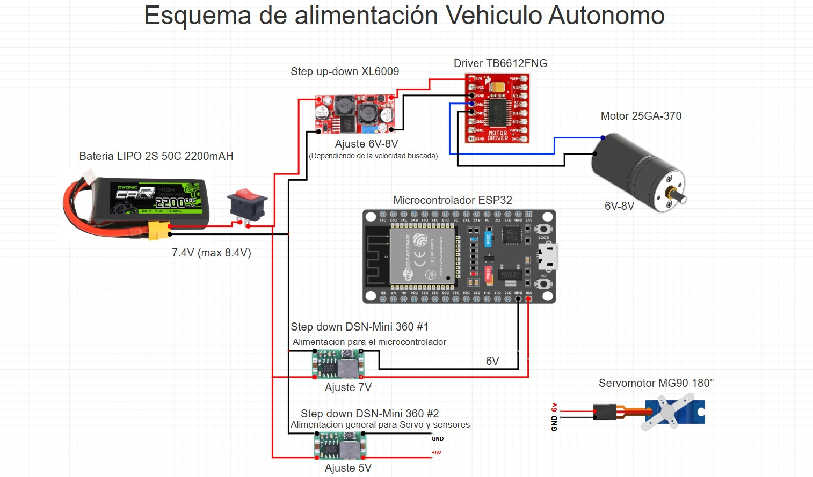
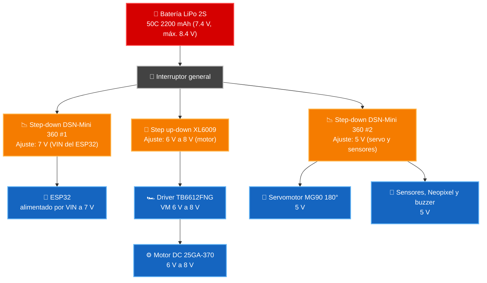
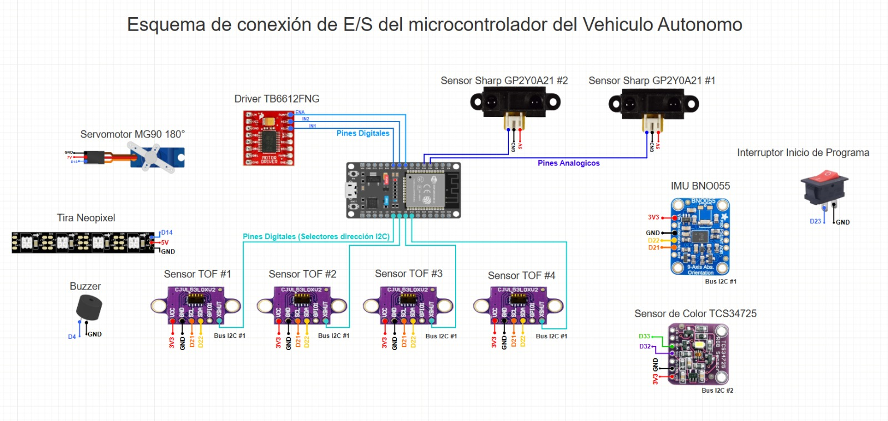
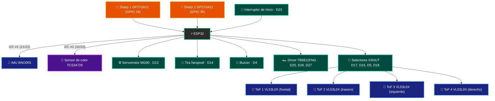
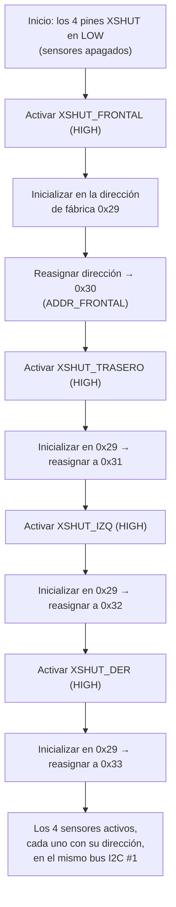
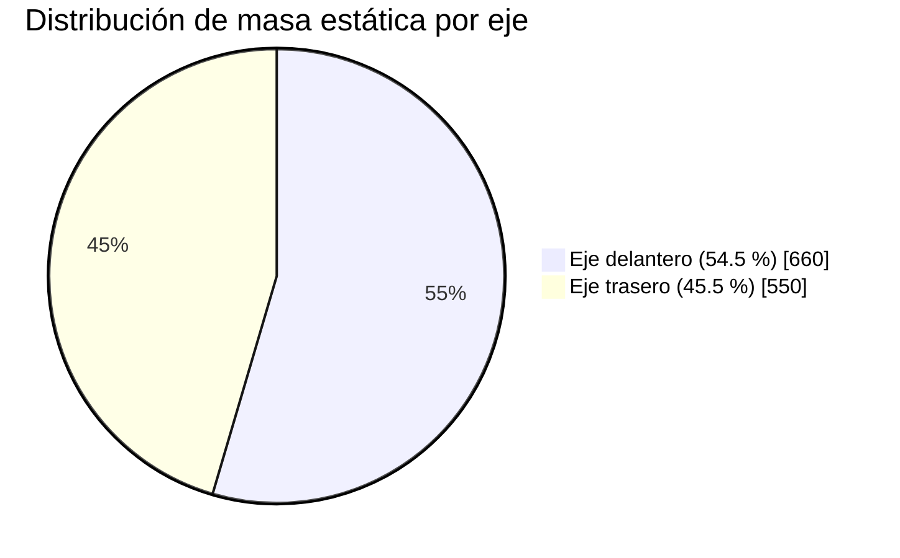
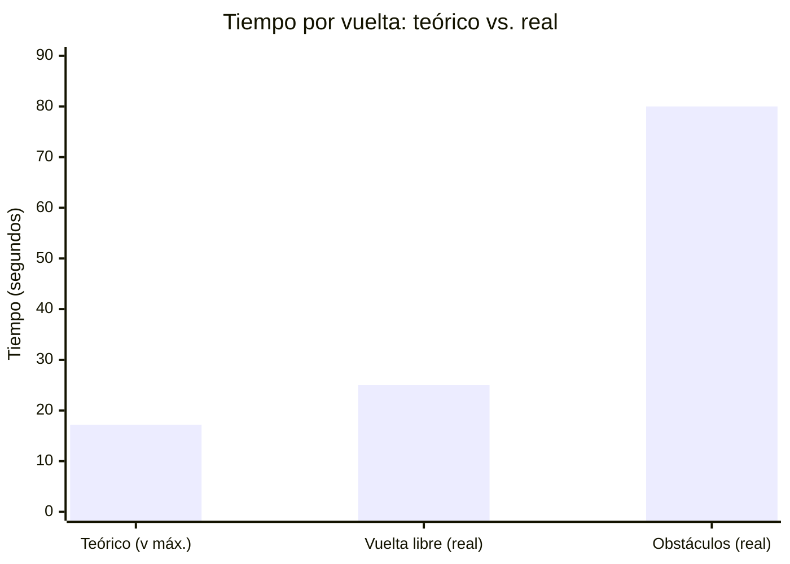
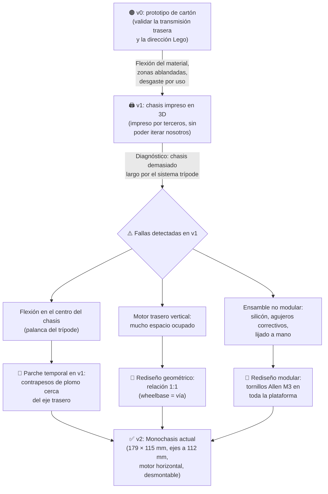
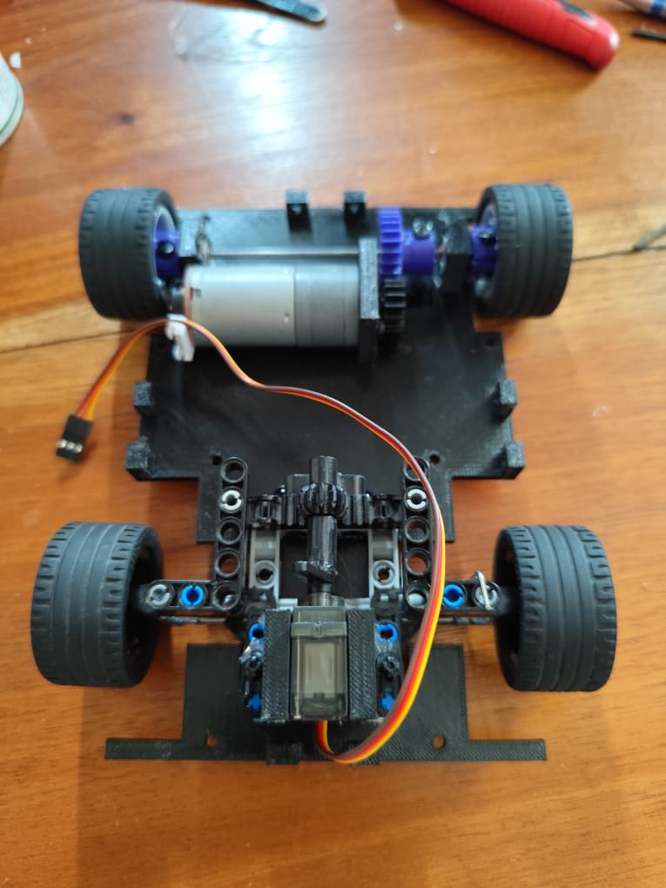
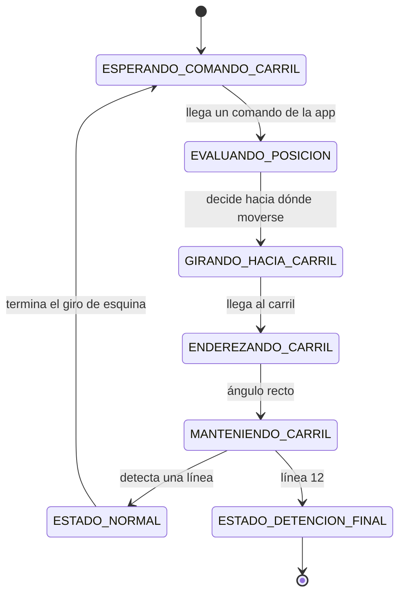

<div align="center">
  

# 🚘 Prometheus Team · Temporada 2026

**World Robot Olympiad (WRO) · Categoría Futuros Ingenieros**<br>
Universidad Politécnica Territorial José Félix Ribas (UPTJFR) · Barinas, Venezuela

</div>

Bienvenidos al repositorio oficial de nuestro equipo para la WRO, categoría Futuros Ingenieros. Aquí guardamos el código del vehículo, los algoritmos de visión artificial y los diseños en 3D, pero también el registro de cómo fuimos resolviendo cada problema hasta llegar a la versión actual. Somos un equipo venezolano que representa a la **Universidad Politécnica Territorial José Félix Ribas (UPTJFR)**. En 2025 quedamos subcampeones nacionales y esta temporada volvemos para mejorar ese resultado.

---

## 📑 Índice

<table>
<tr><td valign="top" width="50%">

**Equipo y vehículo**

- [1. Equipo Prometheus](#equipo-prometheus)
- [2. La hazaña de 2025: subcampeones nacionales](#hazana-2025)
- [3. 2026: con la mira en el primer lugar](#mira-2026)
  - [3.1. Nuestro paso por la competencia nacional](#competencia-nacional)
  - [3.2. Galería de inspección técnica 360°](#galeria-360)

**Hardware**

- [4. Componentes de control, detección e interfaz](#componentes-control)
- [5. Componentes de alimentación y actuación](#componentes-alimentacion)
- [6. Esquemas de alimentación y cableado](#esquemas-alimentacion)
  - [6.1. Versión 4 (actual)](#alimentacion-v4)
  - [6.2. Arquitectura de energía y potencia](#arquitectura-energia)
- [7. Esquemas de sensores y adquisición de datos](#esquemas-sensores)
  - [7.1. Versión 4 (actual)](#sensores-v4)
  - [7.2. Optimización del sistema de sensores](#optimizacion-sensores)
  - [7.3. Resumen de cambios de hardware](#resumen-hardware)
- [8. Gestión energética y autonomía](#gestion-energetica)
  - [8.1. Consumo energético total](#consumo-total)
  - [8.2. Estimación de la autonomía](#estimacion-autonomia)
  - [8.3. Eficiencia de los conversores y autonomía real](#autonomia-real)
  - [8.4. Justificación de la fuente de alimentación](#justificacion-fuente)

</td><td valign="top" width="50%">

**Mecánica**

- [9. Diseño estructural, transmisión y manufactura aditiva](#diseno-estructural)
  - [9.1. Filosofía de rediseño y prototipado](#filosofia-rediseno)
  - [9.2. CAD profesional y arquitectura Monochasis](#monochasis)
  - [9.3. Validación de tolerancias y ensamble virtual](#tolerancias)
  - [9.4. Segundo piso, separadores y sistema Shark Fin](#segundo-piso)
  - [9.5. Ensamble maestro CAD](#ensamble-maestro)
  - [9.6. Manufactura aditiva](#manufactura-aditiva)
  - [9.7. Dimensiones finales y logros estructurales](#dimensiones-finales)
- [10. Análisis de masa y distribución de peso](#analisis-masa)
- [11. Velocidad, torque y tracción](#velocidad-torque)
- [12. Diario de ingeniería: evolución del chasis](#diario-ingenieria)
- [13. Guía de ensamble paso a paso](#guia-ensamble)

**Software**

- [14. Software y control](#software-control)
  - [14.1. Integración del BNO055](#integracion-bno055)
  - [14.2. Archivos y librerías](#archivos-librerias)
  - [14.3. Lógica común de navegación](#logica-comun)
  - [14.4. Modo vuelta libre](#vuelta-libre)
  - [14.5. Modo obstáculos: sistema de carriles](#modo-obstaculos)
- [15. Aplicación de visión Prometheus V5.0](#app-v5)
- [16. Pruebas en pista](#pruebas-pista)

**Anexos**

- [17. Estructura del repositorio](#estructura-repositorio)
- [18. Archivo histórico: temporada 2025](#archivo-2025)

</td></tr>
</table>

---

<a id="equipo-prometheus"></a>
## 1. Equipo Prometheus

Prometheus Team está conformado por estudiantes universitarios de la **Universidad Politécnica Territorial "José Félix Ribas"**. Ya participamos juntos en la WRO 2025, donde llamó la atención nuestro sistema de detección de obstáculos con el teléfono.

<a id="samuel-perez"></a>
### 1.1. 👤 Samuel Pérez
**Diseño 3D, modelado CAD y desarrollo móvil**

<div align="center">
  
</div>

* **Formación:** estudiante de Ingeniería Electrónica en la **UPTJFR**.
* **En el equipo:**
  * **Diseño estructural y modelado 3D:** diseño paramétrico de las piezas mecánicas del vehículo en Onshape.
  * **Desarrollo móvil:** creó la aplicación de detección en **Android Studio** con OpenCV.
  * **Organización:** se encarga de que los entregables técnicos estén completos y a tiempo.
  * **Logros:** finalista en la fase nacional de la **WRO Venezuela 2025**.

---

<a id="trino-carrizales"></a>
### 1.2. 👤 Trino Carrizales
**Programación embebida, algoritmos y control**

<div align="center">
  
</div>

* **Formación:**
  * Estudiante de Ingeniería Electrónica en la **UPTJFR**.
  * Estudiante de Ingeniería en Sistemas en la **Universidad Nacional Experimental de los Llanos Occidentales Ezequiel Zamora (UNELLEZ)**.
* **En el equipo:**
  * **Firmware:** programa y optimiza el código de los microcontroladores **Arduino** y **ESP32**.
  * **Depuración:** encuentra y corrige errores de lógica durante las pruebas, incluso en plena competencia.
  * **Logros:** finalista en la fase nacional de la **WRO Venezuela 2025**.

---

<a id="leandro-padron"></a>
### 1.3. 👤 Leandro Padrón
**Logística, mecánica aplicada y diagnóstico físico**

<div align="center">
  
</div>

* **Formación:** estudiante de Ingeniería Electrónica en la **UPTJFR**.
* **En el equipo:**
  * **Mecánica:** armado de los prototipos y solución de las fallas mecánicas que aparecen en las pruebas.
  * **Logística:** coordina materiales, herramientas y la planificación de las salidas a competencia.
  * **Trabajo en pista:** diagnostica y repara fallas rápido para que el equipo pueda seguir probando.

---

<a id="dayana-perez"></a>
### 1.4. 👤 Ing. Dayana Pérez
**Mentora principal y asesora de investigación**

<div align="center">
  
</div>

* **Formación:**
  * **Ingeniera Electrónica:** Universidad Nacional Experimental Politécnica Antonio José de Sucre (**UNEXPO**, VR Barquisimeto).
  * **Magíster en Educación Superior:** Universidad Fermín Toro (**UFT**).
  * **Doctorante en Tecnologías de la Información y Comunicación:** **UNELLEZ** Barinas.
* **En el equipo:** asesoría metodológica, supervisión académica del proyecto y orientación en la integración de TIC y sistemas electrónicos.

---

<a id="hazana-2025"></a>
## 2. 🥈 La hazaña de 2025: subcampeones nacionales

En 2025 obtuvimos el **2.º lugar en la competencia nacional de Venezuela**. Llegamos después de meses de diseño, depuración de sensores y ajustes a la lógica de navegación, y en la final tuvimos que recalibrar componentes contra reloj y resolver imprevistos en la pista frente a los mejores equipos del país. Quedamos a un paso del primer lugar y esa experiencia nos enseñó mucho, tanto en lo técnico como en la forma de trabajar en equipo.

<a id="mira-2026"></a>
## 3. 🥇 2026: con la mira en el primer lugar

Este año volvemos con más experiencia y con una lista clara de lo que falló el año pasado. Rediseñamos el chasis, cambiamos buena parte del hardware y mejoramos los algoritmos de control para que el vehículo sea más rápido y preciso. La meta es el **1.er lugar nacional** y la clasificación para representar a Venezuela en la final internacional.

---

<a id="competencia-nacional"></a>
### 3.1. 📸 Nuestro paso por la competencia nacional

<p align="center">
  
  
  
</p>

<details>
  <summary>🔍 <b>Ver más momentos de la WRO 2025</b></summary>
  <br>
  <p align="center">
    
    
    
  </p>
</details>

---

<a id="galeria-360"></a>
### 3.2. Galería de inspección técnica 360°

Estas son las seis vistas reglamentarias del vehículo. Con ellas se puede verificar la simetría, la distribución del centro de masa (*CoG*), el estado del chasis impreso y la altura libre al suelo (*ground clearance*).

| 📸 Vista | 🖼️ Foto | 🔍 Qué se verifica |
| :--- | :---: | :--- |
| **Frontal**<br>*(Front)* |  | • Sensores frontales y diagonales.<br>• Alineación del mecanismo de dirección.<br>• Altura del frente y centrado de la estructura. |
| **Trasera**<br>*(Rear)* |  | • Acople del motor y de la transmisión trasera.<br>• Rigidez de los soportes del eje motriz.<br>• Orden del cableado de potencia. |
| **Superior**<br>*(Top)* |  | • Balance transversal de peso.<br>• Posición del ESP32 y de la IMU.<br>• Recorrido del cableado entre pisos. |
| **Inferior**<br>*(Bottom)* |  | • Base lisa y plana, sin piezas que rocen.<br>• Altura libre al suelo.<br>• Fijación de tornillos y tuercas. |
| **Lateral derecha**<br>*(Right)* |  | • Acceso a interruptores y controles.<br>• Separación entre pisos (tracción, lógica y potencia).<br>• Alineación de los sensores del lado derecho y de las ruedas. |
| **Lateral izquierda**<br>*(Left)* |  | • Sensores del lado izquierdo.<br>• Ventilación de los módulos de potencia. |

---

<a id="componentes-control"></a>
## 4. Componentes de control, detección e interfaz

| Imagen | Componente | Descripción | 🔗 Documentación |
| :----: | :--- | :--- | :--- |
|  | **Microcontrolador ESP32** | Cerebro del vehículo. Procesador de doble núcleo con Wi-Fi/Bluetooth y suficientes GPIO para leer todos los sensores (I2C y analógicos) y controlar los actuadores en tiempo real. | • [Datasheet ESP32](https://www.espressif.com/sites/default/files/documentation/esp32_datasheet_en.pdf)<br>• [Arduino-ESP32](https://docs.espressif.com/projects/arduino-esp32/en/latest/) |
|  | **Sensor infrarrojo Sharp GP2Y0A21** | Mide distancia por triangulación infrarroja (10 a 80 cm). Van en las diagonales delanteras para detectar paredes y obstáculos cercanos. | • [Datasheet Sharp](https://global.sharp/products/device/lineup/data/pdf/datasheet/gp2y0a21yk_e.pdf)<br>• [Guía Pololu](https://www.pololu.com/product/136) |
|  | **Sensores ToF VL53L0X** | Miden distancia con un láser infrarrojo por tiempo de vuelo. Los cuatro van en paralelo en el bus I2C #1 y cada uno tiene un pin XSHUT propio para asignarle una dirección distinta. | • [Datasheet ST](https://www.st.com/resource/en/datasheet/vl53l0x.pdf)<br>• [Librería Adafruit](https://github.com/adafruit/Adafruit_VL53L0X) |
|  | **IMU BNO055 (9 ejes)** | Integra acelerómetro, giroscopio y magnetómetro con un procesador que calcula la orientación absoluta (ángulos de Euler o cuaterniones). Va en el bus I2C #1. | • [Datasheet Bosch](https://www.bosch-sensortec.com/media/boschsensortec/downloads/datasheets/bst-bno055-ds000.pdf)<br>• [Librería Adafruit](https://github.com/adafruit/Adafruit_BNO055) |
|  | **Sensor de color TCS34725** | Sensor RGB con filtro infrarrojo. Va debajo del vehículo para detectar las líneas de la pista, solo en el bus I2C #2 para no cargar el bus de navegación. | • [Datasheet AMS](https://ams.com/documents/20143/36005/TCS34725_DS000390_3-00.pdf)<br>• [Librería Adafruit](https://github.com/adafruit/Adafruit_TCS34725) |
|  | **Tira de LEDs Neopixel** | LEDs RGB direccionables conectados al pin D14. Muestran el estado del programa, alertas y el modo de conducción. | • [Datasheet WS2812B](https://cdn-shop.adafruit.com/datasheets/WS2812B.pdf)<br>• [Librería Adafruit](https://github.com/adafruit/Adafruit_NeoPixel) |
|  | **Buzzer** | Piezoeléctrico en el pin D4. Emite avisos sonoros en cada etapa del programa, en fallos de lectura y en alertas. | • [tone() en Arduino](https://www.arduino.cc/reference/en/language/functions/advanced-io/tone/)<br>• [Zumbadores piezoeléctricos](https://www.sparkfun.com/products/7950) |
|  | **Interruptor de inicio** | Interruptor de palanca en el pin D23 con la resistencia pull-up interna del ESP32. Al pasarlo a LOW arranca el recorrido autónomo, una vez el vehículo está calibrado y en posición. | • [GPIO y pull-up en ESP32](https://docs.espressif.com/projects/esp-idf/en/latest/esp32/api-reference/peripherals/gpio.html) |
|  | **Teléfono Android** | Su cámara, con nuestra app de OpenCV, detecta los pilares rojos y verdes y la zona de estacionamiento, y envía comandos al ESP32 por USB. | • [Código de la app](https://github.com/SamFlips/APP-WRO-PROMETHEUS-TEAM/tree/master) |

<a id="componentes-alimentacion"></a>
## 5. Componentes de alimentación y actuación

| Imagen | Componente | Descripción | 🔗 Documentación |
| :----: | :--- | :--- | :--- |
|  | **Batería LiPo 2S 50C 2200 mAh** | Fuente de energía principal. 7.4 V nominales (8.4 V con carga completa) y una tasa de descarga de 50C para soportar los picos de corriente del motor. | • [Baterías LiPo 2S](https://www.hobbywing.com/) |
|  | **Interruptor general** | Interruptor basculante ON/OFF en el positivo de la batería. Corta o habilita la corriente a todo el sistema. | • [Interruptor KCD1](https://www.sparkfun.com/products/11138) |
|  | **Regulador XL6009 (step-up/down)** | Ajustado entre 6 y 8 V según la velocidad buscada. Mantiene estable la alimentación del driver del motor aunque baje la batería. | • [Datasheet XL6009](https://www.xlsemi.com/datasheet/XL6009%20datasheet.pdf) |
|  | **Driver de motores TB6612FNG** | Puente H dual. Recibe dirección y PWM del ESP32 y entrega la potencia al motor con mucha menos pérdida que el L298N que usábamos antes. | • [Datasheet TB6612FNG](https://www.sparkfun.com/datasheets/Robotics/TB6612FNG.pdf) |
|  | **Motor DC 25GA-370 (6 V a 8 V)** | Motorreductor metálico de 220 RPM (caja 21.3:1) para la tracción. También se vende como JGA25-370. Lo alimenta el XL6009 a través del driver. | • [Motorreductores](https://www.pololu.com/category/60/micro-metal-gearmotors) |
|  | **2 × Step-down DSN-Mini 360** | Reguladores conmutados. El #1 está ajustado a 7 V para el pin VIN del ESP32 y el #2 a 5 V para el servo y los sensores. | • [Datasheet MP2307](https://www.monolithicpower.com/en/documentview/productdocument/index/doc_url/M/P/MP2307_r1.9.pdf) |
|  | **Servomotor MG90 180°** | Servo con engranajes metálicos que controla el ángulo de las ruedas delanteras por PWM (pin D13). Se alimenta a 5 V desde el Mini 360 #2. | • [Datasheet MG90S](https://www.electronicoscaldas.com/datasheet/MG90S_Tower-Pro.pdf) |

---

<a id="esquemas-alimentacion"></a>
## 6. Esquemas de alimentación y cableado

*Las versiones anteriores del sistema de alimentación están en el [archivo de 2025](#archivo-electronica-2025).*

<a id="alimentacion-v4"></a>
### 6.1. Versión 4 (actual)





<a id="arquitectura-energia"></a>
### 6.2. Arquitectura de energía, control y gestión de potencia

La **batería LiPo 2S de 2200 mAh** (7.4 V nominales, 8.4 V con carga completa) es la única fuente de energía. Pasa por un **interruptor general de palanca**, que elegimos porque no se desconecta solo con las vibraciones de la pista.

Desde ese punto la alimentación se divide en tres líneas reguladas e independientes. Así el ruido del motor no llega a la lógica de control y evitamos caídas de tensión (*brownouts*):

* **Línea de tracción:** un regulador **XL6009** ajustado entre 6 y 8 V, según la velocidad que busquemos, alimenta el **puente H TB6612FNG**, que a su vez mueve el **motor 25GA-370**.
* **Línea de control:** un **DSN-Mini 360** ajustado a 7 V alimenta el pin VIN del **ESP32** (el único microcontrolador del sistema). Con ese voltaje su regulador interno de 3.3 V tiene margen suficiente y la placa no se reinicia cuando arranca el motor.
* **Línea de actuadores y sensores:** un segundo **DSN-Mini 360**, ajustado a 5 V, alimenta el **servomotor MG90** y el resto de los sensores con una tensión estable.

> [!IMPORTANT]
> **Cambio clave de hardware: L298N → TB6612FNG**
>
> El cambio al TB6612FNG resolvió dos problemas graves del prototipo de 2025. Primero, eliminó la caída de voltaje interna del L298N, que le quitaba fuerza al motor. Segundo, el L298N generaba una interferencia que dejaba inutilizado el bus I2C del microcontrolador. Para esquivarlo tuvimos que usar dos placas ESP32, una solo para el motor. Con el TB6612FNG ese conflicto desapareció y volvimos a un único ESP32, lo que redujo el peso, el cableado, el consumo y los puntos de falla.

> [!NOTE]
> **Compromiso de diseño**
>
> Tres reguladores independientes ocupan más espacio dentro del chasis impreso. Aceptamos ese costo porque separar la potencia de la electrónica sensible eliminó el ruido inductivo del motor y nos dio lecturas I2C limpias durante toda la navegación.

---

<a id="esquemas-sensores"></a>
## 7. Esquemas de sensores y adquisición de datos

*Las versiones anteriores del sistema de detección están en el [archivo de 2025](#archivo-electronica-2025).*

<a id="sensores-v4"></a>
### 7.1. Versión 4 (actual)





**Asignación de pines del ESP32**

| Señal | Pin | Señal | Pin |
| :--- | :---: | :--- | :---: |
| I2C #1 SDA / SCL | 21 / 22 | XSHUT frontal / trasero | 17 / 16 |
| I2C #2 SDA / SCL | 32 / 33 | XSHUT izquierdo / derecho | 5 / 18 |
| Motor IN1 / IN2 / PWM | 27 / 26 / 25 | Sharp derecho / izquierdo | 34 / 35 |
| Servo de dirección | 13 | Tira Neopixel | 14 |
| Interruptor de inicio | 23 | Buzzer | 4 |

<a id="optimizacion-sensores"></a>
### 7.2. Optimización del sistema de sensores y hardware

En esta cuarta versión reorganizamos los sensores aprovechando que el ESP32 tiene dos buses I2C por hardware. El objetivo era ganar precisión, que ningún sensor retrasara a los demás y que la navegación fuera estable dentro de la pista de $3 \times 3$ metros.

<a id="bus-i2c-1"></a>
#### 7.2.1. Subsistema de navegación (bus I2C #1, pines D21/D22)

* **Sensores de distancia ToF:** reemplazaron a los ultrasónicos y eliminaron las zonas muertas a corta distancia. Para conectar los cuatro al mismo bus controlamos sus pines **XSHUT** desde el ESP32 y los encendemos uno por uno para darles direcciones distintas (ver 7.2.2). Además trabajan a 3.3 V, así que ya no hacen falta divisores de tensión.
* **IMU BNO055:** comparte el bus I2C #1. Su procesador interno fusiona los datos y prácticamente **elimina la deriva (*drift*)** acumulada que teníamos con el giroscopio anterior. Al arrancar, el programa toma la orientación actual como cero y todos los giros se calculan respecto a ella.

<a id="xshut"></a>
#### 7.2.2. Calibración y direccionamiento de los 4 sensores ToF (XSHUT)

Los cuatro VL53L0X comparten el bus I2C #1 (pines D21/D22), pero de fábrica todos responden a la misma dirección (`0x29`). Si se encendieran a la vez habría colisión. Para resolverlo, el pin **XSHUT** de cada sensor va a un GPIO distinto del ESP32 y funciona como interruptor de encendido por software:

```cpp
#define XSHUT_FRONTAL 17
#define XSHUT_TRASERO 16
#define XSHUT_IZQ     5
#define XSHUT_DER     18

#define ADDR_FRONTAL 0x30
#define ADDR_TRASERO 0x31
#define ADDR_IZQ     0x32
#define ADDR_DER     0x33
```

**Secuencia de inicialización (encendido escalonado):**



En cada paso solo **un sensor** está encendido en la dirección `0x29`; los demás siguen en reset (XSHUT en LOW). Cuando ya tiene su dirección definitiva, ese sensor queda encendido (XSHUT en HIGH) y se pasa al siguiente.

> [!NOTE]
> **Los 4 sensores usan la misma calibración**
>
> No aplicamos offsets individuales. Los VL53L0X del mismo lote vienen con una calibración de fábrica consistente entre sí; lo único que hay que configurar por sensor es su dirección.

<a id="bus-i2c-2"></a>
#### 7.2.3. Subsistema de lectura de superficie (bus I2C #2, pines D32/D33)

* **Sensor de color TCS34725:** detecta y confirma las líneas de la pista. Lo pusimos en un **segundo bus I2C independiente** para que sus lecturas constantes del suelo no retrasen las de los ToF, que son las que usa el carro para no chocar. En el firmware se lee cada 30 ms en una tarea propia de FreeRTOS.

<a id="proximidad-interfaz"></a>
#### 7.2.4. Subsistema de proximidad redundante e interfaz

* **Sensores Sharp GP2Y0A21 diagonales:** siguen conectados a entradas analógicas y dan una segunda medida de proximidad en los ángulos ciegos del frente.
* **Interfaz de usuario:** la tira Neopixel y el buzzer muestran el estado del robot (errores, calibración correcta, línea detectada). El arranque se hace con un **interruptor de palanca** (pin D23); descartamos el pulsador porque los rebotes y la vibración lo activaban por accidente.

---

> [!IMPORTANT]
> **Simplificación y mantenimiento**
>
> Pasar de los ultrasónicos HC-SR04 a los ToF no solo mejoró la frecuencia de muestreo, también resolvió un problema físico. El HC-SR04 trabaja con 5 V y los pines del ESP32 con 3.3 V, así que en 2025 tuvimos que armar divisores de voltaje a mano con resistencias (no conseguimos convertidores de nivel comerciales). Funcionaban, pero el circuito era voluminoso y daba falsos contactos. Con sensores I2C nativos de 3.3 V esa red desapareció y el montaje quedó más limpio y fácil de reparar en los pits.

> [!NOTE]
> **Compromiso de diseño: tráfico en el bus I2C**
>
> Tener varios sensores I2C traía el riesgo de colisiones y de retrasos en el `loop` principal. Lo resolvimos de dos formas: en software, con lecturas secuenciales (*polling*) y direcciones asignadas con XSHUT; en hardware, separando la carga en dos buses (navegación y superficie). Para ahorrar espacio no pusimos resistencias *pull-up* externas: las que traen las placas de los sensores fueron suficientes.

---

<a id="resumen-hardware"></a>
### 7.3. Resumen de cambios y evolución del hardware

| Componente anterior | Componente actual | Justificación y ventaja principal |
| :--- | :--- | :--- |
| Sensor ultrasónico HC-SR04 con divisores de tensión | **4 × sensores ToF (I2C #1)** | Sin zonas muertas ni redes de resistencias; todo a 3.3 V. Direcciones asignadas con XSHUT. |
| MPU6050 + magnetómetro HMC5883L | **IMU BNO055 (I2C #1)** | Deriva prácticamente eliminada en la pista de $3 \times 3$ m. |
| Sensor de color en el bus compartido | **TCS34725 (I2C #2 aislado)** | Bus propio, sin cuellos de botella con los sensores de distancia. |
| Pulsador de inicio | **Interruptor de palanca (D23)** | No se activa solo con la vibración de la pista. |
| L298N + segundo microcontrolador | **TB6612FNG + un solo ESP32** | Sin caída de voltaje ni interferencia en el I2C. |

---

<a id="gestion-energetica"></a>
## 8. Gestión energética y autonomía del sistema

En esta sección calculamos el consumo eléctrico del vehículo y justificamos la batería que elegimos.

<a id="consumo-total"></a>
### 8.1. Cálculo del consumo energético total

Estimamos el consumo de cada componente en tres escenarios, con valores típicos de sus hojas de datos: **reposo** (energizado pero sin trabajar), **nominal** (operación normal durante una vuelta) y **pico** (consumo máximo instantáneo, como el arranque del motor o los LEDs al máximo).

| Componente | Cantidad | Reposo (mA) | Nominal (mA) | Pico (mA) |
| :--- | :---: | :---: | :---: | :---: |
| **ESP32** (doble núcleo, WiFi/BT apagados) | 1 | ~20 | ~80 | ~80 (procesamiento intensivo) |
| **Sensor infrarrojo Sharp GP2Y0A21** | 2 | 10 c/u | 30 c/u | 33 c/u |
| **Sensor ToF VL53L0X** | 4 | 5 c/u | 15 c/u | 20 c/u (midiendo) |
| **IMU BNO055** | 1 | ~1 | 12.3 | ~16 |
| **Sensor de color TCS34725** | 1 | ~0 (en reposo, µA) | 3 | 3.6 |
| **Tira Neopixel** (10 LEDs) | 10 | 0 (apagada) | 300 (colores mixtos) | 600 (blanco al 100 %) |
| **Buzzer** | 1 | 0 | 30 | 30 |
| **Regulador XL6009** (consumo propio) | 1 | 15 | 15 | 15 |
| **Driver TB6612FNG** (lógica) | 1 | 1 | 2 | 6 |
| **Motor DC 25GA-370** | 1 | 0 (detenido) | 500 | ~1800 (arranque / rotor bloqueado) |
| **Step-down DSN-Mini 360** (consumo propio) | 2 | 5 c/u | 5 c/u | 5 c/u |
| **Servomotor MG90** | 1 | 10 (sosteniendo posición) | 200 (en movimiento) | ~700 (forzado) |
| **TOTAL ESTIMADO** | | **~97 mA** | **~1272.3 mA** | **~3406.6 mA** |

🔋 **Corriente nominal:** ~1.27 A · **Pico teórico simultáneo:** ~3.41 A

> [!NOTE]
> **Sobre el escenario de pico**
>
> Los ~3.41 A corresponden al caso extremo en que *todos* los componentes llegan a su máximo a la vez (arranque del motor, servo forzado y LEDs en blanco). En una vuelta real es muy poco probable, pero es el valor que usamos para comprobar la tasa de descarga (C) mínima de la batería (ver [8.4](#justificacion-fuente)).

---

<a id="estimacion-autonomia"></a>
### 8.2. Estimación de la autonomía

Para estimar el tiempo de funcionamiento continuo usamos la relación entre la capacidad de la batería y el consumo calculado.

#### 8.2.1. Fórmula general

$$\text{Autonomía (horas)} = \frac{\text{Capacidad de la batería (mAh)}}{\text{Consumo total del sistema (mA)}}$$

#### 8.2.2. Aplicación a nuestro vehículo

$$\text{Autonomía} \approx \frac{2200 \text{ mAh}}{1272.3 \text{ mA}} \approx 1.73 \text{ horas}$$

* **Tiempo estimado:** aproximadamente **1 hora y 44 minutos** de operación continua en condiciones normales.
* **Nota práctica:** es un modelo teórico. En la pista el consumo del motor varía todo el tiempo (sube cerca del bloqueo o *stall*) y los sensores trabajan por ráfagas, así que la autonomía real depende de lo que esté haciendo el firmware.

---

<a id="autonomia-real"></a>
### 8.3. Eficiencia de los conversores DC-DC y autonomía real

El cálculo anterior supone que la corriente de cada componente es la misma que sale de la batería. No es así: los reguladores XL6009 y DSN-Mini 360 entregan voltajes distintos a los de la batería (7 V y 5 V frente a 7.4 V nominales) y ninguna conversión es 100 % eficiente.

**Eficiencias de referencia (hoja de datos del fabricante):**

| Conversor | Función en el sistema | Eficiencia usada | Rango del fabricante |
| :--- | :--- | :---: | :---: |
| **XL6009** (step-up/down) | Línea de tracción (motor + TB6612FNG) | ~88 % | Hasta 94 % en condiciones ideales; con una relación cercana a 1:1 y ~500 mA de carga el valor real es menor |
| **DSN-Mini 360** ×2 (step-down, MP2307) | Línea de control (ESP32) y línea de servo y sensores | ~90 % | 90–96 % típico con carga moderada |

**Corriente real extraída de la batería (balance de potencia por línea):**

$$P_{\text{entrada}} = \frac{P_{\text{salida}}}{\eta} \qquad I_{\text{batería}} = \frac{P_{\text{entrada}}}{V_{\text{batería}}}$$

| Línea de alimentación | V salida | I salida (nominal) | P salida | η | P entrada | I de la batería (7.4 V) |
| :--- | :---: | :---: | :---: | :---: | :---: | :---: |
| Tracción (XL6009 → motor + TB6612FNG) | 7 V | 502 mA | 3.51 W | 88 % | 3.99 W | **≈ 540 mA** |
| Control (Mini 360 #1 → ESP32) | 7 V | 80 mA | 0.56 W | 90 % | 0.62 W | **≈ 84 mA** |
| Servo y sensores (Mini 360 #2 → Sharp, ToF, BNO055, TCS34725, Neopixel, buzzer y servo) | 5 V | 665.3 mA | 3.33 W | 90 % | 3.70 W | **≈ 500 mA** |
| **TOTAL REAL EXTRAÍDO DE LA BATERÍA** | | | | | | **≈ 1124 mA** |

$$\text{Autonomía real} \approx \frac{2200 \text{ mAh}}{1124 \text{ mA}} \approx 1.96 \text{ horas} \; (\approx 1\text{ h }57\text{ min})$$

> [!IMPORTANT]
> **Por qué la autonomía real sale mayor que la estimación inicial**
>
> Se esperaría que las pérdidas de los reguladores *redujeran* la autonomía, y frente a un caso ideal (100 % de eficiencia) lo hacen. Pero el primer modelo (~1.73 h) tenía un error en sentido contrario: sumaba los mA de cada componente como si todos trabajaran al voltaje de la batería (7.4 V), cuando la mayoría trabaja a 5 V o 7 V. Al bajar el voltaje, la corriente equivalente del lado de la batería es menor, y ese efecto pesa más que la pérdida en los reguladores. El resultado (~1 h 57 min) coincide con lo que observamos: en una tarde y noche completas de pruebas la batería no llegó a su límite inferior de carga.

---

<a id="justificacion-fuente"></a>
### 8.4. Justificación de la fuente de alimentación

#### 8.4.1. 🔋 ¿Por qué LiPo?

Elegimos una batería de **polímero de litio (LiPo)** por su **relación peso-potencia** y por su **capacidad de entregar mucha corriente al instante** (tasa de descarga). Las dos cosas son importantes para el rendimiento dinámico del robot.

#### 8.4.2. 📊 Comparación de tecnologías

| Tecnología | Densidad energética | Tasa de descarga (C) | Peso / volumen | Con motores y servos |
| :--- | :---: | :---: | :---: | :--- |
| **LiPo (2S 50C)** | **Alta** | **Muy alta (~50C)** | **Muy ligera** | **Excelente.** Entrega corriente al instante sin caídas de voltaje. |
| **Li-ion (18650)** | Muy alta | Baja (1C a 2C) | Ligera | **Deficiente.** Los picos de corriente bajan el voltaje (*voltage sag*) y reinician el ESP32. |
| **NiMH (6 celdas)** | Media | Media | Muy pesada | **Aceptable pero inviable.** El peso extra le quita agilidad al robot. |
| **Power bank (USB)** | Alta | Limitada (2 A a 3 A) | Media | **Incompatible.** Su protección se apaga por sobrecorriente. |

#### 8.4.3. Justificación frente a las alternativas

**a) Frente a Li-ion (18650).** Las 18650 tienen muy buena densidad de energía, pero su tasa de descarga típica es baja. El motor y el servo generan picos de corriente al arrancar o al forzarse, y una Li-ion común sufriría una caída de voltaje fuerte (*voltage sag*). Eso provocaría **reinicios del ESP32** o activaría la protección de la batería (BMS). La LiPo entrega esa corriente al instante sin bajar el voltaje.

**b) Frente a NiMH.** Las NiMH son seguras y duraderas, pero muy pesadas y voluminosas. Para igualar los **7.4 V** de una LiPo 2S harían falta **6 celdas en serie** (1.2 V cada una). Ese peso duplicaría o triplicaría la masa del robot, aumentaría el consumo del motor y le quitaría aceleración en la pista.

**c) Frente a power banks comerciales.** Un power bank eleva el voltaje de sus celdas a 5 V con un regulador que tiene un límite estricto de corriente (normalmente 2 A o 3 A). Nuestro consumo simultáneo supera ese límite con facilidad:

* **10 LEDs Neopixel** en blanco: `~600 mA`
* **Servo MG90** forzado: `~700 mA`
* **Motor 25GA-370** al arrancar o con carga: `> 1 A`

Al pasar ese límite el power bank se apaga. Además, el motor **25GA-370** rinde mejor entre **6 V y 8 V**; a 5 V perdería torque y velocidad.

#### 8.4.4. ¿Por qué 2200 mAh y no más capacidad?

La capacidad de 2200 mAh la decidimos por tres criterios: peso, tasa de descarga y una autonomía que ya comprobamos en la práctica.

- **Peso:** la LiPo 2S 2200 mAh 50C que usamos pesa **115 g**. Una de 2600 o 3000 mAh de la misma tecnología pesa proporcionalmente más, y ese peso afecta la relación torque/masa (ver [sección 11](#velocidad-torque)) sin darnos ninguna ventaja, porque la autonomía actual ya cubre de sobra una ronda de competencia.
- **Tasa de descarga (50C):** con 2200 mAh y 50C la batería puede entregar hasta 110 A instantáneos, muy por encima del pico real del sistema (~3.4 A, ver [8.1](#consumo-total)). El motor arranca sin que baje el voltaje y sin afectar a la lógica de control.
- **Autonomía comprobada:** según el recálculo con pérdidas (8.3), la autonomía real es de ~1 h 57 min. En una tarde y noche completas de pruebas no llegamos al límite de carga, así que 2200 mAh deja margen de sobra para entrenar y competir sin cargar peso muerto.

> [!NOTE]
> **Compromiso de diseño**
>
> Subir a 2600–3000 mAh habría añadido unos 20–35 g (estimado de forma proporcional dentro de la misma línea de productos) a cambio de una autonomía que no es lo que nos limita. El cuello de botella real es el tiempo que tarda el algoritmo de evasión (ver los tiempos de vuelta en [11.4](#tiempo-vuelta)), no la energía disponible. Preferimos mantener el chasis lo más liviano posible.

---

<a id="diseno-estructural"></a>
## 9. Diseño estructural, transmisión y manufactura aditiva

*El diseño y la construcción del chasis de 2025 están en el [archivo de 2025](#archivo-chasis-2025).*

<a id="filosofia-rediseno"></a>
### 9.1. Filosofía de rediseño y prototipado conceptual

Empezamos analizando qué falló en las rondas del año pasado. La conclusión principal fue que el chasis heredado era demasiado largo: eso empeoraba el giro, aumentaba el radio de giro y le quitaba agilidad en las evasiones.

Para corregirlo sin quitarle espacio a la electrónica nos pusimos un objetivo geométrico: una **relación de aspecto 1:1**, es decir, que la distancia entre el eje delantero y el trasero (*wheelbase*) fuera igual al ancho del vehículo (vía). Así la dirección responde mejor.

> [!IMPORTANT]
> **Tren motriz: de correas a engranajes**
>
> Antes del modelado final probamos la idea con prototipos rápidos. Primero pensamos en una transmisión por correa dentada, pero no conseguíamos correas a medida y existía el riesgo de que patinaran (*slipping*), así que la descartamos. Nos quedamos con engranajes rectos en paralelo, que nos permitieron girar el montaje del motor, compactar la transmisión y confirmar que el chasis se podía acortar.

#### 9.1.1. Prototipos conceptuales tempranos

<p align="center">
  
  
  
</p>

---

<a id="monochasis"></a>
### 9.2. Transición a CAD profesional y arquitectura Monochasis

Con la geometría validada pasamos a **Onshape**, un entorno paramétrico. La principal novedad es el **Monochasis** del nivel inferior: una sola pieza que integra los soportes, los canales de cableado y los alojamientos de los componentes. Así eliminamos los ensambles de varias piezas y las fijaciones improvisadas que se aflojaban con la vibración.

La plataforma mide **179 mm de largo por 115 mm de ancho**, con una distancia entre ejes de **~112 mm**, lo que cumple la relación 1:1 que buscábamos.

<p align="center">
  <br>
  <sub>Vista de planta del Monochasis en Onshape.</sub>
</p>

#### 9.2.1. Tren motriz (torque frente a velocidad)

* **Motor de tracción:** 25GA-370 (JGA25) de 220 RPM con caja reductora metálica. El Monochasis tiene una cama hundida hecha a la medida del motor, que deja su eje alineado con la transmisión.
* **Piñón y corona:** un piñón de 15 dientes en el motor mueve una corona de 25 dientes en el eje trasero. Esta **relación de 1.67:1** sacrifica algo de velocidad máxima para aumentar el torque en las ruedas, así el carro acelera de forma controlada desde parado sin forzar el motor.
* **Eje trasero (solución de taller):** no conseguimos varilla calibrada de 4 mm, así que usamos el núcleo de electrodos de soldadura (~2.4 mm). En las zonas de los rodamientos aumentamos el diámetro con termorretráctil hasta lograr un ajuste a presión (*press-fit*) sin holgura.
* **Rodamientos:** el eje gira sobre rodamientos 604ZZ (4 × 12 × 4 mm) encajados en alojamientos del propio chasis.

---

<a id="tolerancias"></a>
### 9.3. Validación de tolerancias y ensamble virtual

Antes de integrar todo, en Onshape modelamos y revisamos cada pieza mecánica por separado para asegurarnos de que las tolerancias fueran correctas.

#### 9.3.1. Componentes clave y sistemas de anclaje

Diseñamos engranajes propios, cada uno con un sistema de fijación según el tipo de eje:

* **Piñón motriz (eje en "D"):** para acoplar el engranaje de 15 dientes al motor aprovechamos el corte plano que trae su eje. El agujero tiene perfil en "D" con tolerancias pensadas para impresión 3D, de modo que entra a presión (*press-fit*). Transmite todo el torque sin desgastarse y no se sale con la vibración.
* **Corona (varilla lisa):** el engranaje de 25 dientes se fija a la varilla trasera con un collarín de **abrazadera tipo "C"**. Al apretar un tornillo transversal, el collarín se cierra sobre la varilla y bloquea el engranaje por fricción, sin pegamento y sin dañar el metal.

<table>
<tr>
<td align="center" width="50%"><br><sub>Piñón motriz (15T) con acople en "D".</sub></td>
<td align="center" width="50%"><br><sub>Corona (25T) con abrazadera tipo "C".</sub></td>
</tr>
</table>

#### 9.3.2. Acople de tracción: adaptador para ruedas Lego

Las **ruedas Lego** del año pasado tienen muy buen agarre en la pista, así que las mantuvimos. Para montarlas en la nueva varilla lisa diseñamos un adaptador: en un extremo tiene el perfil en cruz de Lego y en el otro una base cilíndrica con la misma **abrazadera tipo "C"** de la corona. La rueda queda firme sobre la varilla y se puede cambiar rápido en los pits.

<table>
<tr>
<td align="center" width="50%"><br><sub>Perfil del adaptador.</sub></td>
<td align="center" width="50%"><br><sub>Detalle de la abrazadera transversal.</sub></td>
</tr>
</table>

#### 9.3.3. Ensamble virtual y prevención de fallas

Con las piezas validadas, el ensamble virtual completo nos sirvió para encontrar interferencias y corregir el diseño antes de imprimir.

> [!TIP]
> **Rediseño del soporte del motor**
>
> En la simulación vimos que los tornillos que sujetan el motor quedaban tapados por la corona del eje trasero. Para sacar el motor habría que desmontar la varilla y casi toda la tracción, algo que en los pits cuesta mucho tiempo. Movimos los agujeros a las esquinas libres del soporte y ahora el motor sale quitando solo el piñón.

<table>
<tr>
<td align="center" width="50%"><br><sub>Revisión de interferencias del tren de engranajes.</sub></td>
<td align="center" width="50%"><br><sub>Bloque motriz listo para integrar.</sub></td>
</tr>
</table>

---

<a id="segundo-piso"></a>
### 9.4. Segundo piso, separadores y sistema de visión Shark Fin

El segundo nivel distribuye la masa, protege la electrónica y sostiene el sistema de visión.

> [!NOTE]
> **Compromiso de diseño: centro de gravedad**
>
> En la versión anterior la batería iba arriba, en una posición poco segura. El nuevo diseño tiene un compartimento ventilado **debajo del primer piso**. Se pierde un poco de altura libre al suelo, pero el centro de gravedad baja mucho y el carro ya no se balancea ni corre riesgo de volcar en las curvas rápidas.

<p align="center">
  <br>
  <sub>Vista inferior con el compartimento de la batería.</sub>
</p>

#### 9.4.1. Separadores e insertos roscados

Entre el primer y el segundo piso van **separadores de 60 mm** diseñados por nosotros. Las impresoras 3D comunes no hacen roscas pequeñas que aguanten apretar y aflojar muchas veces, así que no roscamos el plástico: en cada extremo del separador colocamos con calor un **inserto roscado de latón M3**. Así los pilares quedan muy resistentes.

#### 9.4.2. Sujeción del teléfono (mordaza ajustable)

El teléfono va sostenido por dos torres laterales en forma de **aleta de tiburón (*Shark Fin*)**. Para que no cedan con la vibración las fijamos así:

* **Fijación a la base:** cada torre lleva **3 insertos roscados de latón** en su base. Los tornillos atraviesan el segundo piso de abajo hacia arriba y aprietan la torre contra la plataforma.
* **Detalle de diseño (DfAM):** para que los insertos entren bien con calor, los agujeros son ciegos de **4.1 mm de diámetro por 9 mm de profundidad**. Con esas medidas el inserto entra y el plástico derretido llena su moleteado sin meterse en la rosca.

> [!IMPORTANT]
> **Evolución del sistema Shark Fin: de ángulo fijo a ángulo ajustable**
>
> - **Versión 1 (soporte fijo):** las torres sostenían la mordaza con un soporte rígido. No se podía cambiar la inclinación del teléfono; cualquier ajuste de la cámara obligaba a desmontar y modificar la pieza.
> - **Versión 2 (ajustable, actual):** quitamos el soporte rígido y pusimos un tornillo que atraviesa cada torre desde afuera y aprieta la base de la mordaza fija. Aflojándolo, la base pivota y se puede recalibrar el ángulo de la cámara en la pista; apretándolo, queda bloqueada por fricción.
>
> Fue un cambio pequeño, un tornillo en lugar de un soporte rígido, pero ahora ajustamos el encuadre en segundos sin herramientas especiales ni reimprimir piezas.

La sujeción en sí es una **prensa ajustable**:

1. **Ángulo:** las dos torres sostienen una **mordaza fija** central, sujeta por los tornillos laterales (que van en sus propios insertos roscados). Aflojándolos se ajusta el ángulo de la cámara; apretándolos queda fijo.
2. **Apriete:** dentro de la mordaza fija se desliza una **mordaza móvil**. En la parte superior de la base fija modelamos una rosca **M10.5** (0.5 mm de holgura para compensar la contracción del PETG), por donde baja un **tornillo M10 impreso en 3D**. Al girarlo empuja la mordaza móvil en línea recta y sujeta el teléfono con firmeza.

<table>
<tr>
<td align="center" width="50%"><br><sub>Soporte Shark Fin montado entre las torres.</sub></td>
<td align="center" width="50%"><br><sub>Tornillo M10 y rosca M10.5 con holgura térmica.</sub></td>
</tr>
</table>

---

<a id="ensamble-maestro"></a>
### 9.5. Integración total: ensamble maestro CAD

Con todos los subsistemas (tracción, soporte de cámara y chasis) modelados y revisados por separado, armamos en Onshape un ensamble maestro. En esta última revisión virtual comprobamos que se puede llegar a los puertos del microcontrolador y que se cumplen las medidas que nos propusimos.

<p align="center">
  <br>
  <sub>El vehículo completo en el entorno de Onshape.</sub>
</p>

---

<a id="manufactura-aditiva"></a>
### 9.6. Manufactura aditiva

Imprimimos primero en una **Creality K1C** y después en una **Elegoo Centauri Carbon 2**, con filamento **PETG** y los programas Orca Slicer y Elegoo Slicer. Como el chasis recibe golpes y vibraciones todo el tiempo, usamos un perfil pensado para resistencia (*DfAM, Design for Additive Manufacturing*):

| Parámetro | Valor | Justificación |
| :--- | :--- | :--- |
| **Temperatura de boquilla** | 260 °C | Mejor fluidez y mejor adhesión entre capas (*layer adhesion*). |
| **Flujo volumétrico máximo** | 11–12 mm³/s | Limita la presión en el extrusor y evita que se quede corto. |
| **Velocidad de relleno** | 150 mm/s | Evita el desgaste del engranaje del extrusor en recorridos largos. |
| **Perímetros exteriores** | 5 paredes | Forman una capa exterior que resiste la torsión. |
| **Ventilador de capa** | 0 % al inicio / 40 % máx. | Los voladizos quedan peor estéticamente, pero las capas no se separan por enfriarse demasiado rápido. |
| **Cabina** | Abierta | Evita que el calor suba por la garganta del hotend (*heat creep*). |

#### 9.6.1. Optimizaciones de impresión

* **Unión con clavijas (*dowels*):** las piezas con voladizos grandes se cortaron e imprimieron planas. Se unen con clavijas guía de 2.5 mm con 0.15 mm de holgura (*slip-fit*), reforzadas con cianoacrilato.
* **Enfriamiento de piezas pequeñas:** las imprimimos junto con las grandes. El tiempo que el cabezal pasa en las otras piezas les da a las pequeñas tiempo de enfriarse y no se deforman. Usamos además un borde (*brim*) de 5 mm para que se pegaran bien a la cama.

---

<a id="dimensiones-finales"></a>
### 9.7. Dimensiones finales y resumen de logros estructurales

| Parámetro | Medida | Estado |
| :--- | :--- | :--- |
| **Largo total** | 179 mm | Reducido |
| **Ancho total (vía)** | 115 mm | Mantenido |
| **Distancia entre ejes** | 112 mm | ≈ 1:1 con la vía |

**Evolución mecánica (2025 → 2026):**

* **✓ Maniobrabilidad:** el chasis es más corto y el radio de giro mucho menor.
* **✓ Tracción:** transmisión de 1.67:1 que prioriza el torque, y las ruedas Lego reutilizadas con un adaptador propio.
* **✓ Robustez:** pasamos de fijaciones improvisadas a un Monochasis paramétrico en PETG con separadores de 60 mm e insertos de latón.
* **✓ Visión y centro de gravedad:** la batería bajó al nivel inferior y el sistema Shark Fin sujeta el teléfono sin holguras.

---

<a id="analisis-masa"></a>
## 10. ⚖️ Análisis de masa y distribución de peso

<a id="masa-total"></a>
### 10.1. Masa del vehículo: 2025 frente a 2026

Pasar del chasis heredado al **Monochasis** redujo la masa, y lo comprobamos con báscula después del ensamble final. Hay que distinguir **dos etapas dentro de la propia versión de 2025**, porque ese chasis ganó mucho peso entre su primera impresión y su configuración final de competencia:

| Etapa | Con teléfono | Sin teléfono |
| :--- | :---: | :---: |
| **v1 (2025): chasis recién impreso** (sin trípode ni contrapesos) | 943 g | 763 g |
| **v1 (2025): configuración final de competencia** (+ trípode + contrapesos de plomo) | **≈1300 g** | ≈1120 g |
| **v2 (2026): Monochasis actual** | **1092 g** | **861 g** |

| Comparación | Con teléfono | Sin teléfono |
| :--- | :---: | :---: |
| v2 (2026) frente a v1 de competencia (2025) | 🔻 −208 g (−16.0 %) | 🔻 −259 g (−23.1 %) |

> [!IMPORTANT]
> **Lo que realmente costaban el trípode y los contrapesos**
>
> La comparación correcta no es contra los 943 g de la primera impresión de v1 (que todavía **no** tenía el trípode), sino contra su configuración de competencia de **≈1.3 kg**. El trípode y, sobre todo, los contrapesos de plomo que pusimos para compensar el efecto palanca (ver [sección 12](#diario-ingenieria)) le añadieron cerca de **360 g**, casi un tercio de su masa sin teléfono. El sobrepeso de v1 no venía del chasis en sí, sino de corregir con peso un defecto geométrico (la flexión por palanca). La v2 lo resolvió de raíz con la proporción 1:1 y no necesita contrapesos.
>
> Frente al chasis de 2025 recién impreso, la v2 pesa algo más (861 g frente a 763 g sin teléfono), porque ahora lleva cuatro ToF, tres reguladores, la tira de LEDs y el soporte Shark Fin.

> [!NOTE]
> **Compromiso de diseño: peso frente a rigidez**
>
> Bajamos hasta 259 g respecto a la versión final de 2025 **sin perder rigidez**, aunque el Monochasis integra en una sola pieza soportes, canales de cableado y alojamientos que antes eran piezas separadas. La reducción viene sobre todo de eliminar los refuerzos improvisados (silicón, agujeros correctivos, contrapesos de plomo), no de adelgazar las paredes.

<a id="distribucion-masa"></a>
### 10.2. Distribución de masa estática (eje delantero / eje trasero)

Con el teléfono montado en el *Shark Fin* pesamos cada eje por separado para conocer el centro de gravedad longitudinal:

| Eje | Masa medida | Distribución |
| :--- | :---: | :---: |
| **Delantero** | 660 g | **54.5 %** |
| **Trasero** | 550 g | **45.5 %** |
| **Total (configuración de medición)** | 1210 g | 100 % |



> [!IMPORTANT]
> **Interpretación**
>
> El eje delantero lleva unos 9 puntos más que un reparto 50/50. Es lo esperado: el teléfono y el *Shark Fin*, que son lo más pesado montado en altura, están sobre el segundo piso hacia la zona delantera-media. La batería LiPo se movió **debajo del primer piso** (ver [9.4](#segundo-piso)) justamente para bajar el centro de gravedad, aunque no elimina por completo el sesgo hacia adelante. Este reparto ayuda a la tracción al frenar y a la respuesta de la dirección, pero deja menos peso sobre el eje motriz, algo que revisamos en el cálculo de agarre ([11.5](#friccion)).

---

<a id="velocidad-torque"></a>
## 11. 🚀 Velocidad, torque y tracción

Calculamos la velocidad lineal y el torque del tren motriz con la masa actual del vehículo en configuración de competencia (con el teléfono), teniendo en cuenta la caja reductora del motor y nuestra transmisión de engranajes 15T → 25T.

<a id="velocidad-lineal"></a>
### 11.1. Velocidad lineal del vehículo

El motor 25GA-370 gira a 220 RPM en el eje de salida de su caja reductora. Convertido a radianes por segundo:

$$\omega_{\text{motor}} = \frac{220 \cdot 2\pi}{60} \approx 23.04 \text{ rad/s}$$

La transmisión piñón (15T) → corona (25T) reduce otra vez la velocidad en la rueda:

$$\omega_{\text{rueda}} = \omega_{\text{motor}} \cdot \frac{15}{25} \approx 13.82 \text{ rad/s} \;(\approx 132 \text{ RPM})$$

Con un radio de rueda $r = 0.04$ m, la velocidad lineal máxima teórica es:

$$v = \omega_{\text{rueda}} \cdot r = 13.82 \cdot 0.04 \approx 0.55 \text{ m/s}$$

<a id="torque"></a>
### 11.2. Torque necesario y torque disponible

Como criterio exigente tomamos como torque de referencia el necesario para sostener todo el peso del vehículo en el radio de la rueda (equivale a subir una pared vertical). Es mucho más de lo que pide mover el carro en la pista, donde solo hay que vencer la resistencia a la rodadura:

$$T_{\text{ref}} = m \cdot g \cdot r$$

Donde:

* $m$ = masa del vehículo con teléfono (1.092 kg)
* $g$ = gravedad (9.81 $\text{m/s}^2$)
* $r$ = radio de las ruedas (0.04 m)

$$T_{\text{ref}} = 1.092 \cdot 9.81 \cdot 0.04 \approx 0.429 \text{ N·m}$$

El motor entrega 0.0343 N·m antes de su caja reductora (21.3:1), y nuestra transmisión multiplica el torque por 25/15:

$$T_{\text{salida motor}} = 0.0343 \cdot 21.3 \approx 0.731 \text{ N·m} \qquad T_{\text{rueda}} = 0.731 \cdot \frac{25}{15} \approx 1.218 \text{ N·m}$$

<a id="margen-seguridad"></a>
### 11.3. Margen de seguridad de torque

$$\text{Margen de seguridad} = \frac{T_{\text{rueda}}}{T_{\text{ref}}} \times 100 = \frac{1.218}{0.429} \times 100 \approx 284\,\%$$

> [!IMPORTANT]
> **Interpretación del margen**
>
> Incluso con un criterio tan exigente, el tren motriz entrega casi **tres veces** el torque de referencia. Ese excedente se traduce en capacidad de aceleración, tolerancia a superficies con más fricción de la esperada y margen ante el desgaste de los engranajes impresos. El peso del teléfono no compromete la agilidad del carro.

<a id="tiempo-vuelta"></a>
### 11.4. Tiempo teórico de vuelta frente al tiempo real

Con la velocidad máxima calculada ($v \approx 0.55$ m/s) podemos estimar cuánto tardaría una vuelta y compararlo con lo que medimos en las pruebas:

$$\text{Tiempo teórico} = \frac{\text{Distancia de una vuelta}}{v} \approx \frac{9.5 \text{ m}}{0.55 \text{ m/s}} \approx 17.2 \text{ s}$$

| Modo | Tiempo teórico (v máx. constante) | Tiempo real medido (promedio) | Velocidad real efectiva | % de la velocidad teórica |
| :--- | :---: | :---: | :---: | :---: |
| **Vuelta libre** | ≈ 17.2 s | **25 s** | ≈ 0.38 m/s | ≈ 69 % |
| **Modo obstáculos** | ≈ 17.2 s (misma distancia base) | **1:20 min (80 s)** | ≈ 0.12 m/s | ≈ 21 % |



> [!IMPORTANT]
> **Por qué la diferencia es esperable y qué nos dice**
>
> El tiempo teórico supone velocidad máxima constante durante toda la vuelta, y eso no pasa. En vuelta libre el algoritmo reduce la velocidad para corregir el ángulo con el BNO055, ajustar la distancia al muro y girar en cada esquina. En modo obstáculos, además, el carro se detiene a esperar el comando de la app y hace las maniobras de cambio de carril. Llegar al ~69 % de la velocidad teórica en vuelta libre es coherente con un algoritmo que prioriza la precisión de la trayectoria. La caída al ~21 % en obstáculos confirma que el límite no es mecánico (el motor tiene torque de sobra, ver 11.3), sino el tiempo de decisión y de maniobra del modo de evasión.

<a id="friccion"></a>
### 11.5. Coeficiente de fricción y agarre

Para completar el análisis hay que saber cuánta fuerza pueden transmitir las ruedas Lego Technic al tapete de la pista antes de patinar:

$$F_{\text{fricción}} = \mu \cdot N$$

Donde:

- **μ (coeficiente de fricción estático rueda–tapete):** lo estimamos entre **0.6 y 0.8**, un rango típico para neumáticos de goma Lego sobre superficies texturizadas parecidas al tapete de competencia. No tenemos tribómetro, por eso usamos un rango y no un valor único.
- **N (fuerza normal sobre el eje motriz):** sale de la distribución de masa medida: **550 g × 9.81 m/s² ≈ 5.4 N** sobre el eje trasero.

| Escenario | μ | Fuerza de fricción máxima (eje trasero) | Aceleración máxima ($F/m$, con 1.092 kg) |
| :--- | :---: | :---: | :---: |
| Conservador | 0.6 | ≈ 3.24 N | ≈ 3.0 m/s² |
| Favorable | 0.8 | ≈ 4.32 N | ≈ 4.0 m/s² |

> [!TIP]
> **Qué nos dice este dato**
>
> El motor puede empujar con unos **30 N** en la rueda ($1.218 \text{ N·m} / 0.04 \text{ m}$), mucho más que los 3.2–4.3 N de agarre. Eso significa que **la aceleración la limita el agarre y no el motor**: si se aplica toda la potencia de golpe, las ruedas pueden patinar. Aun así, con 3 m/s² el carro llega a su velocidad máxima (0.55 m/s) en menos de 0.2 s, que es más que suficiente para la pista. También explica por qué conviene no quitar más peso del eje trasero.

<a id="alternativas-transmision"></a>
### 11.6. Alternativas de transmisión evaluadas: piñón-corona frente a correa dentada

Antes de quedarnos con la relación 1.67:1 de engranajes evaluamos una transmisión por correa dentada. La descartamos por estas razones:

| Criterio | 🟢 Piñón-corona (elegido) | 🔴 Correa dentada (descartada) |
| :--- | :--- | :--- |
| **Relación de transmisión** | Exacta y constante (contacto diente a diente) | Puede **patinar (*slipping*)** y cambiar la relación real con carga |
| **Repuestos en Venezuela** | Alta disponibilidad: los imprimimos nosotros | Baja: las correas de medida específica son difíciles de conseguir |
| **Con carga** | Estable: la masa del vehículo (861–1092 g) no afecta el engrane | Riesgo de que la correa se rompa con el peso del vehículo |
| **Ajuste / tensado** | No necesita: el engrane no requiere tensión | Crítico: poca tensión hace que patine y demasiada daña los ejes |
| **Mantenimiento en pits** | Fácil: cambio rápido, tolerancias conocidas | Difícil: hay que volver a tensarla cada vez que se toca |
| **Costo de iterar el diseño** | Bajo: un piñón o corona nuevo es una reimpresión | Alto: depende de conseguir una correa a medida |

> [!IMPORTANT]
> **Conclusión**
>
> Los engranajes dan un **acople positivo**, sin un elemento elástico en medio, así que la rotación del motor y la de las ruedas nunca pierden sincronía. Eso es importante para que el algoritmo de navegación, que asume una relación de transmisión conocida, se comporte siempre igual. Además, como fabricamos las piezas nosotros, controlamos las tolerancias de cada diente y podemos cambiar el diseño en horas en lugar de depender de proveedores, algo decisivo en un país donde conseguir piezas específicas (como correas a medida) es difícil.

---

<a id="diario-ingenieria"></a>
## 12. 📓 Diario de ingeniería: evolución del chasis (v0 → v2)

Aquí registramos las fallas y rediseños que nos llevaron al Monochasis actual, siguiendo el orden diagnóstico → causa raíz → solución.



<a id="iteracion-v0"></a>
### 12.1. 🟤 Iteración v0: prototipo de cartón

| | |
| :--- | :--- |
| **Objetivo** | Comprobar que la transmisión trasera y la dirección delantera, ambas hechas con piezas Lego, encajaran físicamente antes de pasar a un diseño CAD. |
| **Método** | Varias versiones de la base de cartón, ajustando medidas hasta que ambos sistemas encajaron bien. |
| **Falla** | Después de varias pruebas el cartón se **dobló**, se ablandó en algunas zonas por la humedad y el uso y mostró fatiga general. Era lo esperado de un material provisional. |
| **Causa raíz** | El cartón nunca se eligió como material estructural; solo servía para definir medidas, no para soportar carga. |
| **Lección** | Las medidas validadas en cartón pasaron directo al CAD de la siguiente versión, sin repetir la prueba y error en un material que no aguanta carga. |

<a id="iteracion-v1"></a>
### 12.2. 🖨️ Iteración v1: primer chasis impreso en 3D

| | |
| :--- | :--- |
| **Objetivo** | Pasar las medidas del cartón a un material rígido y añadir un trípode para subir el teléfono. |
| **Falla #1: flexión** | El chasis, al ser demasiado largo, se doblaba visiblemente en la zona media. |
| **Causa raíz #1** | El vástago del trípode hacía **palanca**: empujaba el chasis hacia adelante y concentraba el esfuerzo en el centro de la plataforma. |
| **Parche #1 (no fue una solución de raíz)** | Rellenamos tapas de tubería con plomo y las pusimos cerca del eje trasero como contrapeso. Esto, más el propio trípode, subió la masa de 943 g a **≈1300 g** (+357 g): estábamos corrigiendo un problema geométrico con peso en vez de atacar la causa. |
| **Falla #2: mal aprovechamiento del espacio** | La tracción trasera, aunque tenía diferencial, llevaba el motor **vertical** respecto al eje en lugar de horizontal y paralelo. |
| **Causa raíz #2** | Esa orientación ocupaba mucho más volumen del necesario y le quitaba espacio a la electrónica y al cableado. |
| **Falla #3: difícil de mantener** | El chasis necesitó varias correcciones después de impreso: agujeros extra, lijado y piezas pegadas con silicón. |
| **Causa raíz #3** | Lo imprimió un proveedor externo (no teníamos impresora propia), así que no podíamos corregir el CAD e imprimir otra vez rápido; cada error se arreglaba a mano sobre la pieza. |
| **Lección** | Un ensamble que depende de pegamento y ajustes manuales no se puede reproducir ni reparar en los pits. Por eso en v2 decidimos: (1) diseñar con las tolerancias correctas desde el CAD y (2) usar en todo tornillos Allen M3 desmontables. |

<a id="iteracion-v2"></a>
### 12.3. ✅ Iteración v2: Monochasis (versión actual, 2026)

| | |
| :--- | :--- |
| **Objetivo** | Corregir a la vez las tres fallas de v1: flexión, mal aprovechamiento del espacio y mantenimiento difícil. |
| **Solución a la flexión** | Chasis más corto (relación ≈1:1, ejes a 112 mm) para eliminar la palanca que lo doblaba. Ya no hace falta ningún contrapeso. |
| **Solución al espacio** | Motor **horizontal y paralelo al eje trasero**, en una cama hundida hecha para el 25GA-370 dentro del Monochasis. |
| **Solución al mantenimiento** | Toda la plataforma se arma con **tornillos Allen M3** sobre insertos de latón colocados con calor. No hay silicón y cualquier pieza se desmonta sin herramientas especiales ni retoques. |
| **Resultado medible** | Frente a la v1 de competencia, la masa bajó **259 g sin teléfono** (1120 g → 861 g) y **208 g con teléfono** (≈1300 g → 1092 g), aun integrando más funciones en una sola pieza. La reducción vino de quitar refuerzos correctivos, no de adelgazar paredes. |

---

<a id="guia-ensamble"></a>
## 13. 🛠️ Guía de ensamble paso a paso

En la WRO se valora mucho que un proyecto se pueda **reproducir**. Por eso documentamos cómo armamos el vehículo, con consejos y técnicas de taller, para que cualquier otro equipo pueda replicarlo. Los archivos STL de todas las piezas están en la carpeta [`models/`](models/).

---

### Paso 1: impresión 3D

Primero hay que imprimir todas las piezas estructurales del repositorio. Nuestros parámetros están en la [sección 9.6](#manufactura-aditiva), pero puedes ajustarlos según tu impresora o el material que uses.

> [!TIP]
> **Consejo para la transmisión:** los engranajes necesitan la mayor resistencia posible. Si imprimes en PETG, sube la temperatura y aumenta bastante el número de perímetros; así los dientes no se parten con el torque del motor.

<p align="center"></p>

---

### Paso 2: motor y piñón en el Monochasis

Con las piezas listas, empezamos por el primer piso.

1. Fija el motor a su cama con tornillos M3. **Importante:** deja los terminales del motor hacia arriba o hacia un lado libre; así es mucho más fácil llevar los cables al driver TB6612FNG.
2. Coloca el piñón en el eje del motor; entra a presión (*press-fit*). El piñón tiene un lado redondeado y un pequeño separador integrado para que haga tope y no roce con la caja reductora. Verifica que quede firme.

<p align="center"></p>

---

### Paso 3: eje trasero, corona y adaptadores de rueda

Para el eje usamos una solución de taller fácil de conseguir: el núcleo limpio de un electrodo de soldadura.

1. Como la varilla es más delgada que el agujero de los rodamientos, auméntale el diámetro con termorretráctil.
2. Pon termorretráctil solo en **un extremo**, hasta que entre con algo de presión en el primer rodamiento del chasis.
3. Pasa la varilla por ese rodamiento, mete la corona (25T) en el centro y pon termorretráctil en el otro extremo para pasarlo por el segundo rodamiento.
4. Alinea los dientes de la corona con el piñón. Cuando engranen, pon un tornillo transversal con su tuerca en el collarín de la corona y apriétalo para cerrar la abrazadera tipo "C" sobre la varilla.
5. Por último, coloca los adaptadores de las ruedas Lego en los dos extremos de la varilla y asegúralos con tornillo y tuerca, con el mismo sistema de abrazadera que la corona.

> [!TIP]
> **Para que no patine:** antes de encoger el termorretráctil con calor, pon unas gotas de cianoacrilato entre el metal y el plástico. Así no gira sobre la varilla cuando el motor hace fuerza.

<p align="center"></p>

---

### Paso 4: sistema de dirección Lego

Coloca el conjunto de dirección delantera, hecho con piezas Lego, en su espacio del chasis; entra con algo de presión. Para fijarlo de forma permanente aplica silicón caliente en los bordes donde se tocan el plástico impreso y las piezas Lego.

*Nota:* además de pegar, el silicón queda algo elástico al secar y amortigua parte de la vibración de la pista.

<p align="center"></p>

---

### Paso 5: sensores ToF

En el contorno del primer piso (adelante, atrás, izquierda y derecha) están los soportes para los sensores láser VL53L0X. Fija cada módulo a su soporte con tornillos M3 y tuercas por detrás, para que no vibre y la lectura sea estable.

<p align="center"></p>

---

### Paso 6: separadores

Coloca con calor los insertos de latón M3 en cada extremo de los separadores de 60 mm. Cuando se enfríen, ponlos en su lugar sobre el primer piso y fíjalos con tornillos M3 desde la cara inferior del chasis. Con esto el primer nivel queda terminado.

<p align="center"></p>

---

### Paso 7: sistema Shark Fin (soporte del teléfono)

Antes de unir los dos niveles hay que preparar el segundo piso con las torres laterales que sostienen el teléfono.

1. Coloca con calor 3 insertos M3 en la base de cada torre (6 en total).
2. Alinea las torres con los agujeros del segundo piso.
3. Mete los tornillos **desde abajo** del segundo piso hacia arriba para que aprieten las torres contra la plataforma.

*(Por esta forma de atornillar desde abajo no fijamos el segundo piso a los separadores en el paso anterior: no habría espacio para meter la herramienta.)*

<p align="center"></p>

---

### Paso 8: integración final

Con las torres bien fijas, coloca el segundo piso sobre los separadores del paso 6 y asegúralo con tornillos M3 por arriba. Luego monta la mordaza central de ángulo ajustable entre las dos torres y continúa con el cableado y la electrónica.

<p align="center"></p>

---

<a id="software-control"></a>
## 14. Software y control

<a id="integracion-bno055"></a>
### 14.1. Continuidad del software e integración del BNO055

La arquitectura del firmware y la lógica general del vehículo se mantienen respecto a 2025, porque ya habían funcionado bien en competencia. Lo que cambió es de dónde salen los datos.

El cambio más importante de esta temporada es el reemplazo del giroscopio MPU6050 (y del magnetómetro con el que lo corregíamos) por la IMU **BNO055**. Partimos de la misma lógica de orientación, pero con este sensor la deriva del giroscopio (*gyro drift*) se vuelve prácticamente despreciable. El efecto en el comportamiento del carro es muy notorio:

* **Orientación confiable:** el vehículo conoce en todo momento su ángulo real respecto al punto de partida.
* **Mejor estabilidad en el carril:** sabe con precisión cuándo está recto respecto al pasillo, así que el servo corrige lo justo y no sobrecorrige.

<a id="archivos-librerias"></a>
### 14.2. Archivos del firmware y librerías

| Archivo | Uso |
| :--- | :--- |
| [`src/v1PrometeusTeam2026.ino`](src/v1PrometeusTeam2026.ino) | Modo vuelta libre (desafío abierto), temporada 2026 |
| [`src/v2PrometrusTeam2026.ino`](src/v2PrometrusTeam2026.ino) | Modo obstáculos, temporada 2026 |
| [`src/README.md`](src/README.md) | Instrucciones para instalar las librerías y cargar el código |

**Librerías usadas en 2026:** `Wire`, `Adafruit_BNO055`, `Adafruit_Sensor`, `Adafruit_VL53L0X`, `Adafruit_TCS34725`, `Adafruit_NeoPixel`, `ESP32Servo` y `ColorConverterLib`.

<a id="logica-comun"></a>
### 14.3. Lógica común de navegación

Los dos programas comparten esta base:

* **Arranque:** al encender, el ESP32 inicializa los sensores, asigna las direcciones de los ToF y espera con los LEDs en modo de espera hasta que el interruptor de D23 pasa a LOW.
* **Referencia de orientación:** al iniciar se guarda el ángulo del BNO055 como 0°. En cada esquina el ángulo objetivo avanza 90° (0°, 90°, 180°, 270°).
* **Detección de líneas:** el TCS34725 se lee cada 30 ms en una tarea propia de FreeRTOS. El color se convierte a HSV (con `ColorConverterLib`) y una línea solo cuenta si se confirma en varias lecturas seguidas. Después de contar una, las siguientes se ignoran durante 5 s para no contar la misma línea dos veces.
* **Sentido de la vuelta:** lo decide la primera línea que aparece. Si es **azul**, el carro gira a la izquierda en todas las esquinas (sentido antihorario); si es **naranja**, gira a la derecha (sentido horario).
* **Fin del recorrido:** cuatro líneas son una vuelta, así que al llegar a **12 líneas** (3 vueltas) el carro avanza un tramo corto y se detiene.
* **Giros con PID:** un PID sobre el error de ángulo (Kp = 2.5, Ki = 0.8, Kd = 0.4) lleva el carro al nuevo ángulo objetivo con una tolerancia de 5°.
* **Centrado con PID:** otro PID sobre la distancia a la pared (Kp = 2.0, Kd = 1.2) mantiene el carro en su trayectoria. Si el desvío angular supera los 15°, primero corrige el ángulo y después la distancia; así no zigzaguea.
* **Seguridad:** si un Sharp diagonal detecta la pared a menos de ~13 cm, el carro retrocede un instante y luego continúa.

<p align="center">
  <br>
  <sub>Lógica PID de giro y centrado.</sub>
</p>

<a id="vuelta-libre"></a>
### 14.4. Modo vuelta libre (pista sin obstáculos)

Este algoritmo busca ir lo más rápido posible en las rectas y hacer bien los giros en las esquinas. Para mantener el carro alineado se apoya sobre todo en el ángulo de la IMU.

* **Estrategia:** el sensor ToF lateral mide la distancia a la pared guía. Si el **BNO055** indica que el carro se desvió, el sistema corrige primero el ángulo para estabilizarlo y después ajusta la distancia a la pared.
* **Esquinas:** el carro sigue su carril hasta que el sensor de color detecta una línea. En ese momento se suspende el centrado y se hace el giro controlado de 90°. Después vuelve a enderezarse y retoma el seguimiento de la pared.

<p align="center">
  <br>
  <sub>Lógica de vueltas a la pista.</sub>
</p>

<a id="modo-obstaculos"></a>
### 14.5. Modo obstáculos: sistema de carriles

**Salida del estacionamiento.** Al activar el interruptor, el carro mide con los ToF laterales hacia qué lado tiene más espacio y ejecuta la maniobra de salida hacia ese lado.

**Carriles.** En lugar de esquivar cada pilar por separado, dividimos el pasillo en carriles: el **carril 1**, a la derecha, para pasar junto a los pilares rojos, y el **carril 2**, a la izquierda, para los verdes. La app reconoce hasta dos pilares a la vez y envía un comando que describe esa combinación (por ejemplo `C21`, `C15` o `C33`). Con eso el carro sabe desde antes a qué carril ir y si tendrá que cambiar de carril a mitad del tramo.



| Estado | Qué hace |
| :--- | :--- |
| `ESPERANDO_COMANDO_CARRIL` | Detiene el motor y lee el puerto serie hasta recibir un comando válido de la app. |
| `EVALUANDO_POSICION` | Mide las distancias laterales para saber en qué parte del pasillo está y hacia dónde tiene que moverse. |
| `GIRANDO_HACIA_CARRIL` | Gira hacia el carril con un ángulo y un tiempo que dependen del comando y de la distancia a la pared. Si el Sharp de ese lado detecta la pared muy cerca, interrumpe el giro, retrocede un poco y continúa. |
| `ENDEREZANDO_CARRIL` | Hace el contragiro hasta quedar otra vez alineado con el tramo (0°, 90°, 180° o 270°). |
| `MANTENIENDO_CARRIL` | Mantiene con PID la distancia a la pared del lado del carril, dando prioridad al ángulo. Sigue así hasta la siguiente línea. |
| `ESTADO_NORMAL` | Hace el giro de esquina y retrocede usando el ángulo del BNO055 y el ToF trasero como guía, para empezar el siguiente tramo recto y a una distancia conocida de los pilares. |
| `ESTADO_DETENCION_FINAL` | Después de la línea 12 avanza un tramo corto y apaga los motores. |

En 2025, después de cada giro el carro retrocedía "a ciegas" durante un tiempo fijo y nunca sabíamos exactamente dónde iba a quedar. Ahora ese retroceso está controlado por el ángulo y por el ToF trasero, así que cada tramo empieza con el carro recto y bien posicionado.

<p align="center">
  <br>
  <sub>Lógica del sistema de carriles.</sub>
</p>

---

<a id="app-v5"></a>
## 15. 📱 Telemetría y visión artificial: aplicación Prometheus V5.0

Nuestra aplicación de detección, hecha en Android Studio con OpenCV, ya va por la versión 5.0 y funciona como el centro de control de nuestro sistema durante las pruebas. Conserva lo que ya funcionaba en 2025 (comunicación USB, interfaz a pantalla completa y monitor serial integrado), pero en 2026 rehicimos buena parte del procesamiento de imagen y de la telemetría para soportar condiciones de pista más exigentes.

El código de la app está en su propio repositorio: [APP-WRO-PROMETHEUS-TEAM](https://github.com/SamFlips/APP-WRO-PROMETHEUS-TEAM/tree/master) · [descarga del proyecto en .zip](https://drive.google.com/file/d/1VvdzdWbxGnchFslUwI8wQfkkwYPTyGRD/view?usp=drive_link).

### Interfaz V5.0 y monitor serial integrado

|  |  |
| :---: | :---: |
| *Interfaz principal con detección de dos objetos y estabilización.* | *Monitor serial integrado funcionando en tiempo real.* |

Estas son las mejoras que implementamos en el núcleo de la aplicación (`MainActivity.kt`, `ColorAnalyzer.kt` y el sistema de configuración):

### 15.1. Calibración en pista y menú dinámico

Ya no hace falta abrir Android Studio para ajustar variables en el lugar de la competencia.

* **Calibración por muestras:** un menú permite calibrar el matiz (*Hue*) y la tolerancia tomando 8 muestras de los pilares en distintos puntos de la pista.
* **Ajuste de parámetros:** las zonas de distancia, el área de referencia y los filtros se configuran desde la interfaz, sin tocar el código.

### 15.2. Filtro antirreflejos y limpieza geométrica

Para lidiar con los cambios de iluminación y los brillos en el tapete, añadimos varias protecciones al procesamiento de imagen (`ColorAnalyzer`):

* **Filtro de saturación interna:** los reflejos pierden saturación al mezclarse con el brillo de la pista. La app calcula la saturación promedio (canal S en HSV) *dentro* de cada contorno y descarta automáticamente los que tienen niveles bajos, porque son destellos. El umbral se configura por separado para rojo y verde desde el menú.
* **Ecualización CLAHE:** se aplica ecualización adaptativa del histograma al canal de brillo para normalizar la iluminación sin perder detalle.
* **Rechazo de formas irregulares:** detectando picos y contando defectos de convexidad, la app ignora formas con ángulos muy agudos (menores a 45°) o contornos complejos que no corresponden a la silueta de un pilar o de un delimitador.

### 15.3. Modo estacionamiento (zona magenta)

El magenta activa un comportamiento especial cuando su área supera los 8000 px, así el modo solo se activa al entrar en ese tramo y no al verlo de lejos.

* Su objetivo no es solo frenar al final del recorrido, sino **cambiar la trayectoria de evasión**.
* Al reconocer la zona de estacionamiento, el `CommandManager` ajusta la ruta para que el vehículo pase alejado de ella (forzando un lado si hace falta) y no se lleve por delante el delimitador magenta durante la vuelta.

### 15.4. Filtro temporal de estabilización

Para eliminar comandos fantasma o falsos positivos, la telemetría pasa por un filtro temporal:

* **Ventana de votación:** la app guarda las detecciones de los últimos 8 cuadros.
* Un comando solo se envía al vehículo si aparece en al menos el **70 % de esa ventana** y se mantiene estable durante **2000 milisegundos**.

### 15.5. Detección dual y arquitectura por casos

A partir de la detección de dos objetos que añadimos a finales de 2025, ahora esa información alimenta un sistema de decisiones más completo:

* La app sigue obteniendo el área, la distancia y la posición de un objeto principal y uno secundario al mismo tiempo. La distancia se estima por el área aparente del pilar, calibrada una vez a una distancia conocida: $d = d_{\text{ref}} \sqrt{A_{\text{ref}} / A_{\text{medida}}}$.
* Toda la lógica de decisión salió del hilo principal y quedó en un `CommandManager` independiente, que analiza la información de los dos objetos según una lista de casos y envía el comando de carril que corresponde (ver [14.5](#modo-obstaculos)).
* Para manejar más datos con el ESP32 mejoramos la comunicación USB: la app descarta la basura binaria y los mensajes de arranque (*boot logs*) que manda el ESP32 al conectarse, así las lecturas son limpias desde el primer momento.

> [!TIP]
> **Comodidad en las pruebas (heredado de 2025)**
>
> La interfaz funciona a pantalla completa, despierta el teléfono al conectar el cable USB y emite un tono distinto por cada comando enviado. Así el equipo puede seguir lo que hace el carro sin quitarle la vista de encima.

<p align="center">
  <br>
  <sub>Diagrama de flujo de la aplicación.</sub>
</p>

**Video del funcionamiento de la app** (clic en la imagen):

<p align="center">
  <a href="https://youtu.be/TpLVCiggEwY"></a>
</p>

---

<a id="pruebas-pista"></a>
## 16. Pruebas en pista

Para las pruebas construimos una réplica de la pista de competencia de 3 × 3 metros con láminas recicladas pegadas. Tiene un error de unos 10 cm. En las esquinas pusimos las dos líneas, azul y naranja, separadas 30° y con el mismo origen en la esquina interior del cuadrado.

<p align="center"></p>

Haz clic en las imágenes para ver los videos:

<table>
<tr>
<td align="center" width="50%"><b>Prueba de vueltas a la pista</b><br><br><a href="https://youtube.com/shorts/Ml_8qpX_Ozo"></a></td>
<td align="center" width="50%"><b>Prueba de evasión de obstáculos</b><br><br><a href="https://youtu.be/qwc4M6uargw?si=8OC0NmMWCrHWz1Wq"></a></td>
</tr>
</table>

---

<a id="estructura-repositorio"></a>
## 17. Estructura del repositorio

| Carpeta | Contenido |
| :--- | :--- |
| [`src/`](src/) | Código del ESP32 (2026 y versiones de 2025) y enlaces al código de la app |
| [`models/`](models/) | Archivos STL de todas las piezas impresas en 3D |
| [`schemes/`](schemes/) | Esquemas de alimentación y de sensores, de todas las versiones |
| [`v-photos/`](v-photos/) | Fotos del vehículo desde los seis lados (2026 y 2025) |
| [`t-photos/`](t-photos/) | Fotos del equipo y logo |
| [`other/`](other/) | Imágenes de componentes, modelos CAD, proceso de construcción y diagramas |

---

<a id="archivo-2025"></a>
## 18. 📁 Archivo histórico: temporada 2025

Esta sección resume el vehículo con el que obtuvimos el **2.º lugar nacional en 2025**. La mayor parte del hardware fue reemplazada en 2026, pero la dejamos como registro porque explica de dónde salen las decisiones de este año. Los detalles están en los bloques desplegables.

<a id="resumen-2025"></a>
### 18.1. El vehículo de 2025 en resumen

Un vehículo de dos pisos diseñado por nosotros, con transmisión trasera y dirección hechas con piezas Lego, un servo para la dirección y el teléfono como cámara para detectar los obstáculos.

<table>
<tr>
<td align="center"></td>
<td align="center"></td>
<td align="center"></td>
</tr>
<tr>
<td align="center"></td>
<td align="center"></td>
<td align="center"></td>
</tr>
</table>

| Subsistema | Hardware en 2025 | Qué pasó en 2026 |
| :--- | :--- | :--- |
| **Procesamiento** | Arduino al inicio; luego 2 × ESP32 (maestro + esclavo para el motor) | Un solo ESP32 |
| **Motor y driver** | 25GA-370 con L298N | Mismo motor, driver TB6612FNG |
| **Distancia** | 4 × HC-SR04 (frente, lados y atrás) + 2 × Sharp | 4 × VL53L0X + 2 × Sharp |
| **Orientación** | MPU6050 + magnetómetro HMC5883L/QMC5883L | BNO055 |
| **Color** | TCS34725 | TCS34725 en un bus aparte |
| **Regulación** | XL6009, DSN-Mini 360 y LM2596 | XL6009 + 2 × DSN-Mini 360 |
| **Chasis** | Dos pisos (Tinkercad → Fusion 360), impreso por terceros, separadores hexagonales | Monochasis en Onshape impreso por nosotros |
| **Soporte del teléfono** | Trípode recortado y pegado a la base | Torres Shark Fin con mordaza ajustable |
| **Masa en competencia** | ≈1300 g con teléfono | 1092 g con teléfono |

<a id="archivo-electronica-2025"></a>
### 18.2. Evolución de la electrónica en 2025

En 2025 el sistema eléctrico pasó por tres versiones antes de llegar a la actual (versión 4, [sección 6](#esquemas-alimentacion)).

| Versión | Alimentación | Sensores y control |
| :--- | :--- | :--- |
| **V1** | LiPo 2S → XL6009 → L298N → motor. Un Mini 360 alimentaba el VIN de un Arduino, que también alimentaba el servo. | Ultrasónicos al frente y a los lados, Sharp en diagonales, giroscopio y sensor de color. |
| **V2** | Los dos Arduino (maestro y esclavo) en un mismo regulador de 7 V y un regulador aparte para servo, ultrasónicos e infrarrojos. | Arduino esclavo dedicado al puente H y botón de inicio. |
| **V3** | Dos ESP32 a 6 V; XL6009 a 7.5 V para el L298N (que dejaba ~6 V al motor); Mini 360 a 5 V para servo y sensores. | Dos ESP32, magnetómetro, ultrasónico trasero, LED y buzzer, y divisores de voltaje para los HC-SR04. |

<details>
<summary>🔌 <b>Ver los esquemas de 2025 (alimentación y sensores V1 a V3)</b></summary>
<br>

| Versión | Alimentación | Sensores |
| :---: | :---: | :---: |
| **V1** |  |  |
| **V2** |  |  |
| **V3** |  |  |

**Divisor de voltaje para los HC-SR04.** El pin `Echo` de los ultrasónicos da 5 V y el ESP32 acepta 3.3 V. Con R1 = 1 kΩ y R2 = 2 kΩ:

$$V_{out} = 5\text{ V} \cdot \frac{2\text{ kΩ}}{1\text{ kΩ} + 2\text{ kΩ}} \approx 3.33\text{ V}$$

| Simulación en Tinkercad | Montaje real (vista inferior) |
| :---: | :---: |
|  |  |

En 2025 el consumo nominal estimado era de ~914 mA (dos ESP32, cuatro ultrasónicos, MPU6050 y magnetómetro), con una autonomía teórica de ~2.4 h.

</details>

<a id="archivo-chasis-2025"></a>
### 18.3. Construcción del chasis 2025

El diseño empezó con un modelo en Tinkercad de dos pisos: abajo la transmisión, la dirección, el motor y los sensores; arriba el microcontrolador y el teléfono. Primero lo probamos en cartón, luego lo pasamos a Fusion 360 para ajustar tolerancias y lo mandamos a imprimir. Las fallas de ese chasis (flexión, motor vertical, retoques a mano) están analizadas en el [diario de ingeniería](#diario-ingenieria).

<details>
<summary>🛠️ <b>Ver el proceso de construcción de 2025</b></summary>
<br>

| | |
| :---: | :--- |
|  | **Prototipo de cartón.** Medidas iniciales en cartón doble, para poder cortar y probar sin gastar en material. |
|  | **Primera prueba.** Transmisión y dirección Lego montadas con el motor y el servo, conectadas al regulador para probar el movimiento. |
|  | **Modelo 3D.** Dos pisos con espacio para separadores hexagonales, interruptor, batería, medidor de voltaje y un alerón decorativo. |
|  | **Fusion 360.** Ajuste de tolerancias y exportación de cada pieza a STL. |
|  | **Piezas impresas** por un proveedor externo. |
|  | **Cambio de base.** Paso del cartón a la base impresa, montaje de dirección y tracción y cableado. |
|  | **Tercer prototipo.** Sensores reubicados (el de color pasó al frente) y cableado nuevo para dos ESP32 y el magnetómetro. |
|  | **Soporte del teléfono.** Para ver dos pilares a la vez subimos la cámara con un trípode recortado, fijado con una perforación en la base superior. Ese trípode terminó causando la flexión del chasis. |

**Videos del proceso:** [mejora del cableado (timelapse)](https://www.youtube.com/shorts/rl1eokkc18E) · [diseño de los diagramas (timelapse)](https://youtube.com/shorts/UtEvRMK07D0?si=VvvrS2JtITUjtCgx)

</details>

<a id="app-2025"></a>
### 18.4. Evolución de la app en 2025 (V1 a V3)

| Versión | Qué agregó | Problema que resolvió o dejó pendiente |
| :--- | :--- | :--- |
| **V1** | Detección de rojo y verde; enviaba `R` o `G` por USB a un Arduino. | Lo difícil fue lograr la comunicación USB Android–Arduino e instalar OpenCV en Android. |
| **V2** | Filtro de formas rectangulares, distancia por área (d = d_ref · √(A_ref / A_medida)) y orientación con la pantalla en tres sectores. | La perspectiva de la cámara hacía que los objetos parecieran más a un lado de lo real. |
| **V3** | Detección de dos objetos a la vez, `CommandManager` por casos, pantalla dividida en izquierda/derecha, nueva interfaz y monitor serial integrado. | Resolvió la orientación; exigió subir el teléfono para ver dos pilares en fila. |

<details>
<summary>📱 <b>Ver capturas de las versiones V1 a V3</b></summary>
<br>

| V1 | V2 | V3 |
| :---: | :---: | :---: |
|  |  |  |
|  |  |  |

</details>

<a id="problemas-2025"></a>
### 18.5. Problemas principales de 2025 y cómo los resolvimos

| Problema | Solución en 2025 | Solución definitiva en 2026 |
| :--- | :--- | :--- |
| **Interferencia del puente H:** el carro no terminaba los giros o no detectaba la línea. Aislar los cables no funcionó. | Un segundo microcontrolador (esclavo) que solo manejaba el motor y recibía órdenes del principal. | TB6612FNG y un solo ESP32. |
| **Deriva del giroscopio.** | Fusión del MPU6050 con el magnetómetro (corrección gradual de 0.1 hacia el ángulo del magnetómetro). Se alteraba cerca de metales y motores. | BNO055 con fusión interna. |
| **El carro se pasaba de 90° en las esquinas.** | Calibramos a mano el giro a 70°. | Giro con PID sobre el ángulo real del BNO055. |
| **Líneas no detectadas o contadas dos veces.** | Tiempo de integración del TCS34725 a 2.4 ms y promedio de las últimas 3 lecturas. | Se mantiene, con confirmación en HSV y lectura en una tarea propia. |
| **Esquive impreciso:** retroceso "a ciegas" después de cada giro. | Sistema de carriles con retroceso guiado por ángulo y ultrasónico trasero. | Mismo sistema con BNO055 y ToF trasero. |

<details>
<summary>🧠 <b>Ver la lógica de navegación de 2025</b></summary>
<br>

**Vuelta libre.** Contaba las líneas de la pista (4 líneas = 1 vuelta, 12 = 3 vueltas) y usaba el giroscopio para girar en cada esquina. Centraba el carro comparando los ultrasónicos laterales con un PID. El sentido lo decidía la primera línea detectada.

**Primer esquive (estados `ESTADO_NORMAL` ↔ `SIGUIENDO_OBJETO` ↔ `ESQUIVANDO`).** La app enviaba el color (`R`/`G`) y la posición del pilar (`I`, `C`, `D`). El carro se orientaba hacia el pilar y, a 30 cm, ejecutaba una secuencia temporizada de 6 etapas: rojo por la derecha y verde por la izquierda. El retorno se podía interrumpir si aparecía otro pilar.

**Esquive 2.0 (sistema de carriles).** Con la detección de dos pilares de la app V3, cambiamos a la lógica de carriles que sigue usándose en 2026 ([sección 14.5](#modo-obstaculos)).

| Primer esquive | Esclavo del motor |
| :---: | :---: |
|  |  |

</details>

<a id="videos-2025"></a>
### 18.6. Videos de 2025

<table>
<tr>
<td align="center" width="33%"><b>Resumen de pruebas</b><br><br><a href="https://youtu.be/E-xsGcDSaJY?si=9i87w-iJ8TijE_ca"></a></td>
<td align="center" width="33%"><b>Vueltas a la pista</b><br><br><a href="https://youtube.com/shorts/wI_OLS1nWhc?si=868zlHss_CnnXe10"></a></td>
<td align="center" width="33%"><b>Evasión de obstáculos</b><br><br><a href="https://www.youtube.com/watch?v=WQM6CjVKSwE"></a></td>
</tr>
<tr>
<td align="center"><b>Prueba del sensor de color</b><br><br><a href="https://youtu.be/7GS6mCXmGks"></a></td>
<td align="center"><b>Mejora del cableado</b><br><br><a href="https://www.youtube.com/shorts/rl1eokkc18E"></a></td>
<td align="center"><b>Diseño de los diagramas</b><br><br><a href="https://youtube.com/shorts/UtEvRMK07D0?si=VvvrS2JtITUjtCgx">▶️ Ver timelapse en YouTube</a></td>
</tr>
</table>

**Código de 2025** (en [`src/`](src/)): `Wro_Prometheus_Arduino_Maestro_v28.ino` y `Wro_Prometheus_Arduino_Esclavo.ino` (versión Arduino), `Wro_Prometeus_V1.ino` y `Wro_Prometeus_V2_.ino` (versión ESP32 con MPU6050, vuelta libre y obstáculos) y `Wro_Prometeus_ESCLAVO_PULLUP_esp32.ino` (ESP32 esclavo del motor).
