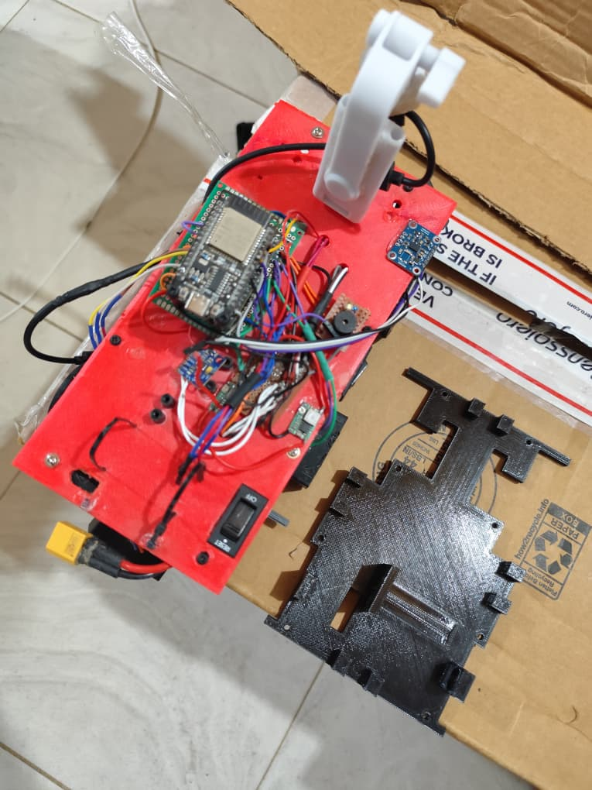
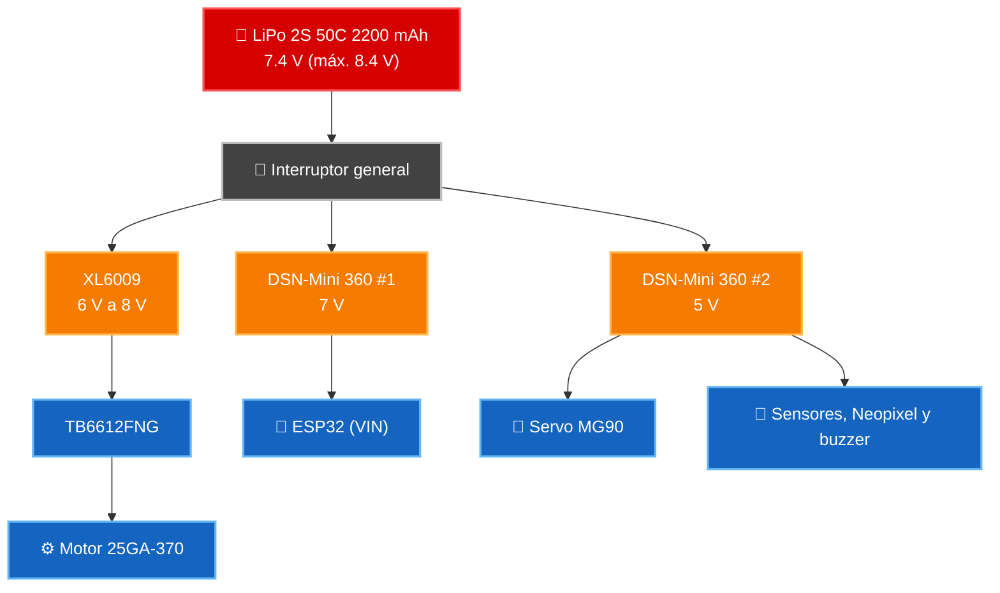
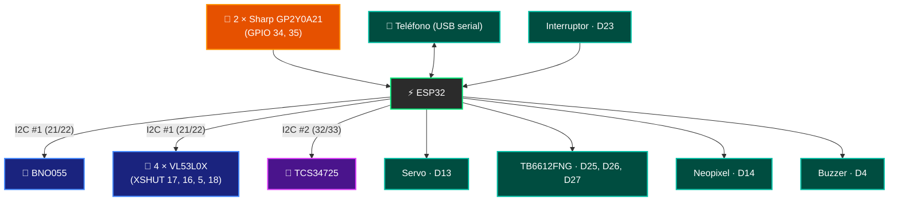
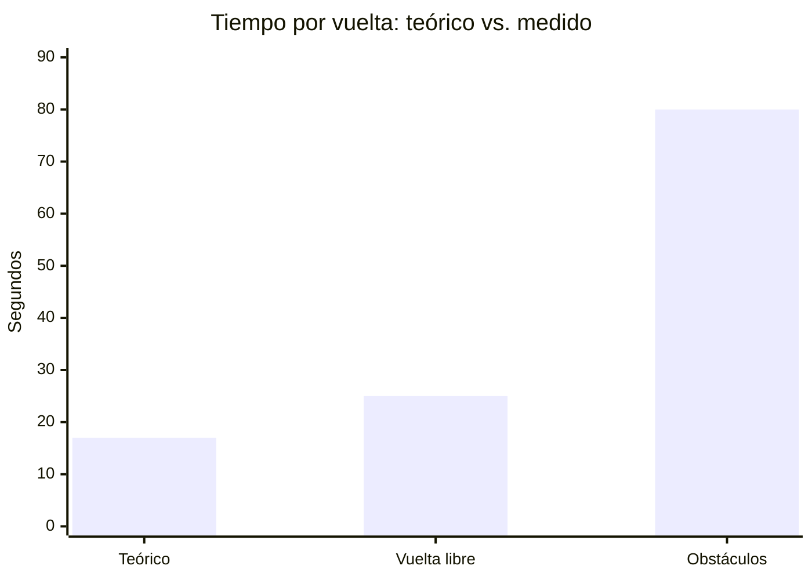
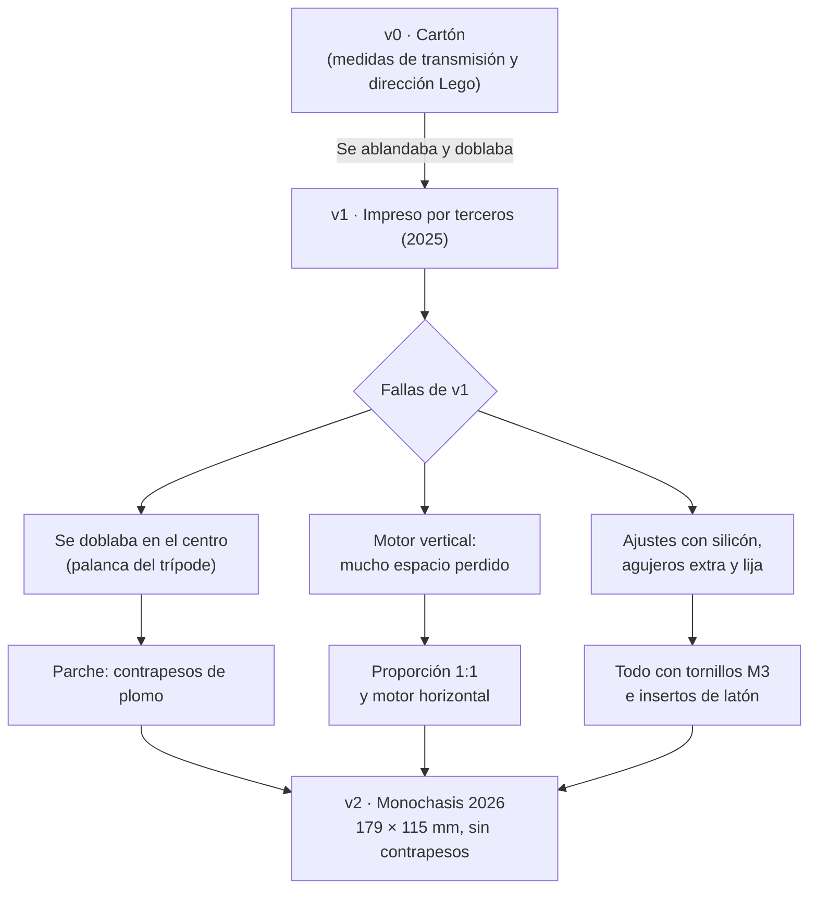
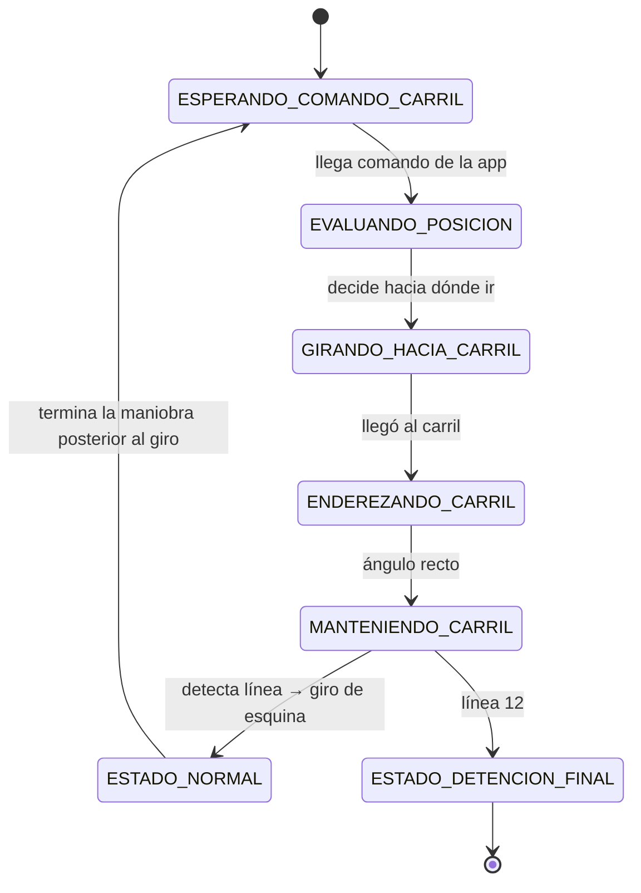

<div align="center">
  

# 🚘 Prometheus Team · WRO 2026

**World Robot Olympiad · Categoría Futuros Ingenieros**
Universidad Politécnica Territorial José Félix Ribas (UPTJFR) · Barinas, Venezuela

</div>

Este es el repositorio de nuestro vehículo autónomo para la temporada 2026. Aquí está el código del ESP32, la aplicación de visión, las piezas en 3D, los esquemas eléctricos y el registro de cómo llegamos a la versión actual. En 2025 quedamos de segundos en la final nacional y este año rehicimos casi todo el carro a partir de lo que falló en esa competencia.

---

## 📑 Índice

<table>
<tr><td valign="top" width="50%">

- [1. El equipo](#equipo)
- [2. De 2025 a 2026](#trayectoria)
- [3. El vehículo (vistas 360°)](#vehiculo)
- [4. Qué cambió respecto a 2025](#cambios)
- [5. Componentes](#componentes)
  - [5.1. Control, detección e interfaz](#componentes-control)
  - [5.2. Alimentación y actuación](#componentes-potencia)
- [6. Alimentación y cableado](#alimentacion)
- [7. Sensores y conexiones](#sensores)
  - [7.1. Buses I2C y asignación de pines](#pines)
  - [7.2. Direccionamiento de los 4 ToF (XSHUT)](#xshut)
- [8. Consumo y autonomía](#energia)
  - [8.1. Consumo por componente](#consumo)
  - [8.2. Autonomía teórica y real](#autonomia)
  - [8.3. Por qué una LiPo 2S de 2200 mAh](#bateria)

</td><td valign="top" width="50%">

- [9. Diseño mecánico](#mecanica)
  - [9.1. Monochasis y tren motriz](#monochasis)
  - [9.2. Segundo piso y soporte Shark Fin](#sharkfin)
  - [9.3. Impresión 3D](#impresion)
- [10. Masa, tracción y velocidad](#dinamica)
- [11. Evolución del chasis (v0 → v2)](#evolucion)
- [12. Guía de ensamble](#ensamble)
- [13. Software y estrategia de navegación](#software)
  - [13.1. Vuelta libre](#vuelta-libre)
  - [13.2. Desafío con obstáculos](#obstaculos)
- [14. Aplicación de visión (V5.0)](#app)
- [15. Pruebas y videos](#pruebas)
- [16. Estructura del repositorio](#repositorio)
- [17. Archivo de la temporada 2025](#archivo-2025)

</td></tr>
</table>

---

<a id="equipo"></a>
## 1. El equipo

Somos tres estudiantes de Ingeniería Electrónica de la UPTJFR y nuestra tutora. Los tres competimos juntos en la WRO 2025.

<table>
<tr>
<td align="center" width="25%"><br><b>Samuel Pérez</b><br><sub>Diseño CAD y app Android</sub></td>
<td align="center" width="25%"><br><b>Trino Carrizales</b><br><sub>Firmware y control</sub></td>
<td align="center" width="25%"><br><b>Leandro Padrón</b><br><sub>Mecánica, montaje y logística</sub></td>
<td align="center" width="25%"><br><b>Ing. Dayana Pérez</b><br><sub>Tutora del equipo</sub></td>
</tr>
</table>

- **Samuel Pérez:** modeló el chasis y las piezas en Onshape y desarrolló la aplicación de detección en Android Studio con OpenCV.
- **Trino Carrizales:** programa el ESP32 (navegación, máquinas de estado, PID) y se encarga de depurar el código en las pruebas. También estudia Ingeniería en Sistemas en la UNELLEZ.
- **Leandro Padrón:** arma y repara el vehículo, resuelve los problemas mecánicos que van saliendo en pista y coordina materiales y logística del equipo.
- **Ing. Dayana Pérez:** Ingeniera Electrónica (UNEXPO Barquisimeto), Magíster en Educación Superior (UFT) y doctorante en TIC (UNELLEZ Barinas). Nos orienta en la parte metodológica y en la documentación.

---

<a id="trayectoria"></a>
## 2. De 2025 a 2026

En la final nacional de 2025 obtuvimos el **2.º lugar**. Fue nuestra primera WRO y el carro llegó funcionando, pero con varios problemas que tuvimos que parchar en el camino: un chasis demasiado largo que se doblaba, contrapesos de plomo para compensarlo, dos microcontroladores por culpa de interferencias del L298N y un giroscopio con deriva.

Para 2026 la meta es el primer lugar. Usamos la lista de fallas de 2025 como punto de partida: chasis nuevo con proporción 1:1, un solo ESP32, sensores ToF en lugar de ultrasónicos e IMU BNO055 en lugar del MPU6050. El resumen está en la [sección 4](#cambios).

<p align="center">
  
  
  
</p>

<details>
  <summary>📸 <b>Más fotos de la final nacional 2025</b></summary>
  <br>
  <p align="center">
    
    
    
  </p>
</details>

---

<a id="vehiculo"></a>
## 3. El vehículo (vistas 360°)

| Vista | Foto | Qué se ve |
| :--- | :---: | :--- |
| **Frontal** |  | ToF frontal, Sharp diagonales y mecanismo de dirección Lego. |
| **Trasera** |  | Motor horizontal, piñón 15T y corona 25T sobre el eje trasero. |
| **Superior** |  | ESP32, BNO055 centrado y recorrido del cableado entre pisos. |
| **Inferior** |  | Compartimento de la batería, sensor de color y altura libre al suelo. |
| **Derecha** |  | Interruptores, separación entre pisos y ToF derecho. |
| **Izquierda** |  | ToF izquierdo y ventilación de los reguladores. |

---

<a id="cambios"></a>
## 4. Qué cambió respecto a 2025

| Área | 2025 | 2026 | Motivo del cambio |
| :--- | :--- | :--- | :--- |
| **Chasis** | Impreso por terceros, 2 pisos, largo, con trípode | Monochasis propio en Onshape, 179 × 115 mm, distancia entre ejes 112 mm | El chasis largo se doblaba y giraba con un radio grande |
| **Masa (con teléfono)** | ≈1300 g (con contrapesos de plomo) | 1092 g | Ya no hacen falta contrapesos (−208 g) |
| **Transmisión** | Diferencial Lego, motor vertical | Engranajes impresos 15T → 25T (1.67:1), motor horizontal | Más espacio útil y repuestos fabricables en casa |
| **Microcontrolador** | 2 placas (maestro + esclavo para el motor) | 1 ESP32 | El TB6612FNG eliminó la interferencia del L298N |
| **Driver de motor** | L298N | TB6612FNG | Menos caída de tensión y sin ruido en el I2C |
| **Distancia** | 4 × HC-SR04 con divisores de voltaje | 4 × VL53L0X (ToF) en I2C | Sin zonas muertas y sin divisores (trabajan a 3.3 V) |
| **Orientación** | MPU6050 + magnetómetro HMC5883L | BNO055 con fusión interna | La deriva del giroscopio desaparece en la práctica |
| **Sensor de color** | Mismo bus que el resto | Bus I2C #2 dedicado, leído en una tarea aparte | No retrasa las lecturas de los ToF |
| **Soporte del teléfono** | Trípode comercial perforado y pegado | Torres Shark Fin con mordaza de tornillo M10 | Ángulo ajustable y sin efecto palanca |
| **Inicio** | Pulsador | Interruptor de palanca (D23) | Los rebotes y vibraciones activaban el pulsador |
| **App** | V3: detección de dos objetos | V5.0: calibración en pista, filtro antirreflejos y filtro temporal | Falsos positivos por la iluminación de la pista |

<p align="center">
  <br>
  <sub>Chasis de 2025 (rojo) al lado del primer piso del Monochasis 2026 (negro).</sub>
</p>

---

<a id="componentes"></a>
## 5. Componentes

<a id="componentes-control"></a>
### 5.1. Control, detección e interfaz

| Imagen | Componente | Función en el vehículo | Documentación |
| :----: | :--- | :--- | :--- |
|  | **ESP32** | Único microcontrolador. Lee todos los sensores, controla motor y servo y recibe los comandos de la app por USB. | [Datasheet](https://www.espressif.com/sites/default/files/documentation/esp32_datasheet_en.pdf) · [Arduino-ESP32](https://docs.espressif.com/projects/arduino-esp32/en/latest/) |
|  | **4 × VL53L0X (ToF)** | Distancia al frente, atrás y a ambos lados. Comparten el bus I2C #1 con direcciones distintas asignadas con XSHUT. | [Datasheet ST](https://www.st.com/resource/en/datasheet/vl53l0x.pdf) · [Librería](https://github.com/adafruit/Adafruit_VL53L0X) |
|  | **IMU BNO055** | Da la orientación (yaw) ya fusionada. Es la referencia para los giros de 90° y para ir recto. | [Datasheet Bosch](https://www.bosch-sensortec.com/media/boschsensortec/downloads/datasheets/bst-bno055-ds000.pdf) · [Librería](https://github.com/adafruit/Adafruit_BNO055) |
|  | **TCS34725** | Debajo del carro, detecta las líneas azul y naranja. Va solo en el bus I2C #2. | [Datasheet](https://ams.com/documents/20143/36005/TCS34725_DS000390_3-00.pdf) · [Librería](https://github.com/adafruit/Adafruit_TCS34725) |
|  | **2 × Sharp GP2Y0A21** | Analógicos, en las diagonales delanteras (10 a 80 cm). Disparan el retroceso de emergencia cuando el carro se acerca demasiado a una pared. | [Datasheet](https://global.sharp/products/device/lineup/data/pdf/datasheet/gp2y0a21yk_e.pdf) |
|  | **Teléfono Android** | Su cámara y la app detectan los pilares rojos/verdes y la zona magenta. | [Código de la app](https://github.com/SamFlips/APP-WRO-PROMETHEUS-TEAM/tree/master) |
|  | **Tira Neopixel (10 LED)** | Indica el estado del programa con colores (esperando, calibrando, línea detectada…). | [Librería](https://github.com/adafruit/Adafruit_NeoPixel) |
|  | **Buzzer** | Avisos sonoros de arranque, errores y eventos. | [tone()](https://www.arduino.cc/reference/en/language/functions/advanced-io/tone/) |
|  | **Interruptor de inicio** | Interruptor de palanca en D23 con pull-up interna. Al pasarlo a LOW arranca el recorrido. | [GPIO ESP32](https://docs.espressif.com/projects/esp-idf/en/latest/esp32/api-reference/peripherals/gpio.html) |

<a id="componentes-potencia"></a>
### 5.2. Alimentación y actuación

| Imagen | Componente | Función en el vehículo | Documentación |
| :----: | :--- | :--- | :--- |
|  | **LiPo 2S 50C 2200 mAh (Ovonic)** | Fuente única: 7.4 V nominales, 8.4 V con carga completa. | [Especificaciones LiPo 2S](https://www.hobbywing.com/) |
|  | **Interruptor general** | Corta el positivo de la batería hacia todo el sistema. | [KCD1](https://www.sparkfun.com/products/11138) |
|  | **XL6009 (step-up/down)** | Alimenta el driver del motor; se ajusta entre 6 y 8 V según la velocidad que queramos. | [Datasheet](https://www.xlsemi.com/datasheet/XL6009%20datasheet.pdf) |
|  | **2 × DSN-Mini 360 (step-down)** | #1 a 7 V para el VIN del ESP32. #2 a 5 V para servo y sensores. | [MP2307](https://www.monolithicpower.com/en/documentview/productdocument/index/doc_url/M/P/MP2307_r1.9.pdf) |
|  | **TB6612FNG** | Puente H del motor de tracción (dirección + PWM). | [Datasheet](https://www.sparkfun.com/datasheets/Robotics/TB6612FNG.pdf) |
|  | **Motor 25GA-370 (JGA25-370)** | 220 RPM a la salida de su caja reductora 21.3:1. Trabaja entre 6 y 8 V. | [Referencia](https://www.pololu.com/category/60/micro-metal-gearmotors) |
|  | **Servo MG90 180°** | Dirección delantera. 90° es recto, 180° izquierda y 0° derecha. | [Datasheet](https://www.electronicoscaldas.com/datasheet/MG90S_Tower-Pro.pdf) |

---

<a id="alimentacion"></a>
## 6. Alimentación y cableado




Desde el interruptor general salen tres líneas independientes, cada una con su regulador:

- **Tracción:** el XL6009 alimenta al TB6612FNG y este al motor. Subiendo o bajando el XL6009 entre 6 y 8 V cambiamos la velocidad máxima sin tocar el código.
- **Control:** el Mini 360 #1 entrega 7 V al VIN del ESP32. Así su regulador interno de 3.3 V tiene margen y no se reinicia cuando el motor arranca.
- **Servo y sensores:** el Mini 360 #2 entrega 5 V al servo, los sensores, la tira Neopixel y el buzzer.

Separar el motor de la lógica nos costó espacio dentro del chasis (son tres reguladores), pero desde que lo hicimos no hemos vuelto a tener reinicios ni lecturas I2C corruptas.

> [!NOTE]
> **L298N → TB6612FNG.** En 2025 el L298N tenía una caída interna de casi 2 V y además metía ruido que bloqueaba el I2C del microcontrolador. La única forma que encontramos de esquivarlo fue poner una segunda placa solo para el motor. Con el TB6612FNG ese problema desapareció y pudimos volver a un solo ESP32, con menos cables, menos peso y menos puntos de falla.

---

<a id="sensores"></a>
## 7. Sensores y conexiones




<a id="pines"></a>
### 7.1. Buses I2C y asignación de pines

- **Bus I2C #1 (GPIO 21/22): navegación.** BNO055 (0x28) y los cuatro ToF (0x30 a 0x33). El BNO055 entrega el yaw ya fusionado; al encender tomamos su lectura como 0° y todos los giros se calculan respecto a ese cero.
- **Bus I2C #2 (GPIO 32/33): suelo.** Solo el TCS34725. Lo pusimos aparte porque se lee cada 30 ms en su propia tarea de FreeRTOS y no queríamos que compitiera con los ToF.
- **Analógicos:** los dos Sharp diagonales quedaron como respaldo de corto alcance.
- No usamos resistencias pull-up externas en los buses; las que traen los módulos fueron suficientes.

| Señal | Pin ESP32 | Señal | Pin ESP32 |
| :--- | :---: | :--- | :---: |
| I2C #1 SDA / SCL | 21 / 22 | XSHUT frontal / trasero | 17 / 16 |
| I2C #2 SDA / SCL | 32 / 33 | XSHUT izquierdo / derecho | 5 / 18 |
| Motor IN1 / IN2 / PWM | 27 / 26 / 25 | Sharp derecho / izquierdo | 34 / 35 |
| Servo de dirección | 13 | Neopixel | 14 |
| Interruptor de inicio | 23 | Buzzer | 4 |

<a id="xshut"></a>
### 7.2. Direccionamiento de los 4 ToF (XSHUT)

Los VL53L0X salen de fábrica con la misma dirección (`0x29`), así que no se pueden encender todos a la vez en el mismo bus. Cada uno tiene su pin XSHUT conectado a un GPIO y en el `setup()` los vamos despertando de uno en uno para cambiarles la dirección:

```cpp
#define XSHUT_FRONTAL 17
#define XSHUT_TRASERO 16
#define XSHUT_IZQ     5
#define XSHUT_DER     18

#define ADDR_FRONTAL 0x30
#define ADDR_TRASERO 0x31
#define ADDR_IZQ     0x32
#define ADDR_DER     0x33
```


En cada paso solo hay un sensor respondiendo en `0x29`. Los cuatro usan la misma configuración, sin offsets individuales: la calibración de fábrica entre unidades del mismo lote fue consistente en nuestras pruebas.

> [!NOTE]
> **HC-SR04 → VL53L0X.** Los ultrasónicos de 2025 trabajaban a 5 V y el ESP32 a 3.3 V, así que tuvimos que armar cuatro divisores de voltaje en una baquelita. Funcionaba, pero se soltaban cables y ocupaba mucho espacio. Los ToF trabajan a 3.3 V, no tienen la zona muerta cercana del ultrasonido y van todos en dos cables de bus.

---

<a id="energia"></a>
## 8. Consumo y autonomía

<a id="consumo"></a>
### 8.1. Consumo por componente

Valores tomados de las hojas de datos para tres casos: **reposo** (energizado sin trabajar), **nominal** (una vuelta normal) y **pico** (arranque del motor, servo forzado, LEDs en blanco).

| Componente | Cant. | Reposo (mA) | Nominal (mA) | Pico (mA) |
| :--- | :---: | :---: | :---: | :---: |
| ESP32 (WiFi/BT apagados) | 1 | ~20 | ~80 | ~80 |
| Sharp GP2Y0A21 | 2 | 10 c/u | 30 c/u | 33 c/u |
| VL53L0X | 4 | 5 c/u | 15 c/u | 20 c/u |
| BNO055 | 1 | ~1 | 12.3 | ~16 |
| TCS34725 | 1 | ~0 | 3 | 3.6 |
| Neopixel (10 LED) | 10 | 0 | 300 | 600 |
| Buzzer | 1 | 0 | 30 | 30 |
| XL6009 (consumo propio) | 1 | 15 | 15 | 15 |
| TB6612FNG (lógica) | 1 | 1 | 2 | 6 |
| Motor 25GA-370 | 1 | 0 | 500 | ~1800 (arranque) |
| DSN-Mini 360 (consumo propio) | 2 | 5 c/u | 5 c/u | 5 c/u |
| Servo MG90 | 1 | 10 | 200 | ~700 (forzado) |
| **Total** | | **~97** | **~1272** | **~3407** |

El pico de **~3.4 A** supone que todo llega a su máximo al mismo tiempo, cosa que en una vuelta real no pasa. Lo usamos solo para verificar la tasa de descarga de la batería.

<a id="autonomia"></a>
### 8.2. Autonomía teórica y real

Dividiendo la capacidad entre el consumo nominal:

$$\text{Autonomía} = \frac{2200 \text{ mAh}}{1272 \text{ mA}} \approx 1.73 \text{ h} \;(\approx 1 \text{ h } 44 \text{ min})$$

Ese cálculo suma las corrientes como si todo trabajara a 7.4 V, pero casi todo trabaja a 5 V o 7 V detrás de un regulador. Haciendo el balance de potencia por línea, con la eficiencia de cada convertidor:

$$I_{\text{batería}} = \frac{V_{\text{salida}} \cdot I_{\text{salida}}}{\eta \cdot V_{\text{batería}}}$$

| Línea | V salida | I salida | η | I tomada de la batería (7.4 V) |
| :--- | :---: | :---: | :---: | :---: |
| Tracción (XL6009 → TB6612 + motor) | 7 V | 502 mA | 88 % | ≈ 540 mA |
| Control (Mini 360 #1 → ESP32) | 7 V | 80 mA | 90 % | ≈ 84 mA |
| Servo y sensores (Mini 360 #2) | 5 V | 665 mA | 90 % | ≈ 500 mA |
| **Total** | | | | **≈ 1124 mA** |

$$\text{Autonomía real} \approx \frac{2200 \text{ mAh}}{1124 \text{ mA}} \approx 1.96 \text{ h} \;(\approx 1 \text{ h } 57 \text{ min})$$

Sale un poco más alta que la primera porque bajar el voltaje reduce más la corriente que lo que se pierde en los reguladores. Coincide con lo que vimos: en una tarde y noche completas de pruebas la batería no llegó a su mínimo.

<a id="bateria"></a>
### 8.3. Por qué una LiPo 2S de 2200 mAh

| Tecnología | Descarga (C) | Peso | Con motor y servo |
| :--- | :---: | :---: | :--- |
| **LiPo 2S 50C** | ~50C | Ligera | Aguanta los picos sin caída de voltaje. |
| Li-ion 18650 | 1C a 2C | Ligera | Los picos bajan el voltaje y reinician el ESP32. |
| NiMH (6 celdas) | Media | Pesada | Funcionaría, pero añade mucho peso. |
| Power bank USB | Límite 2–3 A | Media | Se apaga por sobrecorriente y solo da 5 V. |

- **Corriente:** 2.2 Ah × 50C = 110 A disponibles, muy por encima del pico de ~3.4 A.
- **Capacidad:** con ~1 h 57 min de autonomía, una ronda de competencia no se acerca al límite. Una de 2600–3000 mAh añadiría unos 20–35 g sin ninguna ventaja real.
- **Peso:** la batería pesa 115 g y va debajo del primer piso para bajar el centro de gravedad.

---

<a id="mecanica"></a>
## 9. Diseño mecánico

El chasis de 2025 era demasiado largo: giraba con un radio grande y se doblaba en el centro (ver [sección 11](#evolucion)). Para 2026 nos pusimos una regla: que la distancia entre ejes fuera igual al ancho del carro (proporción 1:1).

Primero probamos la idea con prototipos rápidos en Tinkercad. Ahí también descartamos la transmisión por correa: no conseguíamos correas de la medida que necesitábamos y patinaban. Nos quedamos con engranajes rectos en paralelo, que además nos permitían acostar el motor y acortar el chasis.

<p align="center">
  
  
  
</p>

<a id="monochasis"></a>
### 9.1. Monochasis y tren motriz

El primer piso es una sola pieza diseñada en **Onshape** que ya trae los soportes del motor, los alojamientos de rodamientos, los soportes de los ToF y los canales de cables. Mide **179 × 115 mm** con **112 mm** entre ejes.


- **Motor:** 25GA-370 de 220 RPM acostado en una cama hundida que alinea su eje con la transmisión.
- **Transmisión:** piñón de 15 dientes en el motor y corona de 25 dientes en el eje trasero, una reducción de **1.67:1**. Perdemos algo de velocidad máxima a cambio de más torque en las ruedas.
- **Eje trasero:** no conseguimos varilla calibrada de 4 mm, así que usamos el núcleo de un electrodo de soldadura (~2.4 mm) engrosado con termorretráctil donde va en los rodamientos.
- **Rodamientos:** dos 604ZZ (4 × 12 × 4 mm) encajados en el chasis.

| Pieza | Cómo se fija | Imagen |
| :--- | :--- | :---: |
| **Piñón 15T** | Agujero en forma de "D" que copia el plano del eje del motor; entra a presión y no gira sobre el eje. |  |
| **Corona 25T** | Collarín con abrazadera en "C": un tornillo transversal la cierra sobre la varilla lisa. Sin pegamento. |  |
| **Adaptador de rueda Lego** | Un extremo con la cruz Lego y el otro con la misma abrazadera en "C". Permite cambiar las ruedas rápido. |  |

Al armar el ensamble virtual vimos que los tornillos del soporte del motor quedaban tapados por la corona: para sacar el motor habría que desmontar todo el eje. Los movimos a las esquinas del soporte y ahora el motor sale quitando solo el piñón.

<p align="center">
  
  
</p>

<a id="sharkfin"></a>
### 9.2. Segundo piso y soporte Shark Fin

La batería pasó de estar arriba (2025) a un compartimento **debajo del primer piso**. Perdemos un poco de altura libre al suelo, pero el centro de gravedad baja bastante y el carro ya no se balancea en las curvas.


- **Separadores de 60 mm** entre pisos, con **insertos de latón M3** colocados con calor en cada extremo. Probamos imprimir la rosca en el plástico y no aguantaba apretar y aflojar varias veces.
- **Torres Shark Fin:** dos aletas laterales que sostienen el teléfono. Cada una lleva 3 insertos M3 en la base y se atornilla desde abajo del segundo piso. Los agujeros para los insertos son de 4.1 mm × 9 mm de profundidad, para que el plástico derretido no se meta en la rosca.
- **Mordaza:** entre las torres va una mordaza fija que pivota sobre dos tornillos laterales. Aflojándolos se cambia el ángulo de la cámara y apretándolos queda bloqueado. Dentro de esa mordaza baja una mordaza móvil empujada por un **tornillo M10 impreso**. La rosca de la base se modeló a M10.5 para compensar la contracción del PETG.

La primera versión del soporte tenía el ángulo fijo y cualquier ajuste de cámara implicaba reimprimir la pieza. Con el pivote ahora se reajusta en segundos en los pits.

<p align="center">
  
  
  
</p>

<a id="impresion"></a>
### 9.3. Impresión 3D

Imprimimos en **PETG** con una Creality K1C y luego con una Elegoo Centauri Carbon 2 (Orca Slicer y Elegoo Slicer). El perfil está pensado para resistencia, no para acabado:

| Parámetro | Valor | Por qué |
| :--- | :--- | :--- |
| Temperatura de boquilla | 260 °C | Mejor adhesión entre capas. |
| Flujo volumétrico máximo | 11–12 mm³/s | Evita que el extrusor se quede corto en tramos largos. |
| Velocidad de relleno | 150 mm/s | Menos desgaste del engranaje del extrusor. |
| Perímetros | 5 | Las piezas aguantan mejor la torsión. |
| Ventilador de capa | 0 % al inicio, 40 % máx. | Los voladizos quedan feos, pero las capas no se separan. |
| Cabina | Abierta | Evita que el calor suba por la garganta del hotend. |

- Las piezas con voladizos grandes se imprimieron partidas y planas, y se unieron con clavijas de 2.5 mm (holgura 0.15 mm) más cianoacrilato.
- Las piezas pequeñas se imprimieron junto con las grandes para que tuvieran tiempo de enfriarse entre capas, con un borde (*brim*) de 5 mm.

---

<a id="dinamica"></a>
## 10. Masa, tracción y velocidad

### Masa

| Versión | Con teléfono | Sin teléfono |
| :--- | :---: | :---: |
| 2025, chasis recién impreso (sin trípode) | 943 g | 763 g |
| 2025, configuración de competencia (trípode + contrapesos de plomo) | ≈1300 g | ≈1120 g |
| **2026, Monochasis** | **1092 g** | **861 g** |

Frente al carro con el que competimos en 2025 bajamos **208 g con teléfono (−16 %)** y **259 g sin él (−23 %)**. La comparación justa es contra la configuración de competencia, porque el trípode y el plomo añadieron cerca de 360 g para tapar un problema de diseño (la palanca del trípode doblaba el chasis). El Monochasis no necesita contrapesos. Respecto al chasis de 2025 recién impreso, el de 2026 pesa algo más (861 g frente a 763 g sin teléfono) porque ahora lleva cuatro ToF, tres reguladores, la tira LED y el soporte Shark Fin.

### Reparto de peso por eje

Medido con el teléfono montado:

| Eje | Masa | Reparto |
| :--- | :---: | :---: |
| Delantero | 660 g | 54.5 % |
| Trasero (motriz) | 550 g | 45.5 % |
| **Total en la medición** | 1210 g | 100 % |

El frente pesa un poco más porque el teléfono y las torres van sobre la mitad delantera. La batería debajo del primer piso compensa en parte.

### Velocidad

El motor da 220 RPM y la transmisión reduce 25/15, así que la rueda gira a 132 RPM. Con ruedas de radio 0.04 m:

$$\omega_{\text{rueda}} = \frac{220 \cdot 2\pi}{60} \cdot \frac{15}{25} \approx 13.8 \text{ rad/s} \qquad v = \omega_{\text{rueda}} \cdot r \approx 0.55 \text{ m/s}$$

### Torque

El motor entrega 0.0343 N·m antes de su caja (21.3:1) y la transmisión multiplica otra vez por 25/15:

$$T_{\text{rueda}} = 0.0343 \cdot 21.3 \cdot \frac{25}{15} \approx 1.22 \text{ N·m}$$

Como referencia exigente usamos el torque necesario para sostener todo el peso del carro en el radio de la rueda (como si subiera una pared vertical). Es mucho más de lo que pide la resistencia a la rodadura real:

$$T_{\text{ref}} = m \cdot g \cdot r = 1.092 \cdot 9.81 \cdot 0.04 \approx 0.43 \text{ N·m} \qquad \frac{T_{\text{rueda}}}{T_{\text{ref}}} \approx 2.8$$

El motor tiene casi tres veces ese torque, así que la potencia sobra.

### Agarre

La fuerza máxima antes de que las ruedas patinen depende del peso sobre el eje motriz (550 g → N ≈ 5.4 N) y del coeficiente de fricción goma–tapete. No tenemos cómo medirlo, así que usamos un rango típico de 0.6 a 0.8:

| Caso | μ | Fuerza de agarre (eje trasero) | Aceleración máxima |
| :--- | :---: | :---: | :---: |
| Conservador | 0.6 | ≈ 3.2 N | ≈ 3.0 m/s² |
| Favorable | 0.8 | ≈ 4.3 N | ≈ 4.0 m/s² |

El motor puede empujar con unos 30 N en la rueda (1.22 N·m / 0.04 m), mucho más que el agarre disponible. Eso significa que **lo que limita la aceleración es el agarre, no el motor**. Aun así, con 3 m/s² el carro llega a su velocidad máxima en menos de 0.2 s, y por eso conviene mantener peso sobre el eje trasero.

### Tiempo de vuelta: teórico contra medido

Con una vuelta de unos 9.5 m a velocidad máxima constante:

$$t_{\text{teórico}} = \frac{9.5 \text{ m}}{0.55 \text{ m/s}} \approx 17 \text{ s}$$

| Modo | Teórico | Medido (promedio) | Velocidad efectiva | % de la teórica |
| :--- | :---: | :---: | :---: | :---: |
| Vuelta libre | ≈ 17 s | 25 s | ≈ 0.38 m/s | ≈ 69 % |
| Obstáculos | ≈ 17 s | 80 s | ≈ 0.12 m/s | ≈ 21 % |



En vuelta libre se pierde tiempo frenando en cada esquina y en las correcciones de ángulo. En obstáculos la diferencia es mucho mayor porque el carro se detiene a esperar el comando de la app y hace maniobras de cambio de carril. El motor tiene margen de sobra; lo que hay que mejorar es la estrategia del modo obstáculos.

### Engranajes contra correa dentada

| Criterio | Engranajes (elegido) | Correa dentada |
| :--- | :--- | :--- |
| Relación de transmisión | Exacta, diente contra diente | Puede patinar bajo carga |
| Repuestos en Venezuela | Los imprimimos nosotros | Correas a medida difíciles de conseguir |
| Ajuste | No necesita tensión | Hay que tensarla cada vez que se desarma |
| Cambiar la relación | Reimprimir una pieza | Conseguir otra correa |

Que la relación no patine es importante para nosotros porque el firmware asume que la velocidad de la rueda es proporcional al PWM.

---

<a id="evolucion"></a>
## 11. Evolución del chasis (v0 → v2)



| Versión | Qué buscábamos | Qué falló | Qué aprendimos |
| :--- | :--- | :--- | :--- |
| **v0, cartón** | Comprobar que la transmisión y la dirección Lego encajaran antes de diseñar en CAD. | Con el uso el cartón se ablandó y se dobló, como era de esperar. | Las medidas sirvieron; pasaron tal cual al primer modelo 3D. |
| **v1, impreso (2025)** | Pasar las medidas a algo rígido y subir el teléfono con un trípode. | 1) El chasis largo se doblaba porque el trípode hacía palanca; lo compensamos con tapas de tubería rellenas de plomo (+357 g). 2) El motor iba vertical y ocupaba mucho. 3) Lo imprimió un tercero y cada error se corregía a mano con silicón, agujeros y lija. | Si una pieza necesita retoques manuales, no se puede reparar rápido en los pits. Con impresora propia empezamos a iterar en CAD. |
| **v2, Monochasis (2026)** | Resolver las tres fallas a la vez. | — | Chasis corto 1:1 sin palanca ni contrapesos, motor horizontal en una cama propia y todo desmontable con tornillos Allen M3. |

---

<a id="ensamble"></a>
## 12. Guía de ensamble

Los archivos STL están en [`models/`](models/). Estos son los pasos en el orden en que nosotros armamos el carro.

**1. Imprimir las piezas.** Los parámetros que usamos están en la [sección 9.3](#impresion). Para los engranajes recomendamos subir temperatura y número de paredes; con pocos perímetros los dientes se parten.


**2. Motor y piñón.** Atornilla el motor a su cama con M3, con los terminales hacia arriba o hacia un lado libre (facilita llevar los cables al TB6612FNG). Luego mete el piñón a presión; tiene un separador integrado para que no roce con la caja reductora.


**3. Eje trasero, corona y ruedas.**
1. Pon termorretráctil en un extremo de la varilla hasta que entre ajustada en el primer rodamiento.
2. Pásala por ese rodamiento, mete la corona 25T y pon termorretráctil en el otro extremo para el segundo rodamiento.
3. Alinea la corona con el piñón y aprieta el tornillo de su abrazadera.
4. Coloca los adaptadores Lego en los extremos y apriétalos igual.

> [!TIP]
> Antes de encoger el termorretráctil pon unas gotas de cianoacrilato sobre el metal. Así no gira sobre la varilla cuando el motor hace fuerza.


**4. Dirección Lego.** El conjunto de dirección entra a presión en su espacio del chasis. Lo aseguramos con silicón caliente en los bordes; además de pegar, absorbe parte de la vibración.


**5. Sensores ToF.** Cada VL53L0X va en su soporte (adelante, atrás, izquierda y derecha) con tornillo y tuerca M3.


**6. Separadores.** Coloca los insertos de latón con calor en los separadores de 60 mm y atorníllalos al primer piso desde abajo. Todavía no pongas el segundo piso.


**7. Torres Shark Fin.** Pon 3 insertos en la base de cada torre y atorníllalas al segundo piso desde abajo. Por eso el segundo piso va suelto hasta este paso: con él ya montado no hay espacio para el destornillador.


**8. Cierre.** Coloca el segundo piso sobre los separadores, atorníllalo, monta la mordaza entre las torres y continúa con el cableado y la electrónica.


---

<a id="software"></a>
## 13. Software y estrategia de navegación

El firmware se escribe en el IDE de Arduino para el ESP32. La estructura general (máquina de estados, conteo de líneas, PID de giro y de centrado) viene de 2025; lo que cambió es de dónde salen los datos. El ángulo ya no se calcula fusionando a mano el MPU6050 con el magnetómetro: lo da el **BNO055**. Las distancias ya no vienen de ultrasónicos con divisores, sino de los **ToF**.

| Archivo | Uso |
| :--- | :--- |
| [`src/v1PrometeusTeam2026.ino`](src/v1PrometeusTeam2026.ino) | Vuelta libre (desafío abierto), 2026 |
| [`src/v2PrometrusTeam2026.ino`](src/v2PrometrusTeam2026.ino) | Desafío con obstáculos, 2026 |
| [`src/README.md`](src/README.md) | Librerías y cómo cargar el código |

**Librerías usadas en 2026:** `Wire`, `Adafruit_BNO055`, `Adafruit_VL53L0X`, `Adafruit_TCS34725`, `Adafruit_NeoPixel`, `ESP32Servo` y `ColorConverterLib`.

**Lo que comparten los dos programas:**

- **Arranque:** el carro calibra, enciende los LEDs en espera y no hace nada hasta que se pasa el interruptor de D23 a LOW.
- **Orientación:** al arrancar se guarda el yaw del BNO055 como 0°. Cada esquina suma o resta 90° al ángulo objetivo (0°, 90°, 180°, 270°).
- **Detección de líneas:** el TCS34725 se lee cada 30 ms en una tarea separada de FreeRTOS. El color se convierte a HSV y una línea solo cuenta si se confirma en varias lecturas seguidas. Después de contar una línea se ignoran las demás durante 5 s, para no contar la misma dos veces.
- **Sentido de giro:** lo decide la primera línea que aparece. Si es **azul**, el carro gira a la izquierda en todas las esquinas (antihorario); si es **naranja**, a la derecha (horario).
- **Fin del recorrido:** 12 líneas son 3 vueltas. Después de la última avanza un tramo corto y se detiene.
- **Giros:** PID sobre el error de ángulo (Kp 2.5, Ki 0.8, Kd 0.4) con tolerancia de 5°.
- **Ir recto y centrado:** PID sobre la distancia a la pared (Kp 2.0, Kd 1.2). Si el carro está torcido más de 15°, primero corrige el ángulo y después la distancia. Así se evita que zigzaguee.
- **Seguridad:** si un Sharp diagonal mide menos de ~13 cm a la pared, el carro retrocede unos instantes antes de seguir.

<p align="center">
  
</p>

<a id="vuelta-libre"></a>
### 13.1. Vuelta libre

El carro sigue la pared con el ToF lateral y el BNO055. Cuando el sensor de color confirma una línea, suspende el centrado, ejecuta el giro de 90° hacia el sentido que corresponde, vuelve a enderezarse y retoma el seguimiento. Así hasta las 12 líneas.

<p align="center">
  
</p>

<a id="obstaculos"></a>
### 13.2. Desafío con obstáculos

**Salida del estacionamiento.** Al activar el interruptor, el carro mide con los ToF laterales hacia qué lado tiene más espacio y ejecuta la maniobra de salida hacia ese lado.

**Sistema de carriles.** En lugar de esquivar cada pilar por separado, dividimos el pasillo en carriles: el **carril 1** a la derecha (para pasar los pilares rojos) y el **carril 2** a la izquierda (para los verdes). La app ve hasta dos pilares a la vez y manda un comando que describe la combinación (por ejemplo `C21`, `C15`, `C33`). Con eso el carro sabe de antemano a qué carril ir y si tendrá que cambiarse a mitad del tramo.



| Estado | Qué hace |
| :--- | :--- |
| `ESPERANDO_COMANDO_CARRIL` | Detiene el motor y lee el puerto serie hasta recibir un comando válido de la app. |
| `EVALUANDO_POSICION` | Mira las distancias laterales para saber en qué parte del pasillo está y hacia dónde debe moverse. |
| `GIRANDO_HACIA_CARRIL` | Gira hacia el carril con un ángulo y un tiempo que dependen del comando. Si el Sharp de ese lado detecta la pared demasiado cerca, corta el giro, retrocede un poco y sigue. |
| `ENDEREZANDO_CARRIL` | Contragiro hasta quedar otra vez a 0°, 90°, 180° o 270° según el tramo. |
| `MANTENIENDO_CARRIL` | PID sobre la distancia a la pared del lado del carril, con prioridad al ángulo. Sigue así hasta la próxima línea. |
| `ESTADO_NORMAL` | Gira en la esquina y retrocede usando el ángulo como guía para quedar bien colocado antes de leer el siguiente tramo. |
| `ESTADO_DETENCION_FINAL` | Después de la línea 12 avanza un tramo corto y apaga los motores. |

Antes, después de cada giro el carro retrocedía "a ciegas" un tiempo fijo y nunca sabíamos dónde iba a quedar. Ahora ese retroceso se controla con el ángulo del BNO055 y con el ToF trasero, así que siempre arranca el siguiente tramo recto y a una distancia conocida de los pilares.

<p align="center">
  
</p>

---

<a id="app"></a>
## 14. Aplicación de visión (V5.0)

La detección de pilares la hace una app propia en **Android Studio** con **OpenCV**, que corre en el teléfono montado en el Shark Fin y se comunica con el ESP32 por cable USB. El código está en su propio repositorio: [APP-WRO-PROMETHEUS-TEAM](https://github.com/SamFlips/APP-WRO-PROMETHEUS-TEAM/tree/master) ([descarga en .zip](https://drive.google.com/file/d/1VvdzdWbxGnchFslUwI8wQfkkwYPTyGRD/view?usp=drive_link)).

|  |  |
| :---: | :---: |
| *Pantalla principal con detección de dos objetos.* | *Monitor serial integrado para depurar.* |

**Qué hace la app:**

- Separa rojo, verde y magenta en HSV y se queda solo con contornos con forma de pilar.
- Divide la imagen en izquierda/derecha para saber de qué lado está cada pilar.
- Estima la distancia por el área aparente, calibrando una vez con un pilar a distancia conocida:

$$d = d_{\text{ref}} \sqrt{\frac{A_{\text{ref}}}{A_{\text{medida}}}}$$

- Con la posición y la distancia de hasta dos pilares, el `CommandManager` decide el caso y envía el comando de carril al ESP32.

**Lo nuevo en 2026:**

1. **Calibración en la pista.** Desde un menú se toman 8 muestras de los pilares y la app ajusta el tono y la tolerancia. Las zonas de distancia y los filtros también se cambian ahí, sin recompilar.
2. **Filtro de reflejos.** Los brillos del tapete pierden saturación. La app mide la saturación media dentro de cada contorno y descarta los que quedan por debajo de un umbral (configurable para rojo y verde por separado). Además aplica CLAHE al canal de brillo y descarta formas con ángulos muy agudos (< 45°) o muchos defectos de convexidad.
3. **Zona magenta.** Cuando la zona de estacionamiento ocupa más de 8000 px, la app cambia los comandos para que el carro pase alejado de ella y no se lleve por delante el delimitador.
4. **Filtro temporal.** Las detecciones se guardan en una ventana de 8 cuadros. Un comando solo se envía si aparece en al menos el 70 % de la ventana y se mantiene 2 s.
5. **Comunicación más limpia.** La app descarta la basura binaria y los mensajes de arranque que manda el ESP32 al conectarse.

Se mantiene lo que ya funcionaba en 2025: pantalla completa, el teléfono se despierta al conectar el USB y suena un tono distinto por cada comando enviado, para que podamos seguir lo que pasa sin mirar la pantalla.

<p align="center">
  
</p>

[](https://youtu.be/TpLVCiggEwY)

---

<a id="pruebas"></a>
## 15. Pruebas y videos

Probamos en una réplica de la pista de 3 × 3 m hecha con láminas recicladas (tiene un error de unos 10 cm). En cada esquina pusimos las dos líneas, azul y naranja, separadas 30° desde la esquina interior, como indica el reglamento.


| Prueba 2026 | Video |
| :--- | :---: |
| **Vuelta libre** | [](https://youtube.com/shorts/Ml_8qpX_Ozo) |
| **Evasión de obstáculos** | [](https://youtu.be/qwc4M6uargw?si=8OC0NmMWCrHWz1Wq) |

---

<a id="repositorio"></a>
## 16. Estructura del repositorio

| Carpeta | Contenido |
| :--- | :--- |
| [`src/`](src/) | Código del ESP32 (2026 y versiones de 2025) y enlaces al código de la app |
| [`models/`](models/) | STL de todas las piezas impresas |
| [`schemes/`](schemes/) | Esquemas de alimentación y de sensores (todas las versiones) |
| [`v-photos/`](v-photos/) | Fotos del vehículo 2026 y 2025 desde los seis lados |
| [`t-photos/`](t-photos/) | Fotos del equipo |
| [`other/`](other/) | Imágenes de componentes, CAD, proceso de construcción y diagramas |

---

<a id="archivo-2025"></a>
## 17. Archivo de la temporada 2025

Dejamos aquí, resumido, el vehículo con el que obtuvimos el 2.º lugar nacional. Casi todo fue reemplazado en 2026, pero explica de dónde salen las decisiones de este año.

**Resumen del carro 2025:** chasis de dos pisos impreso en 3D, transmisión y dirección con piezas Lego, motor 25GA-370 con L298N, 4 ultrasónicos HC-SR04, 2 Sharp, MPU6050 + magnetómetro HMC5883L, sensor de color TCS34725 y teléfono sobre un trípode. Terminó con dos ESP32 (uno solo para el motor) y pesaba ≈1300 g en competencia.

|  |  |  |
| :---: | :---: | :---: |
|  |  |  |

### Evolución de la electrónica en 2025

| Versión | Cambios | Esquema |
| :--- | :--- | :---: |
| **Alimentación V1** | LiPo 2S → XL6009 → L298N → motor. Mini 360 a 7 V para un Arduino, que también alimentaba el servo. | [Ver](schemes/power_supply_diagram.jpeg) |
| **Alimentación V2** | Dos Arduino (maestro y esclavo) en el mismo regulador de 7 V y un segundo regulador solo para sensores y servo. | [Ver](schemes/diagrma-alimentacion2.jpg) |
| **Alimentación V3** | Dos ESP32 a 6 V, XL6009 a 7.5 V para el L298N (que dejaba ~6 V al motor) y Mini 360 a 5 V para servo y sensores. | [Ver](schemes/Esquema-alimentacio-3.png) |
| **Sensores V1** | Ultrasónicos al frente y a los lados, Sharp en diagonales, giroscopio y sensor de color. | [Ver](schemes/diagrama-sensores.jpg) |
| **Sensores V2** | Arduino esclavo para el puente H y botón de inicio. | [Ver](schemes/diagrama-sensores2.jpg) |
| **Sensores V3** | Dos ESP32, magnetómetro, ultrasónico trasero, LED y buzzer, y divisores de voltaje (1 kΩ / 2 kΩ, 5 V → 3.33 V) para los HC-SR04. | [Ver](schemes/Esquema-alimentacion-4.png) |

### Problemas principales y cómo los resolvimos en su momento

- **Interferencia del L298N:** el carro no completaba los giros o no veía las líneas. Aislar los cables no funcionó; la solución fue un segundo microcontrolador que solo manejaba el motor y recibía órdenes del principal. En 2026 lo resolvimos de raíz con el TB6612FNG.
- **Deriva del giroscopio:** fusionábamos el MPU6050 con el magnetómetro (corrección gradual de 0.1 hacia el ángulo del magnetómetro). Funcionaba, pero el magnetómetro se alteraba cerca de metales y motores. El BNO055 lo reemplazó.
- **Giros pasados de 90°:** tuvimos que calibrar a mano el giro a 70° porque el carro se pasaba. Con el BNO055 y el PID de giro ya no hace falta.
- **Líneas perdidas o contadas dos veces:** bajamos el tiempo de integración del TCS34725 a 2.4 ms y promediamos las últimas lecturas. Esa idea sigue en el firmware actual.
- **Soporte del teléfono:** para ver dos pilares a la vez hubo que subir la cámara con un trípode recortado y pegado al chasis, que terminó siendo la causa de la flexión.

<details>
<summary>📱 <b>Versiones de la app en 2025 (V1 a V3)</b></summary>
<br>

| Versión | Qué hacía | Imágenes |
| :--- | :--- | :---: |
| **V1** | Detectaba rojo o verde y mandaba `R` o `G` por USB a un Arduino. Lo difícil fue lograr la comunicación USB y hacer funcionar OpenCV en Android. |   |
| **V2** | Filtro de formas rectangulares, distancia por área y orientación (pantalla en tres sectores, que fallaba por la perspectiva). |   |
| **V3** | Detección de dos pilares a la vez, `CommandManager` por casos, pantalla en izquierda/derecha y monitor serial integrado. |   |

</details>

<details>
<summary>🛠️ <b>Construcción del chasis 2025</b></summary>
<br>

| | |
| :---: | :--- |
|  | Primeras medidas en cartón doble, para poder cortar y probar sin gastar. |
|  | Transmisión y dirección Lego montadas con el motor y el servo para la primera prueba. |
|  | Modelo de dos pisos en Tinkercad, pasado luego a Fusion 360 para ajustar tolerancias. |
|  | Piezas impresas. |
|  | Tercera versión: sensores reubicados y cableado para dos ESP32 y el magnetómetro. |
|  | Trípode recortado y fijado a la base superior para elevar el teléfono. |

</details>

<details>
<summary>🎬 <b>Videos de 2025</b></summary>
<br>

| Video | Enlace |
| :--- | :---: |
| Resumen de pruebas (vueltas y obstáculos) | [](https://youtu.be/E-xsGcDSaJY?si=9i87w-iJ8TijE_ca) |
| Vuelta libre | [](https://youtube.com/shorts/wI_OLS1nWhc?si=868zlHss_CnnXe10) |
| Evasión de obstáculos | [](https://www.youtube.com/watch?v=WQM6CjVKSwE) |
| Prueba del sensor de color | [](https://youtu.be/7GS6mCXmGks) |
| Mejora del cableado (timelapse) | [](https://www.youtube.com/shorts/rl1eokkc18E) |

</details>

Los programas de 2025 siguen en `src/` como referencia: `Wro_Prometheus_Arduino_Maestro_v28.ino` y `Wro_Prometheus_Arduino_Esclavo.ino` (versión Arduino), `Wro_Prometeus_V1.ino` y `Wro_Prometeus_V2_.ino` (versión ESP32 con MPU6050, vuelta libre y obstáculos) y `Wro_Prometeus_ESCLAVO_PULLUP_esp32.ino` (ESP32 esclavo del motor).
