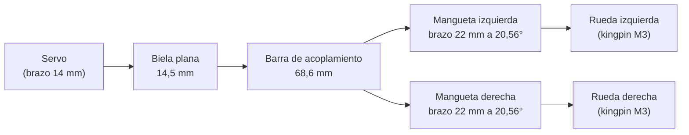
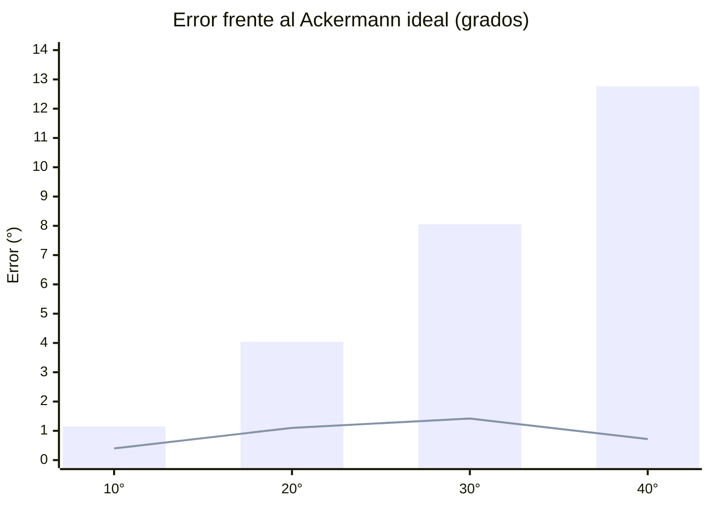

# 🛞 Dirección Ackermann

**Cálculos, justificación y comparación con la dirección Lego anterior** 
Prometheus Team · WRO 2026 · Diseño en Onshape · Octubre 2026

[⬅️ Volver al README principal](../README.md#104--sistema-de-dirección-ackermann) · [📄 Documento original (.docx)](Direccion_Ackermann_Calculos_y_Justificacion.docx)

---

## 📑 Contenido

- [1. Resumen](#1-resumen)
- [2. Datos de partida](#2-datos-de-partida)
- [3. Fundamentos y fórmulas](#3-fundamentos-y-fórmulas)
- [4. Cálculo de la geometría](#4-cálculo-de-la-geometría)
- [5. Cinemática del servo y la biela](#5-cinemática-del-servo-y-la-biela)
- [6. Disposición vertical](#6-disposición-vertical)
- [7. Verificación en CAD](#7-verificación-en-cad)
- [8. Resultado: dirección real frente a la ideal](#8-resultado-dirección-real-frente-a-la-ideal)
- [9. Comparación con la dirección Lego anterior](#9-comparación-con-la-dirección-lego-anterior)
- [10. Decisiones de diseño y justificación](#10-decisiones-de-diseño-y-justificación)
- [11. Pendientes y recomendaciones](#11-pendientes-y-recomendaciones)
- [Anexo: especificaciones finales](#anexo-especificaciones-finales)

---

## 1. Resumen

Reemplazamos la dirección Lego original (convencional, con poco ángulo de giro y encajada a presión en un recorte del chasis) por una **dirección Ackermann impresa en PETG-CF**. El sistema usa un servo, una barra de acoplamiento, manguetas con pivote (*kingpin*) metálico y una biela plana.

| Resultado | Valor |
| :--- | :--- |
| **Ángulo de giro (medido)** | 40° en la rueda interior y 25° a 30° en la exterior (promedio 27,5°, frente a 27,2° ideal) |
| **Radio de giro mínimo** | ≈ 176 mm, medido en el centro del eje trasero |
| **Error frente al Ackermann ideal** | 0,4° a 1,4° en el rango 10°–40°, frente a 1,2° a 12,8° de una dirección paralela |
| **Holgura mínima contra el chasis** | 1,00 mm en todo el recorrido, verificada en CAD |
| **Recorrido real del servo** | 98° (de −50° a +48°), dentro de su capacidad |
| **Ancho entre extremos de rueda** | ≈ 143 mm, igual que el eje trasero |

---

## 2. Datos de partida

| Dato | Valor |
| :--- | :--- |
| Distancia entre ejes (L) | 112 mm |
| Ancho del chasis | 115 mm |
| Neumático / rin Lego | #44309 (43,2 × 22 mm) / #56145 (30,4 × 20 mm) |
| Vía trasera | 140 mm de exterior a exterior (118 mm entre centros de neumático) |
| Ancho delantero (montaje real) | ≈ 143 mm de extremo a extremo de rueda (≈ 121 mm entre centros), igual que el eje trasero |
| Adaptador de rueda | 25,7 mm de largo (13,7 mm en la versión anterior) |
| Espesor de la placa / separación entre pisos | 4 mm / 60 mm |
| Altura del eje de rueda | 10,75 mm sobre la placa (igual que el eje trasero) |
| Servo | **Previsto:** EMAX ES08MA II (analógico, 23 × 11,5 × 24 mm, 12 g, 4,8–6 V, 2,0 kgf·cm a 6 V). **En las pruebas:** MG90 (23 × 12,2 mm) con su brazo de serie, usando el agujero a 14 mm del eje. |
| Material | PETG-CF (manguetas, barra, biela y soporte) |

---

## 3. Fundamentos y fórmulas

En una dirección Ackermann las prolongaciones de los ejes de las dos ruedas delanteras se cortan en un punto sobre la línea del eje trasero. Así cada rueda recorre una circunferencia distinta sin arrastrarse de lado. Para lograrlo, la rueda interior tiene que girar más que la exterior.

| # | Fórmula | Uso |
| :---: | :--- | :--- |
| (1) | $\cot\delta_e - \cot\delta_i = \dfrac{K}{L}$ | Condición de Ackermann |
| (2) | $\theta = \arctan\left(\dfrac{K/2}{L}\right)$ | Ángulo del brazo de dirección |
| (3) | $K - 2\,a\,\sin\theta$ | Separación de los agujeros de la barra |
| (4) | $R = \dfrac{L}{\tan\delta_i} + \dfrac{K}{2}$ | Radio de giro (al centro del eje trasero) |
| (5) | $\dfrac{\delta_i - \delta_{e,\text{real}}}{\delta_i - \delta_{e,\text{ideal}}} \times 100$ | Porcentaje de Ackermann |
| (6) | $F = \dfrac{\tau}{r_{\text{brazo}}}$ | Fuerza en el brazo del servo |

Donde $\delta_i$ y $\delta_e$ son los ángulos de la rueda interior y exterior, $K$ la separación entre los ejes de los *kingpins*, $L$ la distancia entre ejes y $a$ la longitud del brazo de dirección.

---

## 4. Cálculo de la geometría

### 4.1. Elección de K (separación entre kingpins)

El primer cálculo usó el ancho del chasis (115 mm) como K, y era un error: K es la distancia entre pivotes, no entre ruedas. Comparamos cuatro opciones con L = 112 mm y un brazo de 22 mm:

| K (mm) | Criterio | θ | Separación de agujeros | Decisión |
| :---: | :--- | :---: | :---: | :--- |
| 115 | Ancho del chasis (supuesto inicial) | 27,2° | — | ❌ Descartado: no es la distancia entre pivotes |
| 96 | Kingpin en la cara interior del neumático | 23,2° | 78,7 mm | ❌ Descartado: las orejas de Ø10 invadirían unos 5 mm la llanta |
| 108 | Kingpin a 5 mm del plano medio de la rueda | 25,7° | 88,9 mm | ❌ Descartado: la mangueta tendría que entrar en la cavidad del rin |
| **84** | **Kingpin 6 mm dentro de la cara interior (x = ±42 mm)** | **20,56°** | **68,55 mm** | ✅ **Adoptado** |

### 4.2. Brazo de dirección y barra

Con K = 84 mm:

$$\theta = \arctan\left(\frac{42}{112}\right) = 20{,}556^\circ$$

Con un brazo de 22 mm, la punta queda 7,72 mm hacia el centro y 20,60 mm hacia atrás del kingpin. La separación de agujeros de la barra es:

$$84 - 2 \cdot 22 \cdot \sin(20{,}556^\circ) = 68{,}55 \text{ mm}$$

La barra se construyó con 68,6 mm y un tercer agujero a 14 mm del centro para la biela.

### 4.3. Ángulos ideales y radios de giro

Aplicando la fórmula (1) con K/L = 0,75:

| δ interior | δ exterior ideal | Radio de giro (mm) | Error de una dirección paralela |
| :---: | :---: | :---: | :---: |
| 10° | 8,85° | 677 | 1,15° |
| 20° | 15,96° | 350 | 4,04° |
| 30° | 21,95° | 236 | 8,05° |
| 40° | 27,24° | 176 | 12,76° |

La última columna es la diferencia entre el ideal y una rueda exterior que gira lo mismo que la interior (dirección paralela). Crece con el ángulo; por eso una dirección paralela solo es aceptable en giros pequeños.

---

## 5. Cinemática del servo y la biela

El servo se montó **invertido** (eje hacia abajo), delante de la barra, con un brazo de 14 mm y una biela plana de 14,5 mm. Así el brazo del servo, la biela y la barra trabajan en planos casi contiguos. Un diseño anterior con una biela en forma de Z y 25 mm de desnivel se descartó porque hacía palanca sobre las articulaciones y generaba holgura en el mecanismo.

Exigimos que el ángulo entre el brazo y la biela nunca bajara de 40°, para evitar el punto muerto. El primer rango de servo (−19,6° a +24,8°) resultó insuficiente. El CAD dio finalmente −46,8° a +34,3° (81,1°), pero el montaje real necesitó −50° a +48° (ver 5.1).

### 5.1. Recorrido del servo: CAD frente a montaje real

El CAD predijo un recorrido de −46,8° a +34,3° (81,1°, centrado en −6,2°). En el montaje real hizo falta más recorrido y, además, el servo había quedado montado al revés. Tras voltearlo y ampliar el rango, la dirección funciona con −50° a +48° (98°, casi simétrico).

El análisis posterior del mecanismo lo explica: la barra necesita 22 mm de carrera en el punto de la biela y, con un brazo de 14 mm, eso exige entre 100° y 104° de giro del servo. Los 81° del CAD eran optimistas.

| Dato | CAD | Montaje real |
| :--- | :---: | :---: |
| Rango del servo | −46,8° a +34,3° | −50° a +48° |
| Recorrido total | 81,1° | 98° |
| Centro de la ventana | −6,2° | −1° |
| Brazo del servo | 14 mm | 14 mm (último agujero del brazo del MG90) |
| Biela | 14,5 mm | 14,5 mm |

La asimetría del CAD venía de la unión excéntrica de la biela con la barra (a 14 mm del centro) y del desplazamiento lateral del eje del servo. En el montaje real el recorrido resultó casi simétrico, probablemente por haber corregido el montaje invertido.

> [!NOTE]
> Los grados del código dependen de la calibración de µs por grado (partimos de 10 µs/°). Conviene comprobar con un transportador que el brazo gira realmente lo que se le ordena.

### 5.2. Par del servo

Con 2,0 kgf·cm (0,196 N·m) y un brazo de 14 mm, el servo entrega hasta unos **14 N** en el brazo. La carga estimada para girar con el carro parado, con unos 0,66 kg sobre el eje delantero, es menor de 0,3 kgf·cm. El margen de seguridad es de **más de 6 veces**: el punto débil del sistema es la holgura mecánica, no la fuerza.

---

## 6. Disposición vertical

Las alturas se miden desde la cara inferior de la placa. La rueda baja 6,85 mm por debajo de la placa, así que ningún elemento puede quedar a menos de unos 2 mm del suelo.

| Elemento | Altura z (mm) |
| :--- | :---: |
| Parte baja del neumático (suelo) | −6,85 |
| Pie de la mangueta | −4,5 a −0,5 (2,35 mm sobre el suelo) |
| Placa y puentes de los kingpins | 0 a 4 |
| Oreja y brazo de la mangueta | 4,5 a 7,5 |
| Barra de acoplamiento | 8 a 11 |
| Biela | 11,5 a 14,5 |
| Brazo del servo | 15 a 17 |
| Eje de la rueda | 14,75 |

---

## 7. Verificación en CAD

Modelamos una «rueda fantasma» (cilindro de Ø43,2 × 22 mm con su eje a z = 14,75 mm) y la hicimos girar alrededor del kingpin en pasos de 5° para detectar interferencias con el chasis, las manguetas, la barra y la biela.

| Problema detectado | Corrección | Resultado |
| :--- | :--- | :--- |
| A 40°, la esquina trasera interior del neumático (x ≈ 34,6 mm) rozaba el puente y la pared del hombro | Puente inclinado (extremo en x = 27, y = 32) y recortes de hombro entre x = 33,3 y 37,5 mm | Holgura mínima de 1,00 mm en todo el rango |
| Un recorte nuevo dañó el brazo de dirección | Se limitó el alcance de los recortes al chasis | Pieza restaurada |
| Los casquillos de la biela no apretaban la pila | Casquillos de 4 mm (z 11–15) | Articulaciones apretadas y biela libre (0,5 mm) |
| La barra tocaba la cabeza M3 del servo, y la barra y la biela tocaban los pilares a −40° | Alivio en la barra y rebaje en los pilares | Todas las holguras ≥ 1 mm |

**Criterio general:** ≥ 1 mm contra el resto de piezas y 0,5 mm solo dentro de una misma articulación. Las holguras de 0,5 mm entre la rueda y la mangueta son estáticas, porque ambas giran juntas.

---

## 8. Resultado: dirección real frente a la ideal

Pares de ángulos medidos en el modelo del mecanismo (con la barra rígida de 68,6 mm):

| δ interior | δ exterior real | δ exterior ideal | Error | % Ackermann |
| :---: | :---: | :---: | :---: | :---: |
| 10° | 9,25° | 8,85° | +0,40° | 65 % |
| 20° | 17,06° | 15,96° | +1,10° | 73 % |
| 30° | 23,37° | 21,95° | +1,42° | 82 % |
| 40° | 27,96° | 27,24° | +0,72° | 94 % |

El error máximo es de 1,4°, y el mecanismo se acerca al Ackermann ideal justo donde más importa: en los ángulos grandes (94 %). En ángulos pequeños el error absoluto es menor de 0,5°.

Barras: dirección paralela (Lego). Línea: nuestra dirección Ackermann.

### 8.1. Mediciones en el montaje real

Medimos con transportador, sobre papel, el ángulo de cada rueda respecto a su posición recta, con el servo en los límites de −50° y +48°:

| Giro | Rueda interior | Rueda exterior | Exterior ideal (fórmula 1) | Error | % Ackermann |
| :--- | :---: | :---: | :---: | :---: | :---: |
| A la derecha | 40° | 30° | 27,24° | +2,8° | 78 % |
| A la izquierda | 40° | 25° | 27,24° | −2,2° | 118 % |
| **Promedio** | **40°** | **27,5°** | **27,24°** | **+0,3°** | **98 %** |

El promedio de la rueda exterior (27,5°) coincide con el ideal (27,2°) y con el modelo (28,0°). La diferencia de 5° entre los dos lados no se explica por el mecanismo, que es simétrico: lo más probable es un error de medición o un desfase del cero (ruedas no exactamente rectas) de 2 a 3°, que es la incertidumbre de un transportador sobre papel.

Una comprobación independiente es el recorrido total de cada rueda, que según el modelo debe ser de unos 68°. La rueda derecha recorre 40° + 25° = 65° y la izquierda 30° + 40° = 70°, con un promedio de 67,5°, lo que es consistente. Para eliminar el sesgo conviene medir ese recorrido total de cada rueda. El radio de giro mínimo, con la rueda interior a 40°, sigue siendo de unos 176 mm.

### 8.2. Ajustes realizados tras las pruebas físicas

- **Servo volteado:** había quedado montado al revés. Al corregirlo y ampliar el rango a −50°/+48°, la dirección alcanza los ángulos esperados.
- **Brazo del servo de 14 mm** (último agujero del brazo del MG90) y **biela de 14,5 mm**.
- **Holguras verticales** del pie y la oreja de la mangueta, y de los casquillos: de 0,5 mm a 0,1 mm por lado (0,2 mm en total), porque la impresión no necesita tanta tolerancia. Eliminó el juego vertical, pero aparecieron puntos muertos que se resolvieron con el servo corregido y el rango ampliado.
- **Canal de unos 2 mm** en la cara superior del chasis para el recorrido de las cabezas de los tornillos de las puntas de los brazos, que rozaban.
- **Pie inferior de la mangueta** restaurado en el modelo y pivote cambiado a M3 con la cabeza embutida. Usamos tornillos normales en lugar de tornillos de hombro (no los conseguimos), así que las tuercas se fijan con autoblocantes o fijador de roscas.
- **Adaptador de rueda** alargado de 13,7 a 25,7 mm. El ancho entre extremos de rueda queda en ≈ 143 mm, igual que el eje trasero.
- **Eje de rueda:** varilla de soldadura de Ø2,6 mm (núcleo) con apoyo impreso en lugar de rodamientos 604ZZ, y unión en cruz Lego alojada en un hueco de 6 mm del adaptador.

### 8.3. Efecto del ancho de 143 mm

- **Vía entre centros:** ≈ 121 mm (143 − 22) frente a los 118 mm de diseño. El centro de la rueda queda unos 1,5 mm más afuera por lado (18,5 mm del kingpin en lugar de 17 mm).
- **Geometría Ackermann:** sin efecto. Depende de K = 84 mm y L = 112 mm, no de la vía, así que los ángulos y el radio mínimo (176 mm) no cambian.
- **Esfuerzo de dirección:** el desfase del pivote aumenta un 9 %, insignificante frente al margen de par de más de 6 veces.
- **Holguras:** la cara interior del neumático queda unos 1,5 mm más lejos de la mangueta y del chasis, es decir, mejoran. El brazo de palanca sobre la varilla también crece un 9 %, un aumento despreciable.
- **Vía delantera igual a la trasera (≈ 143 mm):** es lo recomendable, porque las ruedas traseras siguen las huellas de las delanteras y el vehículo es más estable. Hay que comprobar que el ancho total cumple el reglamento de la categoría.

---

## 9. Comparación con la dirección Lego anterior

La dirección Lego era convencional: las dos ruedas giraban el mismo ángulo (geometría paralela) y su ángulo máximo era reducido. Las cifras de la columna Lego son referencias teóricas para esa geometría; la fila del ángulo máximo debe reemplazarse por el valor medido en el vehículo anterior.

| Aspecto | Dirección Lego anterior | Dirección Ackermann nueva |
| :--- | :--- | :--- |
| **Geometría** | Paralela: mismo ángulo en las dos ruedas | Ackermann: K = 84 mm, L = 112 mm, brazos a 20,56° |
| **Ángulo máximo** | Reducido (por medir; lo típico en Lego es 15° a 20°) | 40° interior y 25° a 30° exterior (medido) |
| **Radio de giro mínimo** | ≈ 308 a 418 mm con 20° a 15° ($R \approx L / \tan\delta$) | **176 mm**, un 43 % menor que con 20° |
| **Error frente al ideal** | 4,0° con 20° y 8,1° con 30° | 1,1° con 20° y 1,4° con 30° |
| **Efecto en el neumático** | Arrastre lateral y desgaste al girar | Ruedas casi tangentes a sus círculos de giro |
| **Pivotes** | Encaje a presión en un recorte del chasis (con holgura) | Pivote M3 con ajuste definido (previsto con tornillo de hombro Ø4; hoy tornillo normal con tuerca autoblocante) |
| **Rigidez** | Plástico Lego con juego | PETG-CF (manguetas, barra y biela) con holguras controladas |
| **Rango del servo** | — | 98° (−50° a +48°), dentro de la capacidad del servo |

---

## 10. Decisiones de diseño y justificación

| Decisión | Alternativa descartada | Justificación |
| :--- | :--- | :--- |
| K = 84 mm | K = 96 o 108 mm | Evita que las orejas de la mangueta invadan la llanta; casi no se pierde giro. |
| Brazo de 22 mm | — | Da el recorrido de barra necesario (unos 10 a 11 mm) con un brazo de servo de 14 mm. |
| Servo invertido delante de la barra | Servo detrás con biela en Z de 25 mm | Biela plana en un solo plano: más rígida y sin holgura por palanca; además libera el centro del chasis. |
| Servo apoyado sobre la placa | Servo hundido en un hueco | La rueda baja 6,85 mm y el servo mide ~28 mm: colgaría hasta el suelo. |
| Brazos y barra sobre la placa (z 4,5–11) | Barra por debajo | Evita el roce con el suelo. |
| Relleno de huecos hasta x = ±30 mm | Relleno completo | Da apoyo al soporte del servo y mantiene 1 mm contra la columna y la oreja al girar. |
| Kingpin metálico M3 | Rosca girando contra el plástico | Evita el desgaste del plástico; el inserto de latón solo sujeta. |
| Varilla de soldadura Ø2,6 mm con apoyo impreso | Rodamientos 604ZZ junto al rin | Los rines Lego no tienen espacio interior; la carga es pequeña (≈ 3 N por rueda) y la varilla estaba disponible. La unión en cruz Lego va en un hueco de 6 mm del adaptador. |
| Servo volteado y rango −50°/+48° | Rango del CAD (−46,8°/+34,3°) | El montaje real necesitó unos 98° de recorrido; el análisis del mecanismo lo confirma (≈ 100–104° con brazo de 14 mm). |
| Holguras de 0,1 mm por lado | Holguras de 0,5 mm | La impresión no necesita tanta tolerancia; elimina el juego vertical. |
| Adaptador de 25,7 mm y ancho ≈ 143 mm | Adaptador de 13,7 mm (ancho ≈ 140 mm) | Iguala la vía delantera con la trasera, sin efecto en la geometría Ackermann. |
| PETG-CF | PETG simple | Más rigidez: lo que ordena el control PID se traduce en giros sin retraso elástico. |

---

## 11. Pendientes y recomendaciones

- [ ] Volver a medir los ángulos como recorrido total de cada rueda (de un extremo al otro) para eliminar el sesgo del cero, y confirmar que la rueda exterior quede entre 26° y 29°.
- [ ] Calibrar los µs por grado del servo con un transportador y confirmar que los límites −50°/+48° del código corresponden a grados reales.
- [ ] Repetir la calibración con el servo definitivo (EMAX ES08MA II), ya que las pruebas usan un MG90, y dejar 2–3° de margen respecto a los topes.
- [ ] Medir el ángulo máximo de la dirección Lego anterior para completar la tabla comparativa.
- [ ] Verificar la convergencia (*toe-in*) y ajustarla con la ranura de la barra; fijar las tuercas de los tornillos que no son de hombro.

---

## Anexo: especificaciones finales

| Parámetro | Valor |
| :--- | :--- |
| Distancia entre ejes L | 112 mm |
| Separación entre kingpins K | 84 mm (x = ±42 mm) |
| Ángulo del brazo de dirección | 20,56° |
| Longitud del brazo de dirección | 22 mm |
| Separación de agujeros de la barra | 68,6 mm |
| Biela / brazo del servo | 14,5 mm / 14 mm |
| Recorrido del servo | −50° a +48° (98°, montaje real) |
| Giro de ruedas | Interior 40° y exterior 25° a 30° (promedio 27,5°, medido) |
| Ancho entre extremos de rueda | ≈ 143 mm (igual que el eje trasero) |
| Radio de giro mínimo | 176 mm (al centro del eje trasero) |
| Holgura mínima al chasis | 1,00 mm |
| % Ackermann | 65 % a 94 % en 10°–40° |

---

[⬅️ Volver al README principal](../README.md#104--sistema-de-dirección-ackermann)

