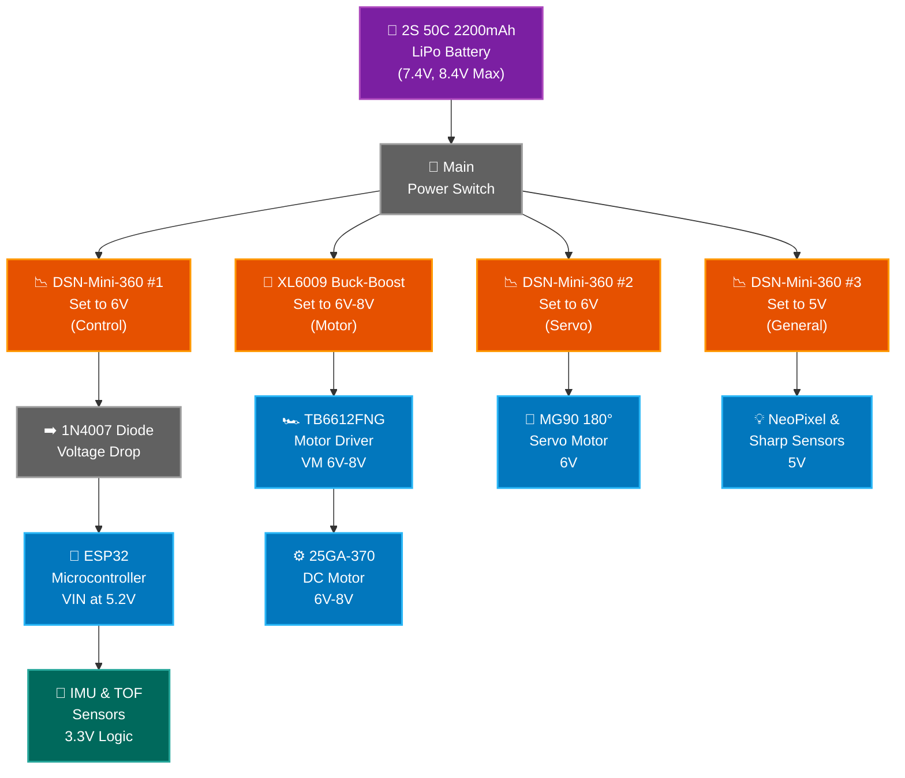
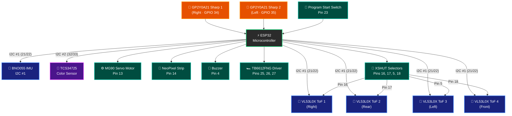
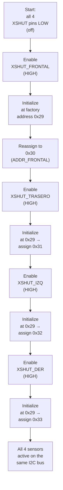

# 🔌 Electrical Schematics

[⬅️ Back to the main README](../README.md)

Schematics for the vehicle's power supply and its input and output connections. This page repeats sections *6. Power and Wiring Schematics* and *7. Sensor and Data Acquisition Schematics* of the main README, so the explanation is the same in both places.

| File | Contents |
| :--- | :--- |
| [`Power_Supply_Diagram_FINALS.png`](Power_Supply_Diagram_FINALS.png) | Power supply diagram (version 4, current) |
| [`IO_Connection_Schematic_FINALS.png`](IO_Connection_Schematic_FINALS.png) | Input and output connection schematic (version 4, current) |

---

## 6. ⚡ Power and Wiring Schematics

*Earlier versions of the power system are in the [2025 archive](../README.md#192--electronics-evolution).*

### 6.1. 🧾 Version 4 (current)




### 6.2. 🔋 Power, Control, and Power Management Architecture

The **2S 2200 mAh LiPo battery** (7.4 V nominal, 8.4 V fully charged) is the only power source. It goes through a **main toggle switch**, which we chose because track vibration cannot knock it off.

From there, power splits into four independent regulated lines, plus the 3.3 V logic line that comes from the ESP32 itself. This keeps motor noise away from the control logic and prevents voltage drops (*brownouts*):

* **Drive line:** an **XL6009** regulator, set between 6 and 8 V depending on the speed we want, powers the **TB6612FNG H-bridge**, which in turn drives the **25GA-370 motor**.

* **Control line:** a **DSN-Mini 360** set to 6 V feeds a **1N4007 rectifier diode** (to prevent backfeeding when the USB cable is plugged in to upload code). After the diode's voltage drop, about 5.2 V reaches the **ESP32**'s VIN pin. At this voltage, its internal regulator has enough headroom and the board does not reset from voltage dips when the motor starts.

* **Servo line:** a second **DSN-Mini 360** set to 6 V powers only the **MG90 servo**. Isolating the servo on its own regulator is essential to keep its current peaks and electrical noise from interfering with the analog and digital readings in the rest of the system.

* **General 5 V line:** a third **DSN-Mini 360** set to 5 V supplies the peripherals that need this voltage. For now, this line powers only the **NeoPixel strip** and the two **Sharp distance sensors**.

* **3.3 V logic line:** the remaining modules and sensors (such as the IMU and the ToF sensors) are powered directly from the **ESP32**'s 3.3 V pin. This gives them a clean, stable voltage, free of the switching noise (ripple) that the Mini 360 regulators can introduce.

> [!IMPORTANT]
> **Key hardware change: L298N → TB6612FNG**
>
> Switching to the TB6612FNG solved two serious problems from the 2025 prototype. First, it eliminated the L298N's internal voltage drop, which robbed the motor of power. Second, the L298N generated interference that knocked out the microcontroller's I2C bus. To work around it, we had to use two ESP32 boards, one just for the motor. With the TB6612FNG that conflict disappeared and we went back to a single ESP32, which reduced weight, wiring, power draw, and points of failure.

> [!NOTE]
> **Design trade-off**
>
> Four independent regulators take up more space inside the printed chassis. We accepted that cost because separating power from the sensitive electronics eliminated the motor's inductive noise and gave us clean I2C readings throughout the run.

---

## 7. 📡 Sensor and Data Acquisition Schematics

*Earlier versions of the sensing system are in the [2025 archive](../README.md#192--electronics-evolution).*

### 7.1. 🧾 Version 4 (current)




**ESP32 Pin Assignment**

| Signal | Pin |
| :--- | :---: |
| I2C #1 SDA / SCL (IMU & ToFs) | 21 / 22 |
| I2C #2 SDA / SCL (Color Sensor) | 32 / 33 |
| XSHUT Right (ToF 1) | 16 |
| XSHUT Rear (ToF 2) | 17 |
| XSHUT Left (ToF 3) | 5 |
| XSHUT Front (ToF 4) | 18 |
| Motor IN1 / IN2 / PWM | 27 / 26 / 25 |
| Sharp Right / Left | 34 / 35 |
| Steering Servo | 13 |
| NeoPixel Strip | 14 |
| Program Start Switch | 23 |
| Buzzer | 4 |

### 7.2. 🔧 Sensor and Hardware Optimization

In this fourth version we reorganized the sensors to take advantage of the ESP32's two hardware I2C buses. The goal was to gain accuracy, keep any one sensor from slowing down the others, and make navigation stable inside the $3 \times 3$ meter track.

#### 7.2.1. Navigation subsystem (I2C bus #1, pins D21/D22)

* **ToF distance sensors:** they replaced the ultrasonic sensors and eliminated the short-range dead zones. To connect all four to the same bus, the ESP32 controls their **XSHUT** pins and turns them on one at a time to give each a different address (see 7.2.2). They also run at 3.3 V, so voltage dividers are no longer needed.
* **BNO055 IMU:** shares I2C bus #1. Its internal processor fuses the data and practically **eliminates the accumulated drift** we had with the previous gyroscope. At startup, the program takes the current heading as zero and calculates every turn relative to it.

#### 7.2.2. Calibration and addressing of the 4 ToF sensors (XSHUT)

The four VL53L0X sensors share I2C bus #1 (pins D21/D22), but out of the box they all answer at the same address (`0x29`). Turning them on at the same time would cause a collision. To solve this, each sensor's **XSHUT** pin goes to a different ESP32 GPIO and works as a software-controlled power switch:

```cpp
#define XSHUT_FRONTAL 18
#define XSHUT_TRASERO 17
#define XSHUT_IZQ     5
#define XSHUT_DER     16

#define ADDR_FRONTAL 0x30
#define ADDR_TRASERO 0x31
#define ADDR_IZQ     0x32
#define ADDR_DER     0x33
```

**Startup sequence (staggered power-up):**



At each step only **one sensor** is powered at address `0x29`; the rest stay in reset (XSHUT LOW). Once a sensor has its final address, it stays on (XSHUT HIGH) and the process moves to the next one.

> [!NOTE]
> **Offset calibration:** depending on the surface, we calibrate each ToF sensor's offset individually so it reads the true distance, even though all four sensors almost always read nearly the same.

#### 7.2.3. Surface sensing subsystem (I2C bus #2, pins D32/D33)

* **TCS34725 color sensor:** detects and confirms the track lines. We put it on a **second, independent I2C bus** so its constant floor readings do not delay the ToF readings, which are what the car uses to avoid collisions. In the firmware it is read every 30 ms in its own FreeRTOS task.

#### 7.2.4. Redundant proximity and interface subsystem

* **Diagonal Sharp GP2Y0A21 sensors:** still connected to analog inputs, they provide a second proximity reading in the blind spots at the front.
* **User interface:** the NeoPixel strip and the buzzer show the robot's state (errors, successful calibration, line detected). The run starts with a **toggle switch** (pin D23); we dropped the push button because bounce and vibration triggered it by accident.

---

> [!IMPORTANT]
> **Simpler wiring and easier maintenance**
>
> Moving from HC-SR04 ultrasonic sensors to ToF sensors did more than raise the sampling rate; it also solved a physical problem. The HC-SR04 runs on 5 V while the ESP32 pins use 3.3 V, so in 2025 we had to hand-build resistor voltage dividers (we could not find commercial level shifters). They worked, but the circuit was bulky. With native 3.3 V I2C sensors that network disappeared, and the build became cleaner and easier to repair.

> [!NOTE]
> **Design trade-off: I2C bus traffic**
>
> Having several I2C sensors brought the risk of collisions and delays in the main `loop`. We solved it in two ways: in software, with sequential reads (*polling*) and addresses assigned through XSHUT; in hardware, by splitting the load across two buses (navigation and surface). To save space we did not add external *pull-up* resistors: the ones on the sensor boards were enough.

---

### 7.3. 📋 Summary of Hardware Changes

| Previous component | Current component | Rationale and main advantage |
| :--- | :--- | :--- |
| HC-SR04 ultrasonic sensor with voltage dividers | **4 × ToF sensors (I2C #1)** | No dead zones or resistor networks; everything at 3.3 V. Addresses assigned through XSHUT. |
| MPU6050 + HMC5883L magnetometer | **BNO055 IMU (I2C #1)** | Drift practically eliminated on the $3 \times 3$ m track. |
| Color sensor on the shared bus | **TCS34725 (isolated I2C #2)** | Its own bus, with no bottlenecks against the distance sensors. |
| Start push button | **Toggle switch (D23)** | Track vibration cannot trigger it. |
| L298N + second microcontroller | **TB6612FNG + a single ESP32** | No voltage drop and no I2C interference. |

---

## 📁 Previous Versions (2025)

| File | Contents |
| :--- | :--- |
| [`power_supply_diagram.jpeg`](power_supply_diagram.jpeg) | Power V1 (Arduino and L298N) |
| [`diagrma-alimentacion2.jpg`](diagrma-alimentacion2.jpg) | Power V2 (two Arduinos) |
| [`Esquema-alimentacio-3.png`](Esquema-alimentacio-3.png) | Power V3 (two ESP32 boards) |
| [`diagrama-sensores.jpg`](diagrama-sensores.jpg) | Sensors V1 |
| [`diagrama-sensores2.jpg`](diagrama-sensores2.jpg) | Sensors V2 (secondary Arduino and start button) |
| [`Esquema-alimentacion-4.png`](Esquema-alimentacion-4.png) | Sensors V3 (two ESP32 boards, magnetometer, and rear ultrasonic sensor) |
| [`Divisor-de-voltaje.png`](Divisor-de-voltaje.png) | Voltage divider for the HC-SR04 sensors (5 V → 3.3 V) |
