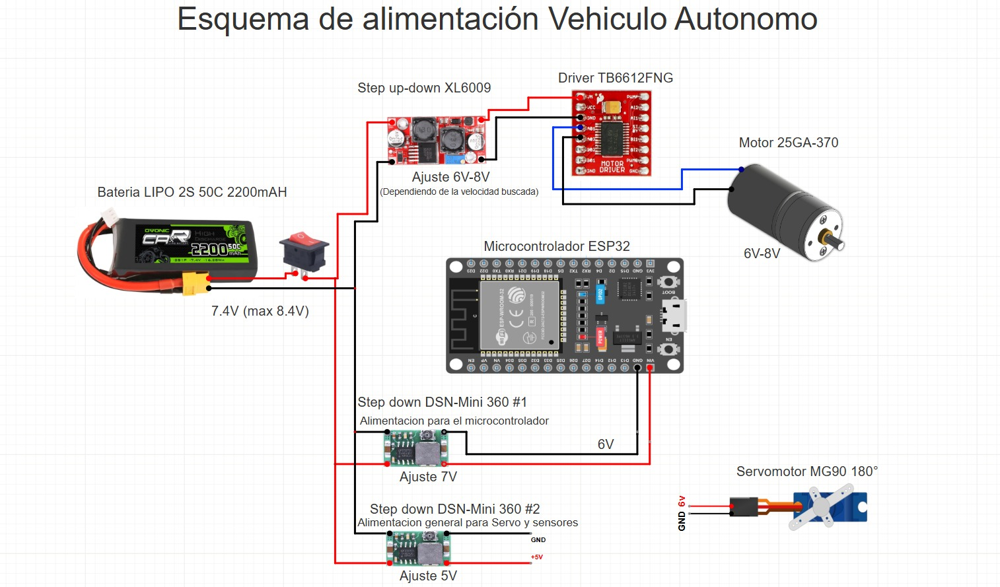
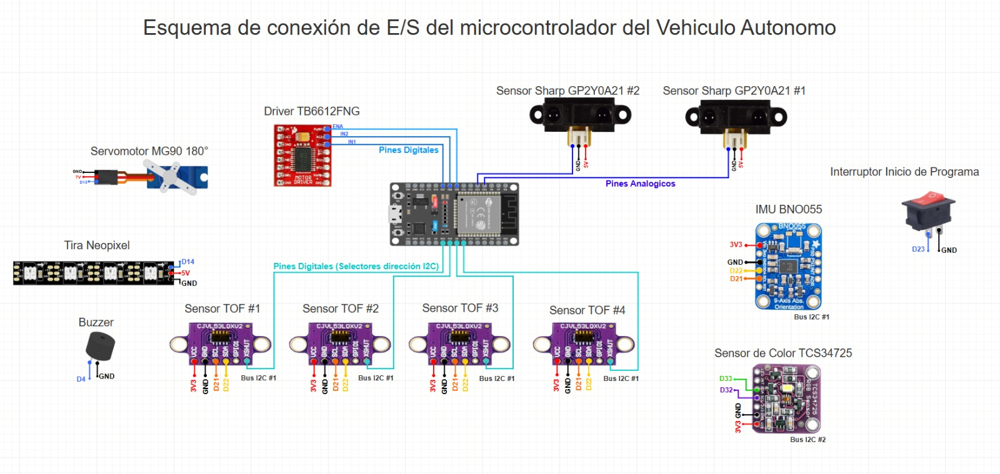

# 🔌 Esquemas eléctricos

[⬅️ Volver al README principal](../README.md)

Esquemas de la alimentación y de los sensores del vehículo. La explicación completa está en las secciones *7. Esquemas de alimentación y cableado* y *8. Esquemas de sensores y adquisición de datos* del README principal.

---

## ✅ Versión actual (V4, 2026)

### ⚡ Alimentación

Batería LiPo 2S 2200 mAh → interruptor general → tres líneas reguladas:

| Regulador | Ajuste | Alimenta |
| :--- | :---: | :--- |
| XL6009 | 6–8 V | Driver TB6612FNG y motor 25GA-370 |
| DSN-Mini 360 #1 | 7 V | VIN del ESP32 |
| DSN-Mini 360 #2 | 5 V | Servo MG90, sensores, Neopixel y buzzer |

### 📡 Sensores

| Bus / tipo | Pines ESP32 | Dispositivos |
| :--- | :---: | :--- |
| I2C #1 | 21 / 22 | IMU BNO055 y 4 × ToF VL53L0X (XSHUT en 17, 16, 5 y 18) |
| I2C #2 | 32 / 33 | Sensor de color TCS34725 |
| Analógico | 34 / 35 | 2 × Sharp GP2Y0A21 |
| Salidas | 13, 14, 4, 25–27 | Servo, Neopixel, buzzer y driver del motor |
| Entrada | 23 | Interruptor de inicio (pull-up interna) |

---

## 📁 Versiones anteriores (2025)

| Archivo | Contenido |
| :--- | :--- |
| [`power_supply_diagram.jpeg`](power_supply_diagram.jpeg) | Alimentación V1 (Arduino y L298N) |
| [`diagrma-alimentacion2.jpg`](diagrma-alimentacion2.jpg) | Alimentación V2 (dos Arduino) |
| [`Esquema-alimentacio-3.png`](Esquema-alimentacio-3.png) | Alimentación V3 (dos ESP32) |
| [`diagrama-sensores.jpg`](diagrama-sensores.jpg) | Sensores V1 |
| [`diagrama-sensores2.jpg`](diagrama-sensores2.jpg) | Sensores V2 (Arduino esclavo y botón de inicio) |
| [`Esquema-alimentacion-4.png`](Esquema-alimentacion-4.png) | Sensores V3 (dos ESP32, magnetómetro y ultrasónico trasero) |
| [`Divisor-de-voltaje.png`](Divisor-de-voltaje.png) | Divisor de voltaje para los HC-SR04 (5 V → 3,3 V) |
