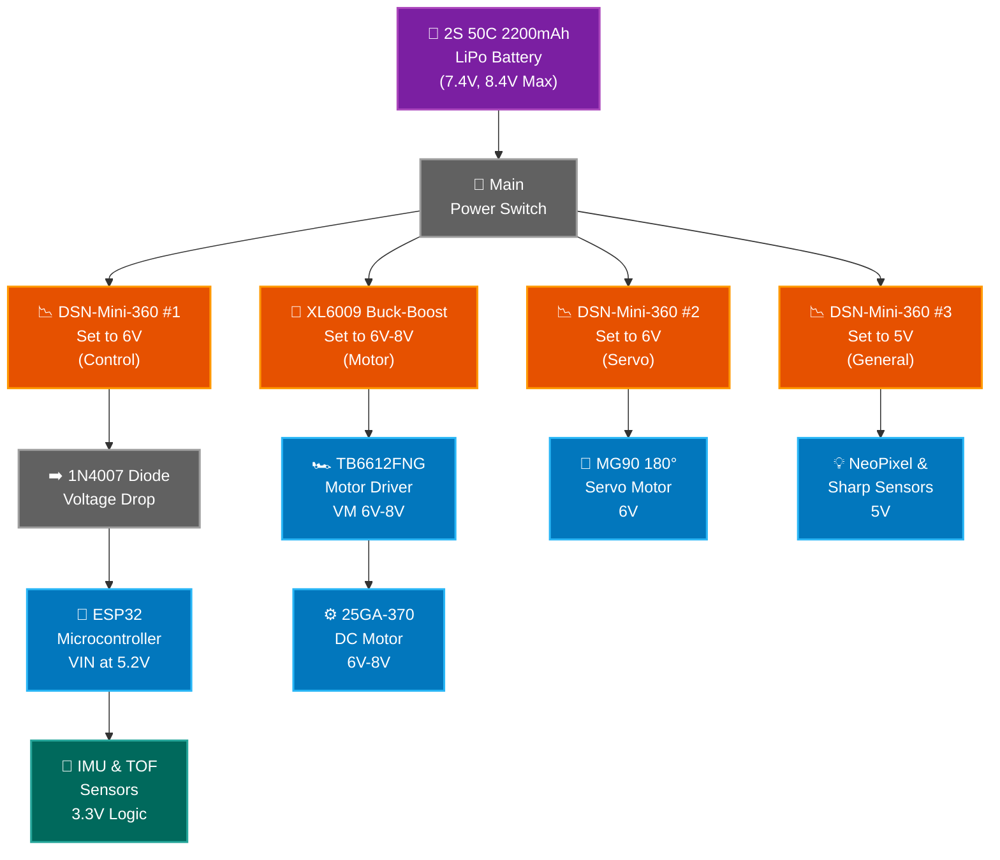
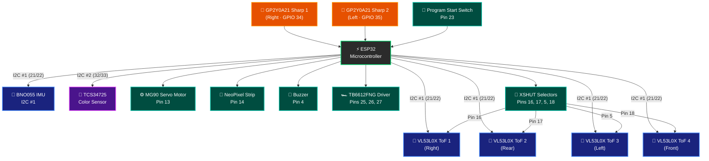
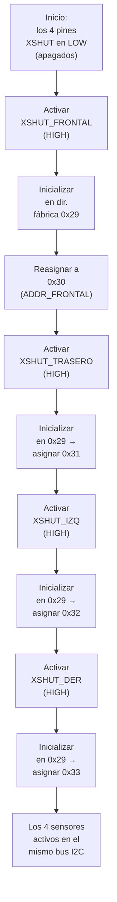

# 🔌 Esquemas eléctricos

[⬅️ Volver al README principal](../README.md)

Esquemas de la alimentación y de las conexiones de entrada y salida del vehículo. Esta página repite las secciones *6. Esquemas de alimentación y cableado* y *7. Esquemas de sensores y adquisición de datos* del README principal, para que la explicación sea la misma en los dos lugares.

| Archivo | Contenido |
| :--- | :--- |
| [`Power_Supply_Diagram_FINALS.png`](Power_Supply_Diagram_FINALS.png) | Diagrama de alimentación (versión 4, actual) |
| [`IO_Connection_Schematic_FINALS.png`](IO_Connection_Schematic_FINALS.png) | Esquema de conexiones de entrada y salida (versión 4, actual) |

---

## 6. ⚡ Esquemas de alimentación y cableado

*Las versiones anteriores del sistema de alimentación están en el [archivo de 2025](../README.md#192--electronics-evolution).*

### 6.1. 🧾 Versión 4 (actual)




### 6.2. 🔋 Arquitectura de energía, control y gestión de potencia

La **batería LiPo 2S de 2200 mAh** (7.4 V nominales, 8.4 V con carga completa) es la única fuente de energía. Pasa por un **interruptor general de palanca**, que elegimos porque no se desconecta solo con las vibraciones de la pista.

Desde ese punto la alimentación se divide en cuatro líneas reguladas e independientes, más la línea lógica de 3,3 V que sale del propio ESP32. Así el ruido del motor no llega a la lógica de control y evitamos caídas de tensión (*brownouts*):

* **Línea de tracción:** un regulador **XL6009** ajustado entre 6 y 8 V, según la velocidad que busquemos, alimenta el **puente H TB6612FNG**, que a su vez mueve el **motor 25GA-370**.

* **Línea de control:** un **DSN-Mini 360** ajustado a 6 V se conecta a un **diodo rectificador 1N4007** (para evitar retroalimentaciones al conectar el cable USB para subir código). Tras la caída de voltaje del diodo, llegan unos 5.2 V al pin VIN del **ESP32**. Con este voltaje, su regulador interno tiene margen suficiente para trabajar y evita que la placa se reinicie por caídas de tensión cuando arranca el motor.

* **Línea del servomotor:** un segundo regulador **DSN-Mini 360** ajustado a 6 V alimenta de forma exclusiva al **servomotor MG90**. Aislar el servo en su propio regulador es fundamental para evitar que sus picos de consumo y el ruido eléctrico interfieran con las lecturas analógicas y digitales del resto del sistema.

* **Línea general de 5 V:** un tercer **DSN-Mini 360** ajustado a 5 V se encarga de la alimentación general de los periféricos que requieren este voltaje. Por ahora, de esta línea se alimentan únicamente la **tira NeoPixel** y los dos **sensores de distancia Sharp**.

* **Línea lógica de 3.3 V:** el resto de los módulos y sensores del sistema (como la IMU y los sensores TOF) se alimentan directamente desde el pin de 3.3 V del **ESP32**. Esto asegura que reciban un voltaje limpio, estable y libre del ruido de conmutación (rizado) que pueden llegar a inducir los reguladores Mini 360 debido a su naturaleza conmutada (switching).

> [!IMPORTANT]
> **Cambio clave de hardware: L298N → TB6612FNG**
>
> El cambio al TB6612FNG resolvió dos problemas graves del prototipo de 2025. Primero, eliminó la caída de voltaje interna del L298N, que le quitaba fuerza al motor. Segundo, el L298N generaba una interferencia que dejaba inutilizado el bus I2C del microcontrolador. Para esquivarlo tuvimos que usar dos placas ESP32, una solo para el motor. Con el TB6612FNG ese conflicto desapareció y volvimos a un único ESP32, lo que redujo el peso, el cableado, el consumo y los puntos de falla.

> [!NOTE]
> **Compromiso de diseño**
>
> 4 reguladores independientes ocupan más espacio dentro del chasis impreso. Aceptamos ese costo porque separar la potencia de la electrónica sensible eliminó el ruido inductivo del motor y nos dio lecturas I2C limpias durante toda la navegación.

---

## 7. 📡 Esquemas de sensores y adquisición de datos

*Las versiones anteriores del sistema de detección están en el [archivo de 2025](../README.md#192--electronics-evolution).*

### 7.1. 🧾 Versión 4 (actual)




**ESP32 Pin Assignment**

| Signal | Pin |
| :--- | :---: |
| I2C #1 SDA / SCL (IMU & ToFs) | 21 / 22 |
| I2C #2 SDA / SCL (Color Sensor) | 32 / 33 |
| XSHUT Right (ToF 1) | 16 |
| XSHUT Rear (ToF 2) | 17 |
| XSHUT Left (ToF 3) | 5 |
| XSHUT Front (ToF 4) | 18 |
| Motor IN1 / IN2 / PWM | 27 / 26 / 25 |
| Sharp Right / Left | 34 / 35 |
| Steering Servo | 13 |
| NeoPixel Strip | 14 |
| Program Start Switch | 23 |
| Buzzer | 4 |

### 7.2. 🔧 Optimización del sistema de sensores y hardware

En esta cuarta versión reorganizamos los sensores aprovechando que el ESP32 tiene dos buses I2C por hardware. El objetivo era ganar precisión, que ningún sensor retrasara a los demás y que la navegación fuera estable dentro de la pista de $3 \times 3$ metros.

#### 7.2.1. Subsistema de navegación (bus I2C #1, pines D21/D22)

* **Sensores de distancia ToF:** reemplazaron a los ultrasónicos y eliminaron las zonas muertas a corta distancia. Para conectar los cuatro al mismo bus controlamos sus pines **XSHUT** desde el ESP32 y los encendemos uno por uno para darles direcciones distintas (ver 7.2.2). Además trabajan a 3.3 V, así que ya no hacen falta divisores de tensión.
* **IMU BNO055:** comparte el bus I2C #1. Su procesador interno fusiona los datos y prácticamente **elimina la deriva (*drift*)** acumulada que teníamos con el giroscopio anterior. Al arrancar, el programa toma la orientación actual como cero y todos los giros se calculan respecto a ella.

#### 7.2.2. Calibración y direccionamiento de los 4 sensores ToF (XSHUT)

Los cuatro VL53L0X comparten el bus I2C #1 (pines D21/D22), pero de fábrica todos responden a la misma dirección (`0x29`). Si se encendieran a la vez habría colisión. Para resolverlo, el pin **XSHUT** de cada sensor va a un GPIO distinto del ESP32 y funciona como interruptor de encendido por software:

```cpp
#define XSHUT_FRONTAL 18
#define XSHUT_TRASERO 17
#define XSHUT_IZQ     5
#define XSHUT_DER     16

#define ADDR_FRONTAL 0x30
#define ADDR_TRASERO 0x31
#define ADDR_IZQ     0x32
#define ADDR_DER     0x33
```

**Secuencia de inicialización (encendido escalonado):**



En cada paso solo **un sensor** está encendido en la dirección `0x29`; los demás siguen en reset (XSHUT en LOW). Cuando ya tiene su dirección definitiva, ese sensor queda encendido (XSHUT en HIGH) y se pasa al siguiente.

> [!NOTE]
> **Los 4 sensores usan la misma calibración**
>
> No aplicamos offsets individuales. Los VL53L0X del mismo lote vienen con una calibración de fábrica consistente entre sí; lo único que hay que configurar por sensor es su dirección.

#### 7.2.3. Subsistema de lectura de superficie (bus I2C #2, pines D32/D33)

* **Sensor de color TCS34725:** detecta y confirma las líneas de la pista. Lo pusimos en un **segundo bus I2C independiente** para que sus lecturas constantes del suelo no retrasen las de los ToF, que son las que usa el carro para no chocar. En el firmware se lee cada 30 ms en una tarea propia de FreeRTOS.

#### 7.2.4. Subsistema de proximidad redundante e interfaz

* **Sensores Sharp GP2Y0A21 diagonales:** siguen conectados a entradas analógicas y dan una segunda medida de proximidad en los ángulos ciegos del frente.
* **Interfaz de usuario:** la tira Neopixel y el buzzer muestran el estado del robot (errores, calibración correcta, línea detectada). El arranque se hace con un **interruptor de palanca** (pin D23); descartamos el pulsador porque los rebotes y la vibración lo activaban por accidente.

---

> [!IMPORTANT]
> **Simplificación y mantenimiento**
>
> Pasar de los ultrasónicos HC-SR04 a los ToF no solo mejoró la frecuencia de muestreo, también resolvió un problema físico. El HC-SR04 trabaja con 5 V y los pines del ESP32 con 3.3 V, así que en 2025 tuvimos que armar divisores de voltaje a mano con resistencias (no conseguimos convertidores de nivel comerciales). Funcionaban, pero el circuito era voluminoso. Con sensores I2C nativos de 3.3 V esa red desapareció y el montaje quedó más limpio y fácil de reparar.

> [!NOTE]
> **Compromiso de diseño: tráfico en el bus I2C**
>
> Tener varios sensores I2C traía el riesgo de colisiones y de retrasos en el `loop` principal. Lo resolvimos de dos formas: en software, con lecturas secuenciales (*polling*) y direcciones asignadas con XSHUT; en hardware, separando la carga en dos buses (navegación y superficie). Para ahorrar espacio no pusimos resistencias *pull-up* externas: las que traen las placas de los sensores fueron suficientes.

---

### 7.3. 📋 Resumen de cambios y evolución del hardware

| Componente anterior | Componente actual | Justificación y ventaja principal |
| :--- | :--- | :--- |
| Sensor ultrasónico HC-SR04 con divisores de tensión | **4 × sensores ToF (I2C #1)** | Sin zonas muertas ni redes de resistencias; todo a 3.3 V. Direcciones asignadas con XSHUT. |
| MPU6050 + magnetómetro HMC5883L | **IMU BNO055 (I2C #1)** | Deriva prácticamente eliminada en la pista de $3 \times 3$ m. |
| Sensor de color en el bus compartido | **TCS34725 (I2C #2 aislado)** | Bus propio, sin cuellos de botella con los sensores de distancia. |
| Pulsador de inicio | **Interruptor de palanca (D23)** | No se activa solo con la vibración de la pista. |
| L298N + segundo microcontrolador | **TB6612FNG + un solo ESP32** | Sin caída de voltaje ni interferencia en el I2C. |

---

## 📁 Versiones anteriores (2025)

| Archivo | Contenido |
| :--- | :--- |
| [`power_supply_diagram.jpeg`](power_supply_diagram.jpeg) | Alimentación V1 (Arduino y L298N) |
| [`diagrma-alimentacion2.jpg`](diagrma-alimentacion2.jpg) | Alimentación V2 (dos Arduino) |
| [`Esquema-alimentacio-3.png`](Esquema-alimentacio-3.png) | Alimentación V3 (dos ESP32) |
| [`diagrama-sensores.jpg`](diagrama-sensores.jpg) | Sensores V1 |
| [`diagrama-sensores2.jpg`](diagrama-sensores2.jpg) | Sensores V2 (Arduino esclavo y botón de inicio) |
| [`Esquema-alimentacion-4.png`](Esquema-alimentacion-4.png) | Sensores V3 (dos ESP32, magnetómetro y ultrasónico trasero) |
| [`Divisor-de-voltaje.png`](Divisor-de-voltaje.png) | Divisor de voltaje para los HC-SR04 (5 V → 3,3 V) |
