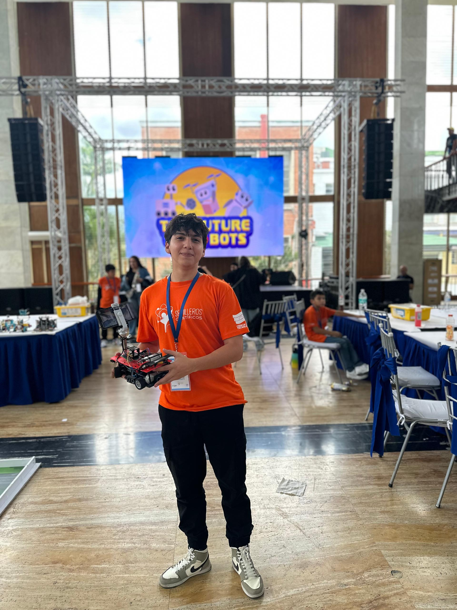
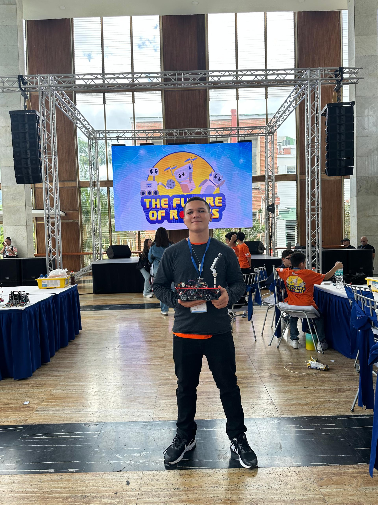
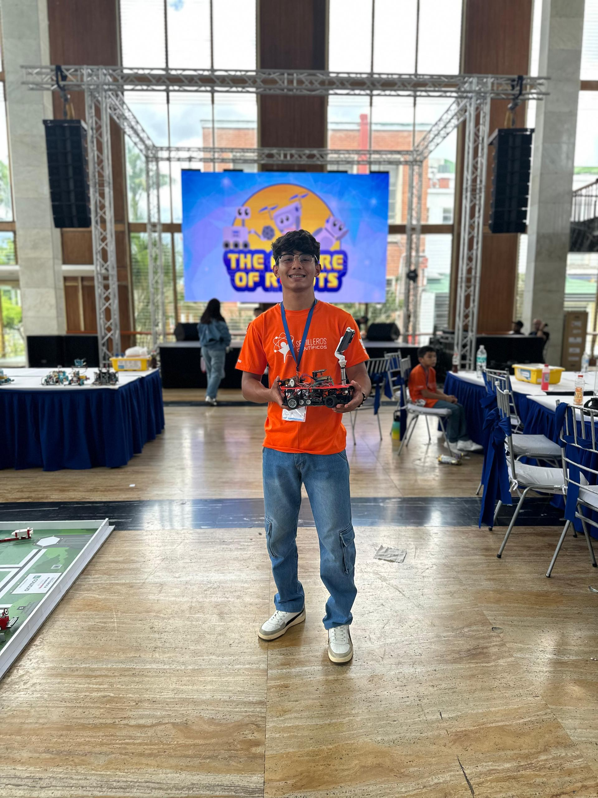
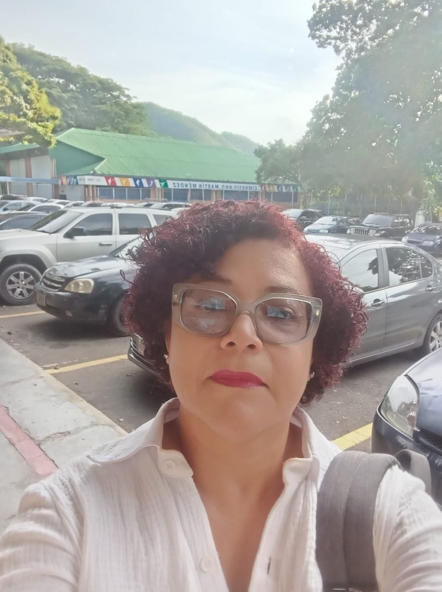

# 👥 Fotos del equipo

[⬅️ Volver al README principal](../README.md)

---

## 📸 Foto oficial

## 😄 Foto divertida

## 🏆 En competencia

---

## 👤 Integrantes

| Samuel Pérez | Trino Carrizales | Leandro Padrón | Ing. Dayana Pérez |
| :---: | :---: | :---: | :---: |
|  |  |  |  |
| Diseño 3D, CAD y app Android | Firmware, algoritmos y control | Mecánica, montaje y logística | Mentora del equipo |

El logo del equipo está en [`prometehuslogo.jpg`](prometehuslogo.jpg).
