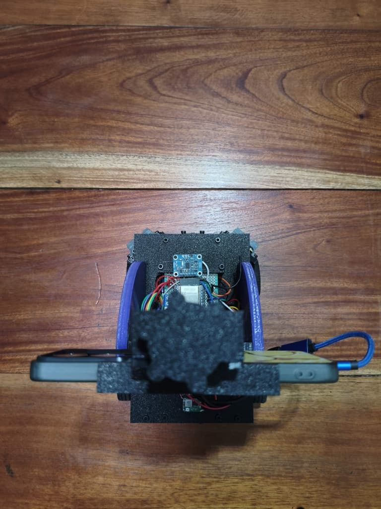

# 🚗 Fotos del vehículo

[⬅️ Volver al README principal](../README.md)

Las seis vistas reglamentarias del vehículo: frente, atrás, ambos lados, arriba y abajo.

---

## ✅ Vehículo 2026

| Vista frontal | Vista trasera |
| :---: | :---: |
|  |  |
| **Lateral izquierdo** | **Lateral derecho** |
|  |  |
| **Vista superior** | **Vista inferior** |
|  |  |

---

## 📁 Vehículo 2025

| Frente | Atrás | Lateral izquierdo |
| :---: | :---: | :---: |
|  |  |  |
| **Lateral derecho** | **Arriba** | **Abajo** |
|  |  |  |
